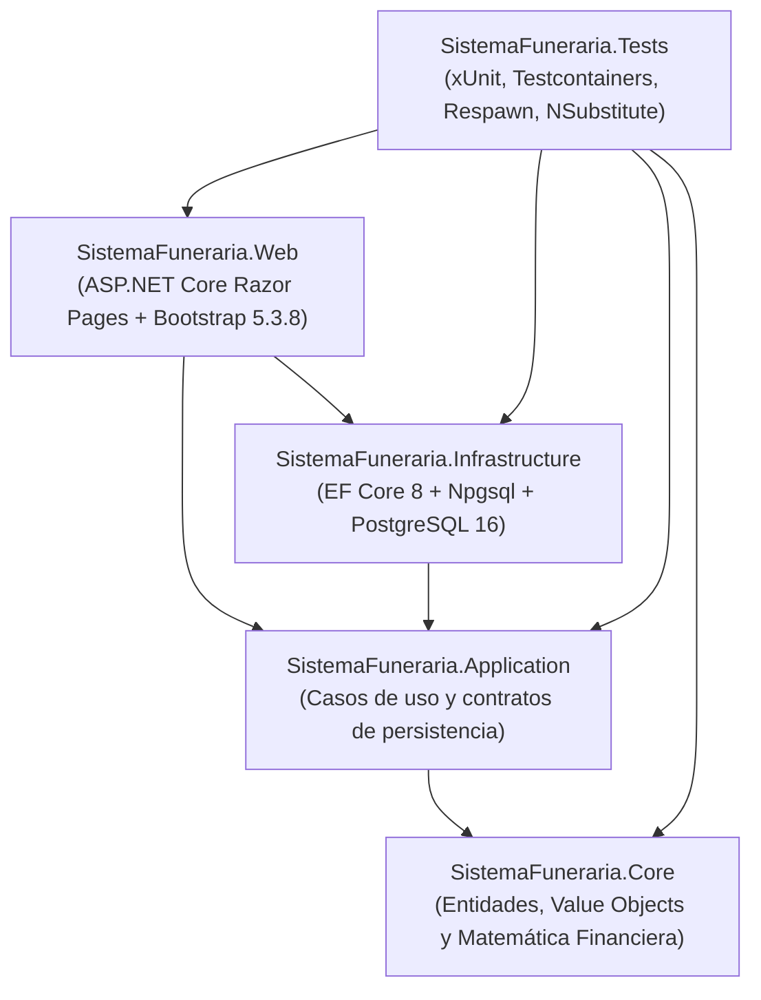

# Sistema de Venta y Financiamiento de Lotes Funerarios

[](https://github.com/riguidixrodriguez/SistemaFuneraria/actions/workflows/ci.yml)
[](https://dotnet.microsoft.com/)
[](https://learn.microsoft.com/dotnet/csharp/)
[](https://www.postgresql.org/)
[](https://getbootstrap.com/)
[](docs/01-PRD-requisitos.md)

Aplicación web integral para comercializar lotes funerarios bajo modalidades de contado y crédito financiado, administrar tablas de amortización bajo sistema francés con ajuste exacto al céntimo, registrar cobranza ordinaria, abonos extraordinarios a capital y liquidaciones anticipadas con descuento comercial de intereses futuros.

El proyecto implementa un proceso formal de **Verificación y Validación (V&V)** con trazabilidad bidireccional desde los requisitos de software hasta las evidencias de pruebas unitarias, de integración y del sistema.

---

## Tabla de contenido

- [Arquitectura y stack tecnológico](#arquitectura-y-stack-tecnológico)
- [Reglas de negocio y parámetros inmutables](#reglas-de-negocio-y-parámetros-inmutables)
- [Estructura de la documentación](#estructura-de-la-documentación)
- [Requisitos previos](#requisitos-previos)
- [Puesta en marcha local](#puesta-en-marcha-local)
- [Guía de contribución para desarrolladores](#guía-de-contribución-para-desarrolladores)
- [Ejecución de pruebas y calidad](#ejecución-de-pruebas-y-calidad)

---

## Arquitectura y stack tecnológico

El sistema adopta una **Clean Architecture pragmática** dividida en cinco proyectos independientes. Las dependencias fluyen estrictamente hacia el centro; la lógica de negocio no depende de infraestructura, bases de datos ni frameworks web.



### Componentes del stack

| Capa / Dimensión | Tecnología | Descripción técnica |
|---|---|---|
| **Runtime y lenguaje** | **.NET 8 (LTS) / C# 12** | Compilación con `Nullable=enable`, tipos de registro (`record`), expresiones de colección e inyección de dependencias nativa. |
| **Capa de Dominio (`Core`)** | **C# puro (0 dependencias NuGet)** | Entidades ricas con estado protegido, Value Objects inmutables y motores matemáticos puros (`CalculadoraFinanciamiento`, `GeneradorAmortizacion`). |
| **Capa de Aplicación (`Application`)** | **C# puro + Abstracciones EF Core** | Orquestación de casos de uso mediante el patrón `Resultado<T>` explícito y validadores estáticos de entrada. Sin bibliotecas de validación externas. |
| **Persistencia (`Infrastructure`)** | **EF Core 8 + Npgsql + PostgreSQL 16** | Mapeo relacional con precisión `numeric(14,2)`, nombres en `snake_case` nativo y control de concurrencia optimista vía token `xmin`. |
| **Capa de Presentación (`Web`)** | **ASP.NET Core Razor Pages + Bootstrap 5.3.8** | Renderizado del lado del servidor seguro contra CSRF. Reactividad en el cotizador con **Vanilla JS** (`fetch()` nativo y actualización de `PartialViews`). Cero dependencias de Node.js o npm. |
| **Seguridad e identidad** | **ASP.NET Core Identity** | Autenticación y control de acceso basado en roles (`Administrador`, `Vendedor`, `Cajero`) con formularios dedicados. |
| **Suite de pruebas (`Tests`)** | **xUnit + NSubstitute + Testcontainers + Respawn** | Pruebas unitarias de dominio sin mocks, oráculo de 36 combinaciones financieras y pruebas de integración sobre PostgreSQL efímero. |
| **Gobernanza de compilación** | **`Directory.Build.props` & `Directory.Packages.props`** | Central Package Management (CPM) y regla de compilación estricta (`TreatWarningsAsErrors=true`). |

---

## Reglas de negocio y parámetros inmutables

El alcance funcional para la versión `v1.0.0` está cerrado bajo los siguientes parámetros:

### 1. Catálogo de productos (RN-01)
Precios fijos en Pesos Mexicanos (MXN). No editables por el personal operativo.

| Código | Descripción | Capacidad | Precio de contado |
|---|---|---|---|
| `LOT-02` | Lote Básico | 2 gavetas | **$120,000.00** |
| `LOT-03` | Lote Familiar | 3 gavetas | **$150,000.00** |
| `LOT-04` | Lote Ampliado | 4 gavetas | **$180,000.00** |

### 2. Opciones de financiamiento (RN-04, RN-05, RN-06)
- **Enganches permitidos:** Únicamente `10%`, `20%` o `30%`. Cualquier otro porcentaje es rechazado.
- **Plazos y tasas de interés anual fija:**
  - `12 meses`: 16% anual ($i = 1.333333\%$ mensual)
  - `18 meses`: 18% anual ($i = 1.500000\%$ mensual)
  - `24 meses`: 20% anual ($i = 1.666667\%$ mensual)
  - `48 meses`: 24% anual ($i = 2.000000\%$ mensual)

### 3. Dinámica financiera
- **Amortización francesa:** Intereses calculados sobre saldos insolutos. La cuota del último periodo absorbe el diferencial por redondeo para cerrar el saldo final exactamente en **$0.00** (RNF-02).
- **Abono extraordinario a capital (RN-08):** Se aplica directo al capital insoluto, conservando el plazo y la fecha de vencimiento final original y reduciendo la mensualidad de las cuotas restantes.
- **Liquidación anticipada (RN-09):** Monto a liquidar = Saldo de Capital Pendiente + 90% de los intereses futuros programados (descuento comercial obligatorio del 10% en intereses futuros).
- **Identificación de mora (RN-10):** Mensualidades vencidas identificadas visualmente con **$0.00 de interés moratorio** en la versión v1.0.0.

---

## Estructura de la documentación

La documentación técnica del proyecto se ubica en el primer nivel de la carpeta [`docs/`](docs/). Consulta cada documento para entender el comportamiento del sistema y los criterios de aceptación:

| Documento | Propósito y contenido |
|---|---|
| [**01-PRD-requisitos.md**](docs/01-PRD-requisitos.md) | Especificación de Requisitos de Software. Define el alcance, fórmulas matemáticas, requisitos funcionales (RF-01 a RF-14) y reglas de negocio (RN-01 a RN-12). |
| [**02-matriz-trazabilidad.md**](docs/02-matriz-trazabilidad.md) | Matriz de Trazabilidad Bidireccional (RTM). Fundamentada en Partición de Equivalencia (EP), Valores Límite (BVA), Tabla de Decisiones (Oráculo de 36 combinaciones) y Escenarios (ST-01 a ST-04). |
| [**03-plan-pruebas.md**](docs/03-plan-pruebas.md) | Plan Maestro de Pruebas (IEEE 829 / ISO 29119). Define la estrategia de 3 ambientes, niveles de prueba, criterios de parada y roles del equipo. |
| [**04-diseno-casos-prueba.md**](docs/04-diseno-casos-prueba.md) | Especificación detallada de los casos de prueba formales **CP-01 a CP-10** con precondiciones, entradas, pasos y salidas esperadas al céntimo. |
| [**05-registro-ejecucion.md**](docs/05-registro-ejecucion.md) | Bitácora de ejecución formal de pruebas. Mantenida bajo política de escritor único por QA Lead y Tech Lead. |
| [**06-bitacora-incidencias.md**](docs/06-bitacora-incidencias.md) | Registro y ciclo de vida de defectos (SEV1 a SEV3). Incluye plantilla formal y la resolución de la incidencia modelo `INC-001`. |
| [**07-informe-cierre.md**](docs/07-informe-cierre.md) | Acta formal de certificación de calidad y dictamen de liberación para producción (`v1.0.0`). |
| [**08-backlog.md**](docs/08-backlog.md) | Backlog Maestro Oficial con 55 tickets atómicos (`SF-001` a `SF-055`, 135 SP) organizados en 4 Milestones. |
| [**09-modelo-datos-erd.md**](docs/09-modelo-datos-erd.md) | Especificación oficial del Modelo Entidad-Relación (ERD), diccionario de datos PostgreSQL 16, índices parciales y tokens de concurrencia optimista (`xmin`). |
| [**workflow.md**](docs/workflow.md) | Manual operativo del desarrollador: ramas GitFlow, ciclo diario de 8 pasos, límite de Blast Radius y resolución de emergencias Git. |
| [**evidencias/README.md**](docs/evidencias/README.md) | Guía de aislamiento de evidencias TDD (`Red_Test.md` y `Green_Test.md`) por carpeta de ticket (`docs/evidencias/SF-XXX/`). |

> [!NOTE]
> La fuente de verdad del backlog y las tareas del equipo reside en [`docs/08-backlog.md`](docs/08-backlog.md). La documentación histórica y fixtures de datos del oráculo se preservan en [`docs/anexos/`](docs/anexos/).

---

## Requisitos previos

Para compilar, ejecutar y probar el proyecto en tu entorno local necesitas:

- [.NET 8.0 SDK](https://dotnet.microsoft.com/download/dotnet/8.0) (versión 8.0.400 o superior).
- [Docker Desktop](https://www.docker.com/) o servicio de PostgreSQL 16 local.
- [Git](https://git-scm.com/) configurado en tu terminal.
- Editor recomendado: JetBrains Rider o Visual Studio Code con el C# Dev Kit.

---

## Puesta en marcha local

### 1. Clonar el repositorio

```bash
git clone https://github.com/riguidix/SistemaFuneraria.git
cd SistemaFuneraria
```

### 2. Iniciar la base de datos PostgreSQL

Si cuentas con Docker Compose, inicia el contenedor oficial de PostgreSQL 16:

```bash
docker compose up -d
```

Verifica que el servicio responda en `localhost:5432` con usuario `postgres` y la base de datos `funeraria_dev`.

### 3. Restaurar dependencias y compilar

El proyecto utiliza Central Package Management (CPM). Restaura los paquetes y compila la solución completa:

```bash
dotnet restore
dotnet build --configuration Release
```

### 4. Ejecutar la suite de pruebas automatizadas

Verifica que las pruebas unitarias y de integración pasen en verde:

```bash
dotnet test --verbosity normal
```

### 5. Iniciar la aplicación web

```bash
dotnet run --project src/SistemaFuneraria.Web
```

Abre tu navegador en `https://localhost:5001` o `http://localhost:5000`.

---

## Guía de contribución para desarrolladores

Para mantener el orden, la trazabilidad y evitar conflictos de integración (`Merge Conflicts`), todo colaborador debe seguir rigurosamente este flujo de trabajo.

### Mapa de ramas

```text
main   <-- Producción (v1.0.0, solo Tech Lead mediante PR desde beta)
 ^
beta   <-- Staging / Certificación UAT (solo Tech Lead mediante PR desde dev)
 ^
dev    <-- Integración Continua (rama base para el desarrollo del equipo)
 ^
feature/SF-XXX-slug  <-- Tu rama de trabajo (nace de dev y regresa a dev)
```

### Procedimiento paso a paso para contribuir

1. **Actualiza tu rama base:**
   ```bash
   git checkout dev
   git pull origin dev
   ```

2. **Crea tu rama de trabajo:**
   Nombra tu rama con el identificador del ticket y una descripción corta en minúsculas separada por guiones:
   ```bash
   git checkout -b feature/SF-010-calculadora-financiamiento dev
   ```

3. **Aplica TDD estricto (Rojo $\rightarrow$ Verde $\rightarrow$ Refactor):**
   - **Rojo:** Escribe primero la prueba unitaria en `SistemaFuneraria.Tests` y confirma que falle ejecutando `dotnet test`.
   - **Verde:** Escribe la implementación mínima en `SistemaFuneraria.Core` o `SistemaFuneraria.Application` para que la prueba pase.
   - **Refactor:** Limpia la estructura de código manteniendo la suite en verde.

4. **Guarda evidencias TDD aisladas:**
   Crea la carpeta de tu ticket en `docs/evidencias/SF-XXX/` y documenta tus corridas usando las plantillas oficiales:
   - `docs/evidencias/SF-XXX/Red_Test.md` (Captura del test fallando).
   - `docs/evidencias/SF-XXX/Green_Test.md` (Captura del test pasando).
   *No modifiques los documentos maestros de `docs/` para garantizar cero conflictos de merge.*

5. **Aplica Conventional Commits:**
   Registra tus cambios usando el formato estándar vinculando tu ticket:
   ```bash
   git add .
   git commit -m "feat(financiamiento): implementa calculo de enganche accesible y estandar" -m "Closes #SF-010"
   ```

6. **Respeta la regla de Blast Radius:**
   El Pull Request debe modificar **máximo 300 líneas de código efectivas** ($\le 300$ LOCs). Si tu tarea requiere más cambios, divídela en entregas incrementales desacopladas.

7. **Sube tu rama y abre el Pull Request:**
   ```bash
   git push origin feature/SF-010-calculadora-financiamiento
   ```
   En GitHub, crea el Pull Request con **Base: `dev`** y completa la plantilla interactiva de [`.github/pull_request_template.md`](.github/pull_request_template.md).

---

## Ejecución de pruebas y calidad

La integridad de los cálculos y las operaciones de base de datos se validan automáticamente en cada Pull Request mediante GitHub Actions ([`.github/workflows/ci.yml`](.github/workflows/ci.yml)).

### Comandos de prueba frecuentes

```bash
# Ejecutar todas las pruebas del proyecto
dotnet test

# Ejecutar únicamente las pruebas del oráculo financiero (36 combinaciones)
dotnet test --filter "FullyQualifiedName~CalculadoraFinanciamientoTests"

# Ejecutar pruebas con reporte detallado
dotnet test --logger "console;verbosity=detailed"
```

### Reglas de calidad obligatorias
- **Advertencias como errores:** La compilación falla si el código produce advertencias del analizador (`TreatWarningsAsErrors=true`).
- **Cero flotantes:** Se prohíbe el uso de `float` o `double` en cálculos de dinero; se utiliza exclusivamente el tipo `decimal` de C# y `numeric(14,2)` en base de datos.
- **Rollback-First:** Todo cambio de persistencia o migración de base de datos debe contar con su script de reversión probado.

---

## Licencia y contexto del proyecto

Proyecto desarrollado con fines académicos y de evaluación para la materia **Estándares y Métricas para el Desarrollo de Software** (Noviembre de 2026).
