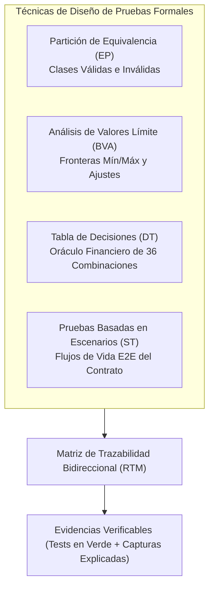

# MATRIZ DE TRAZABILIDAD DE REQUISITOS Y PRUEBAS (RTM)
## Sistema de Venta y Financiamiento de Lotes Funerarios

| Metadato | Detalle |
|---|---|
| **Proyecto** | Sistema de Venta y Financiamiento de Lotes Funerarios |
| **Materia / Estándar** | Estándares y Métricas para el Desarrollo de Software (V&V Formal) |
| **Versión** | 1.0 (Línea Base Congelada) |
| **Fecha de Publicación** | 06 de Noviembre de 2026 |
| **Líder Técnico & PM** | Lead Fullstack |
| **Cobertura Requisitos** | 100% (RF-01 a RF-14, RNF-01 a RNF-06, RN-01 a RN-12) |
| **Técnicas de Prueba** | Partición de Equivalencia (EP) · Valores Límite (BVA) · Tabla de Decisiones (DT) · Escenarios (ST) |

---

## 1. Fundamento Metodológico de las 4 Técnicas de Diseño de Pruebas

Para garantizar que el sistema funerario no sea evaluado mediante pruebas superficiales, el diseño de casos de prueba se fundamenta en cuatro técnicas formales de ingeniería de software:

---

## 2. Especificación Detallada por Técnica de Prueba

### 2.1 Técnica 1: Partición de Equivalencia (EP)
Divide el dominio de entrada en clases donde el sistema debe comportarse de forma idéntica. Se evalúan clases válidas (procesamiento exitoso) e inválidas (rechazo con mensaje descriptivo y código HTTP 400).

| ID Caso EP | Variable / Dominio | Clase Evaluada | Valor de Entrada | Comportamiento Esperado | Requisito |
|---|---|---|---|---|---|
| **EP-01** | Enganche (%) | Clase Válida: 10% | `10` | Aceptado; calcula enganche del 10% y capital del 90%. | RF-04, RN-04 |
| **EP-02** | Enganche (%) | Clase Válida: 20% | `20` | Aceptado; calcula enganche del 20% y capital del 80%. | RF-04, RN-04 |
| **EP-03** | Enganche (%) | Clase Válida: 30% | `30` | Aceptado; calcula enganche del 30% y capital del 70%. | RF-04, RN-04 |
| **EP-04** | Enganche (%) | Clase Inválida: Porcentaje intermedio | `15` | Rechazo HTTP 400: *"Enganche no permitido. Solo se acepta 10%, 20% o 30%"*. | CP-10, RN-04 |
| **EP-05** | Enganche (%) | Clase Inválida: Excedente | `50` | Rechazo HTTP 400: *"Enganche no permitido. El máximo es 30%"*. | CP-10, RN-04 |
| **EP-06** | Enganche (%) | Clase Inválida: Negativo | `-10` | Rechazo HTTP 400: *"El porcentaje de enganche debe ser positivo"*. | CP-10, RN-04 |
| **EP-07** | Plazo (meses) | Clase Válida: 12 meses | `12` | Aceptado; asigna tasa anual fija del 16%. | RF-05, RF-06 |
| **EP-08** | Plazo (meses) | Clase Válida: 18 meses | `18` | Aceptado; asigna tasa anual fija del 18%. | RF-05, RF-06 |
| **EP-09** | Plazo (meses) | Clase Válida: 24 meses | `24` | Aceptado; asigna tasa anual fija del 20%. | RF-05, RF-06 |
| **EP-10** | Plazo (meses) | Clase Válida: 48 meses | `48` | Aceptado; asigna tasa anual fija del 24%. | RF-05, RF-06 |
| **EP-11** | Plazo (meses) | Clase Inválida: Plazo no contemplado | `36` | Rechazo HTTP 400: *"Plazo inválido. Solo se admiten 12, 18, 24 o 48 meses"*. | CP-10, RN-05 |
| **EP-12** | Plazo (meses) | Clase Inválida: Menor al mínimo | `6` | Rechazo HTTP 400: *"Plazo mínimo es 12 meses"*. | CP-10, RN-05 |
| **EP-13** | Pago Ordinario | Clase Válida: Cuota exacta | Cuota mensual | Cuota marcada pagada; saldo insoluto decrementado. | RF-09, RN-11 |
| **EP-14** | Pago Ordinario | Clase Inválida: Importe Negativo | `-$1,000.00` | Rechazo HTTP 400: *"El monto de pago debe ser mayor a cero"*. | RN-11 |
| **EP-15** | Pago Ordinario | Clase Inválida: Cero | `$0.00` | Rechazo HTTP 400: *"El monto de pago debe ser mayor a cero"*. | RN-11 |
| **EP-16** | Abono Capital | Clase Válida: Abono parcial | `$10,000.00` | Reduce capital pendiente; genera nueva mensualidad calculada. | RF-10, RF-11 |
| **EP-17** | Abono Capital | Clase Inválida: Mayor a deuda | $\text{Saldo} + \$5,000$ | Rechazo HTTP 400: *"El abono no puede exceder el saldo insoluto"*. | RN-11 |

---

### 2.2 Técnica 2: Análisis de Valores Límite (BVA)
Se enfoca en evaluar los valores justo en las fronteras de decisión y los puntos inmediatamente adyacentes (frontera inferior, frontera superior y exactitud de cierre).

| ID Caso BVA | Parámetro Evaluado | Tipo de Límite | Valor de Prueba | Resultado Esperado | Requisito |
|---|---|---|---|---|---|
| **BVA-01** | Enganche (%) | Frontera Inferior Externa | `9.99%` | Rechazo: Por debajo del enganche accesible (10%). | RF-04, RN-04 |
| **BVA-02** | Enganche (%) | Frontera Inferior Exacta | `10.00%` | Aceptado: Enganche accesible aplicado correctamente. | RF-04, RN-04 |
| **BVA-03** | Enganche (%) | Frontera Inferior Interna | `10.01%` | Rechazo: Valor no coincide con opción exacta. | RF-04, RN-04 |
| **BVA-04** | Enganche (%) | Frontera Superior Interna | `29.99%` | Rechazo: Valor no coincide con opción exacta. | RF-04, RN-04 |
| **BVA-05** | Enganche (%) | Frontera Superior Exacta | `30.00%` | Aceptado: Enganche alto aplicado correctamente. | RF-04, RN-04 |
| **BVA-06** | Enganche (%) | Frontera Superior Externa | `30.01%` | Rechazo: Por encima del enganche máximo permitido. | RF-04, RN-04 |
| **BVA-07** | Plazo (meses) | Frontera Inferior Externa | `11 meses` | Rechazo: Plazo menor a 12 meses. | RF-05, RN-05 |
| **BVA-08** | Plazo (meses) | Frontera Inferior Exacta | `12 meses` | Aceptado: Tasa asignada 16%. | RF-05, RF-06 |
| **BVA-09** | Plazo (meses) | Frontera Superior Exacta | `48 meses` | Aceptado: Tasa asignada 24%. | RF-05, RF-06 |
| **BVA-10** | Plazo (meses) | Frontera Superior Externa | `49 meses` | Rechazo: Plazo excede el límite máximo. | RF-05, RN-05 |
| **BVA-11** | Cierre Amortización | Saldo Final Periodo $n$ | Periodo $n$ | Saldo final exactamente en `$0.00` tras absorber ajuste de centavos. | CP-06, RNF-02 |
| **BVA-12** | Abono a Capital | Límite Mínimo Válido | `$0.01` | Aceptado: Reduce capital en 1 centavo y recalcula. | RF-10, RN-08 |
| **BVA-13** | Abono a Capital | Límite Máximo Parcial | $\text{Saldo} - \$0.01$ | Aceptado: Deja $0.01 de saldo insoluto y recalcula cuota mínima. | RF-10, RN-08 |
| **BVA-14** | Abono a Capital | Límite Exacto Deuda | $\text{Saldo Insoluto}$ | Desvía a flujo de liquidación total anticipada. | RF-12, RN-09 |
| **BVA-15** | Abono a Capital | Límite Excedente Inmediato| $\text{Saldo} + \$0.01$ | Rechazo: Supera el saldo pendiente por un centavo. | RN-11 |

---

### 2.3 Técnica 3: Tabla de Decisiones (DT) · Oráculo Financiero de 36 Combinaciones
Representa la combinación cartesiana exhaustiva de las reglas de negocio del sistema:
$$\text{3 Lotes} \times \text{3 Niveles de Enganche} \times \text{4 Plazos} = \mathbf{36\text{ Combinaciones}}$$

Todos los valores son calculados mediante amortización francesa sobre saldos insolutos con tasa mensual $i = \frac{\text{Tasa Anual}}{12}$ y ajuste final en el último periodo (RNF-02, CP-05, CP-06).

| ID DT | Lote (Gavetas) | Precio Lote | Enganche (%) | Monto Enganche | Capital Financiado | Plazo | Tasa Anual | Cuota Mensual ($1 \dots n-1$) | Cuota Final Ajustada ($n$) | Total Intereses | Total Pagado |
|---|---|---|---|---|---|---|---|---|---|---|---|
| **DT-01** | Básico (2) | $120,000.00 | 10% | $12,000.00 | $108,000.00 | 12m | 16% | $9,798.93 | $9,798.94 | $9,587.17 | $129,587.17 |
| **DT-02** | Básico (2) | $120,000.00 | 10% | $12,000.00 | $108,000.00 | 18m | 18% | $6,891.02 | $6,891.10 | $16,038.44 | $136,038.44 |
| **DT-03** | Básico (2) | $120,000.00 | 10% | $12,000.00 | $108,000.00 | 24m | 20% | $5,496.75 | $5,496.66 | $23,921.91 | $143,921.91 |
| **DT-04** | Básico (2) | $120,000.00 | 10% | $12,000.00 | $108,000.00 | 48m | 24% | $3,521.00 | $3,520.90 | $61,007.90 | $181,007.90 |
| **DT-05** | Básico (2) | $120,000.00 | 20% | $24,000.00 | $96,000.00 | 12m | 16% | **$8,710.16** | $8,710.19 | **$8,521.95** | **$128,521.95** |
| **DT-06** | Básico (2) | $120,000.00 | 20% | $24,000.00 | $96,000.00 | 18m | 18% | $6,125.36 | $6,125.28 | $14,256.40 | $134,256.40 |
| **DT-07** | Básico (2) | $120,000.00 | 20% | $24,000.00 | $96,000.00 | 24m | 20% | $4,886.00 | $4,885.92 | $21,263.92 | $141,263.92 |
| **DT-08** | Básico (2) | $120,000.00 | 20% | $24,000.00 | $96,000.00 | 48m | 24% | $3,129.78 | $3,129.44 | $54,229.10 | $174,229.10 |
| **DT-09** | Básico (2) | $120,000.00 | 30% | $36,000.00 | $84,000.00 | 12m | 16% | $7,621.39 | $7,621.39 | $7,456.68 | $127,456.68 |
| **DT-10** | Básico (2) | $120,000.00 | 30% | $36,000.00 | $84,000.00 | 18m | 18% | $5,359.69 | $5,359.60 | $12,474.33 | $132,474.33 |
| **DT-11** | Básico (2) | $120,000.00 | 30% | $36,000.00 | $84,000.00 | 24m | 20% | $4,275.25 | $4,275.17 | $18,605.92 | $138,605.92 |
| **DT-12** | Básico (2) | $120,000.00 | 30% | $36,000.00 | $84,000.00 | 48m | 24% | $2,738.55 | $2,738.87 | $47,450.72 | $167,450.72 |
| **DT-13** | Familiar (3) | $150,000.00 | 10% | $15,000.00 | $135,000.00 | 12m | 16% | $12,248.67 | $12,248.61 | $11,983.98 | $161,983.98 |
| **DT-14** | Familiar (3) | $150,000.00 | 10% | $15,000.00 | $135,000.00 | 18m | 18% | $8,613.78 | $8,613.79 | $20,048.05 | $170,048.05 |
| **DT-15** | Familiar (3) | $150,000.00 | 10% | $15,000.00 | $135,000.00 | 24m | 20% | $6,870.93 | $6,871.03 | $29,902.42 | $179,902.42 |
| **DT-16** | Familiar (3) | $150,000.00 | 10% | $15,000.00 | $135,000.00 | 48m | 24% | $4,401.25 | $4,401.07 | $76,259.82 | $226,259.82 |
| **DT-17** | Familiar (3) | $150,000.00 | 20% | $30,000.00 | $120,000.00 | 12m | 16% | $10,887.70 | $10,887.74 | $10,652.44 | $160,652.44 |
| **DT-18** | Familiar (3) | $150,000.00 | 20% | $30,000.00 | $120,000.00 | 18m | 18% | $7,656.69 | $7,656.75 | $17,820.48 | $167,820.48 |
| **DT-19** | Familiar (3) | $150,000.00 | 20% | $30,000.00 | $120,000.00 | 24m | 20% | $6,107.50 | $6,107.37 | $26,579.87 | $176,579.87 |
| **DT-20** | Familiar (3) | $150,000.00 | 20% | $30,000.00 | $120,000.00 | 48m | 24% | $3,912.22 | $3,912.24 | $67,786.58 | $217,786.58 |
| **DT-21** | Familiar (3) | $150,000.00 | 30% | $45,000.00 | $105,000.00 | 12m | 16% | $9,526.74 | $9,526.74 | $9,320.88 | $159,320.88 |
| **DT-22** | Familiar (3) | $150,000.00 | 30% | $45,000.00 | $105,000.00 | 18m | 18% | $6,699.61 | $6,699.56 | $15,592.93 | $165,592.93 |
| **DT-23** | Familiar (3) | $150,000.00 | 30% | $45,000.00 | $105,000.00 | 24m | 20% | $5,344.06 | $5,344.06 | $23,257.44 | $173,257.44 |
| **DT-24** | Familiar (3) | $150,000.00 | 30% | $45,000.00 | $105,000.00 | 48m | 24% | $3,423.19 | $3,423.42 | $59,313.35 | $209,313.35 |
| **DT-25** | Ampliado (4)| $180,000.00 | 10% | $18,000.00 | $162,000.00 | 12m | 16% | $14,698.40 | $14,698.39 | $14,380.79 | $194,380.79 |
| **DT-26** | Ampliado (4)| $180,000.00 | 10% | $18,000.00 | $162,000.00 | 18m | 18% | $10,336.54 | $10,336.48 | $24,057.66 | $204,057.66 |
| **DT-27** | Ampliado (4)| $180,000.00 | 10% | $18,000.00 | $162,000.00 | 24m | 20% | $8,245.12 | $8,245.13 | $35,882.89 | $215,882.89 |
| **DT-28** | Ampliado (4)| $180,000.00 | 10% | $18,000.00 | $162,000.00 | 48m | 24% | $5,281.50 | $5,281.29 | $91,511.79 | $271,511.79 |
| **DT-29** | Ampliado (4)| $180,000.00 | 20% | $36,000.00 | $144,000.00 | 12m | 16% | $13,065.24 | $13,065.28 | $12,782.92 | $192,782.92 |
| **DT-30** | Ampliado (4)| $180,000.00 | 20% | $36,000.00 | $144,000.00 | 18m | 18% | $9,188.03 | $9,188.09 | $21,384.60 | $201,384.60 |
| **DT-31** | Ampliado (4)| $180,000.00 | 20% | $36,000.00 | $144,000.00 | 24m | 20% | $7,329.00 | $7,328.88 | $31,895.88 | $211,895.88 |
| **DT-32** | Ampliado (4)| $180,000.00 | 20% | $36,000.00 | $144,000.00 | 48m | 24% | $4,694.66 | $4,694.99 | $81,344.01 | $261,344.01 |
| **DT-33** | Ampliado (4)| $180,000.00 | 30% | $54,000.00 | $126,000.00 | 12m | 16% | $11,432.09 | $11,432.05 | $11,185.04 | $191,185.04 |
| **DT-34** | Ampliado (4)| $180,000.00 | 30% | $54,000.00 | $126,000.00 | 18m | 18% | $8,039.53 | $8,039.51 | $18,711.52 | $198,711.52 |
| **DT-35** | Ampliado (4)| $180,000.00 | 30% | $54,000.00 | $126,000.00 | 24m | 20% | $6,412.87 | $6,412.88 | $27,908.89 | $207,908.89 |
| **DT-36** | Ampliado (4)| $180,000.00 | 30% | $54,000.00 | $126,000.00 | 48m | 24% | $4,107.83 | $4,107.92 | $71,175.93 | $251,175.93 |

---

### 2.4 Técnica 4: Pruebas Basadas en Escenarios (ST - E2E)
Modela el ciclo de vida transaccional completo de las operaciones de negocio de principio a fin.

#### ST-01: Ciclo de Vida de Venta de Contado
* **Objetivo:** Comprobar la adquisición directa sin crédito de un lote familiar de 3 gavetas.
* **Precondición:** Catálogo activo; cliente *"María Gómez"* registrado sin contratos activos.
* **Secuencia de Pasos:**
  1. El vendedor selecciona el Lote Familiar de 3 gavetas (Precio: $150,000.00).
  2. Selecciona la modalidad *"Contado"*.
  3. El sistema confirma que el importe a liquidar es exactamente $150,000.00.
  4. Se confirma la venta y el cajero registra el pago por $150,000.00.
* **Resultado Esperado:** 
  * Se genera recibo oficial por $150,000.00.
  * El estado del lote cambia a `Vendido`.
  * No se genera tabla de amortización ni saldo deudor ($0.00).
* **Requisitos Trazados:** RF-01, RF-02, RF-03, RN-01, RN-02, RN-03, CP-01, CP-02.

#### ST-02: Venta Financiada con Abono Extraordinario a Capital y Recálculo (CP-07)
* **Objetivo:** Verificar la venta financiada, pago de mensualidades iniciales, abono a capital y recálculo de cuota manteniendo el plazo original de 12 meses.
* **Precondición:** Cliente *"Carlos Ruiz"* registrado; Lote Básico ($120,000.00) disponible.
* **Secuencia de Pasos:**
  1. Venta financiada: 20% enganche ($24,000.00), plazo 12 meses, tasa anual 16%.
  2. Capital financiado inicial: $96,000.00. Mensualidad calculada: $8,710.16.
  3. Cliente paga Enganche ($24,000.00). Se genera tabla de amortización de 12 meses.
  4. Cliente paga Periodo 1 ($8,710.16): Interés $1,280.00, Capital $7,430.16. Saldo Final 1: $88,569.84.
  5. Cliente paga Periodo 2 ($8,710.16): Interés $1,180.93, Capital $7,529.23. Saldo Final 2: $81,040.61.
  6. En el Periodo 3, cliente paga su mensualidad ordinaria ($8,710.16; Saldo Final 3: $73,410.99) y realiza un **Abono Extraordinario a Capital de $10,000.00**.
  7. Nuevo saldo de capital insoluto al inicio del periodo 4: $\$73,410.99 - \$10,000.00 = \mathbf{\$63,410.99}$.
  8. El sistema recalcula la cuota para los 9 periodos restantes conservando la fecha de vencimiento original (mes 12).
* **Resultado Esperado:**
  * Nueva cuota reducida para periodos 4 a 12: $\approx \mathbf{\$7,523.51}$ (ahorro de $\$1,186.65$ por mes).
  * El saldo final del periodo 12 cierra exactamente en $\$0.00$.
* **Requisitos Trazados:** RF-04, RF-07, RF-08, RF-09, RF-10, RF-11, RN-07, RN-08, CP-06, CP-07.

#### ST-03: Vencimiento sin Interés Moratorio y Liquidación Anticipada con Descuento (CP-08, CP-09)
* **Objetivo:** Comprobar la detección de mensualidades vencidas sin cargos por mora y la liquidación anticipada con 10% de descuento sobre intereses futuros.
* **Precondición:** Contrato activo Lote Básico, 20% enganche, plazo 12 meses.
* **Secuencia de Pasos:**
  1. Periodos 1 y 2 pagados en tiempo y forma.
  2. Se simula fecha de consulta posterior a la fecha de vencimiento del Periodo 3 sin registro de pago.
  3. Se consulta el Estado de Cuenta del cliente (RF-13, RF-14).
  4. Se verifica que el Periodo 3 figura en estado `Vencida`, con días de mora calculados pero **con recargo por intereses moratorios en $0.00** (RN-10).
  5. El cliente acude a regularizar y paga el Periodo 3 ($8,710.16). La cuenta queda al corriente (Saldo final 3: $73,410.99).
  6. El cliente solicita la **Liquidación Anticipada** total del contrato en ese momento.
  7. El sistema suma los intereses futuros programados de los periodos 4 a 12 ($\sum_{j=4}^{12} I_j = \$4,980.45$).
  8. Aplica el 10% de descuento comercial sobre dichos intereses ($\text{Descuento} = \$498.05$).
  9. Monto de liquidación cotizado: $\text{Capital Pendiente } (\$73,410.99) + 90\% \text{ Intereses Futuros } (\$4,482.40) = \mathbf{\$77,893.39}$.
  10. Se registra el cobro de la liquidación.
* **Resultado Esperado:**
  * El contrato pasa inmediatamente a estado `Liquidado`.
  * La deuda total queda saldada en $\$0.00$.
* **Requisitos Trazados:** RF-12, RF-13, RF-14, RN-09, RN-10, CP-08, CP-09.

#### ST-04: Concurrencia e Integridad Transaccional (RN-11, RNF-04)
* **Objetivo:** Verificar que dos transacciones simultáneas de cobro no dupliquen pagos ni generen descuadres de saldo insoluto.
* **Secuencia de Pasos:**
  1. Dos peticiones concurrentes intentan pagar la misma mensualidad (Periodo 4).
* **Resultado Esperado:**
  * La primera transacción adquiere bloqueo pesimista, procesa el pago y actualiza el saldo.
  * La segunda transacción es rechazada con HTTP 409 Conflict: *"La mensualidad ya se encuentra liquidada"*.
  * No hay duplicación de recibos ni registros huérfanos.

---

## 3. Matriz Maestra de Trazabilidad Bidireccional (RTM)

| ID Requisito | Descripción del Requisito | Técnica de Prueba | ID Caso de Prueba | Ticket FUN | Dev Responsable | Tipo / Método de Prueba | Evidencia Exigida (Archivo / Tipo) | Estado |
|---|---|---|---|---|---|---|---|---|
| **RF-01** | Catálogo de lotes (2, 3, 4 gavetas con precios fijos) | DT, ST | **CP-01**, DT-01, DT-13, DT-25 | `FUN-020` | Gustavo L. | Integración / Web UI | Captura de pantalla del catálogo con precios exactos de lista. | Pendiente |
| **RF-02** | Registro de clientes con campos obligatorios | EP | **CP-02**, EP-Cliente | `FUN-017`, `FUN-018` | Guillermo S. | Unit / Integration | Formulario con validación cliente/servidor y registro en BD. | Pendiente |
| **RF-03** | Selección de modalidad (Contado vs Financiamiento) | ST | **CP-02**, ST-01 | `FUN-021`, `FUN-022` | Juan R. | E2E / Funcional | Captura de venta de contado sin tabla de amortización. | Pendiente |
| **RF-04** | Cálculo de enganche accesible, estándar y alto (10, 20, 30%) | EP, BVA | **CP-03**, EP-01..06, BVA-01..06 | `FUN-010`, `FUN-025` | Gustavo L. | Unit xUnit (`Theory`) | Test unitario en verde + salida del simulador web. | Pendiente |
| **RF-05** | Validación estricta de plazos (12, 18, 24, 48 meses) | EP, BVA | **CP-04**, **CP-10**, EP-07..12 | `FUN-010`, `FUN-025` | Guillermo S. | Unit xUnit | Test de rechazo de plazos inválidos (e.g. 36 meses). | Pendiente |
| **RF-06** | Asignación de tasa anual fija indexada al plazo | DT | **CP-04**, DT-01..36 | `FUN-008`, `FUN-010` | Gustavo L. | Unit xUnit | Verificación de tasas: 16%, 18%, 20% y 24%. | Pendiente |
| **RF-07** | Cálculo de amortización (cuota mensual e intereses) | DT | **CP-05**, DT-01..36 | `FUN-010`, `FUN-012` | Gustavo L. | Unit xUnit (Oráculo) | 36 pruebas unitarias en verde con datos exactos del oráculo. | Pendiente |
| **RF-08** | Generador de tabla de amortización y ajuste en última cuota | BVA, DT | **CP-06**, BVA-11, DT-01..36 | `FUN-011` | Gustavo L. | Unit / Integration | Tabla generada donde saldo final del periodo $n$ es exactamente $0.00. | Pendiente |
| **RF-09** | Registro de pago ordinario y decremento de saldo | EP, ST | **CP-07**, EP-13..15, ST-02 | `FUN-031`, `FUN-032` | Reydescel H. | Integración ACID | Recibo emitido, cuota marcada pagada y saldo actualizado. | Pendiente |
| **RF-10** | Registro de abono extraordinario a capital | EP, BVA, ST | **CP-07**, EP-16..17, BVA-12..15 | `FUN-035`, `FUN-036` | Reydescel H. | Integración / Dominio | Descuento íntegro del abono sobre el capital pendiente. | Pendiente |
| **RF-11** | Recálculo de cuota periódica conservando fecha fin | ST | **CP-07**, ST-02 | `FUN-035`, `FUN-037` | Gustavo L. / Juan R. | Funcional / UI | Comparativa visual de tabla antes y después del abono. | Pendiente |
| **RF-12** | Liquidación anticipada con 10% de descuento en intereses futuros | ST | **CP-08**, ST-03 | `FUN-039`, `FUN-040` | Guillermo S. | Unit / Integration | Cotización con desglose de capital + 90% intereses futuros. | Pendiente |
| **RF-13** | Consulta de estado de cuenta completo del cliente | ST | **CP-09**, ST-03 | `FUN-044`, `FUN-045` | Reydescel H. / Juan R.| Funcional / Web UI | Vista de estado de cuenta con historial de pagos y saldos. | Pendiente |
| **RF-14** | Identificación de cuotas vencidas sin intereses moratorios | ST | **CP-09**, ST-03 | `FUN-043`, `FUN-046` | Gustavo L. / Edgar A.| Unit (`TimeProvider`)| Mensualidad marcada en rojo con mora, moratorio en $0.00. | Pendiente |
| **RNF-01**| Usabilidad y navegación guiada en flujo de venta | Inspección | Heurística Nielsen | `FUN-005`, `FUN-022` | Juan R. | UI / UX Review | Flujo de venta completado en $\le 4$ pasos guiados. | Pendiente |
| **RNF-02**| Integridad de cálculos monetarios y cero error acumulado | BVA, DT | BVA-11, DT-01..36 | `FUN-007`, `FUN-011` | Gustavo L. | Code Audit / Unit | Uso exclusivo de `decimal` en C# y `numeric(14,2)` en BD. | Pendiente |
| **RNF-03**| Seguridad y control de acceso basado en roles (RBAC) | Funcional | RBAC-Auth | `FUN-016` | Juan R. | Integration Test | Vendedor no puede cobrar en caja; Cajero no puede crear usuarios. | Pendiente |
| **RNF-04**| Confiabilidad transaccional ACID en cobranza concurrente | ST | ST-04 | `FUN-032` | Reydescel H. | Testcontainers Concurrencia | Dos hilos concurrentes no duplican pagos (`lock` / transacción). | Pendiente |
| **RNF-05**| Mantenibilidad y Clean Architecture desacoplada | Inspección | CleanArch Linter | `FUN-001` | Reydescel H. | CI / ArchUnit | Proyecto `Core` con 0 referencias a librerías externas o BD. | Pendiente |
| **RNF-06**| Compatibilidad responsiva en navegadores modernos | Funcional | Cross-Browser | `FUN-005` | Juan R. | Manual UI Testing | Interfaz probada en Chrome, Edge y Firefox sin distorsión visual. | Pendiente |
| **RN-01** | Catálogo con 3 lotes y precios inmutables | DT | CP-01, DT-01..36 | `FUN-008`, `FUN-020` | Gustavo L. | Unit / UI | Catálogo estático inalterable. | Pendiente |
| **RN-02** | Venta asociada a cliente y lote disponible | Integración | DB-Constraints | `FUN-014`, `FUN-015` | Reydescel H. | Integration | Foreign keys y unicidad en base de datos. | Pendiente |
| **RN-03** | Venta contado 100% sin intereses ni amortización | ST | CP-02, ST-01 | `FUN-021` | Reydescel H. | Functional | Pago único inmediato, lote asignado, sin crédito. | Pendiente |
| **RN-04** | Solo enganches de 10%, 20% o 30% | EP, BVA | CP-03, CP-10, EP-01..06 | `FUN-025` | Guillermo S. | Unit / UI | Rechazo de enganches inválidos. | Pendiente |
| **RN-05** | Solo plazos de 12, 18, 24 o 48 meses | EP, BVA | CP-04, CP-10, EP-07..12 | `FUN-025` | Guillermo S. | Unit / UI | Rechazo de plazos inválidos. | Pendiente |
| **RN-06** | Tasa fija según plazo | DT | CP-04, DT-01..36 | `FUN-008` | Gustavo L. | Unit | Tasa fija e inmutable. | Pendiente |
| **RN-07** | Intereses ordinarios sobre saldo insoluto | DT | CP-05, DT-01..36 | `FUN-010` | Gustavo L. | Unit | Interés mensual = Saldo Insoluto $\times$ Tasa Mensual. | Pendiente |
| **RN-08** | Abono extraordinario reduce capital y recalcula cuota | ST | CP-07, ST-02 | `FUN-035`, `FUN-036` | Gustavo L. / Reydescel H.| Unit / Integration | Conserva fecha de término original; reduce cuota. | Pendiente |
| **RN-09** | Descuento del 10% en liquidación sobre intereses futuros | ST | CP-08, ST-03 | `FUN-039`, `FUN-040` | Gustavo L. / Guillermo S.| Unit / Integration | Saldo Capital + 90% Intereses Futuros Restantes. | Pendiente |
| **RN-10** | Identificación de atraso sin moratorios en v1.0.0 | ST | CP-09, ST-03 | `FUN-043`, `FUN-046` | Gustavo L. / Edgar A. | Unit / Functional | Mora visualmente identificada, recargo = $0.00. | Pendiente |
| **RN-11** | Pagos no negativos ni excedentes de saldo | EP, BVA | EP-14..15, BVA-15 | `FUN-032`, `FUN-034` | Reydescel H. / Edgar A. | Unit / Integration | Rechazo automático de montos $\le 0$ o $>$ Saldo. | Pendiente |
| **RN-12** | Formato de moneda mexicana (`es-MX`, `$#,##0.00`) | Inspección | UI-Format | `FUN-005` | Juan R. | Functional / UI | Cultura `es-MX` fijada globalmente en la aplicación Web. | Pendiente |
