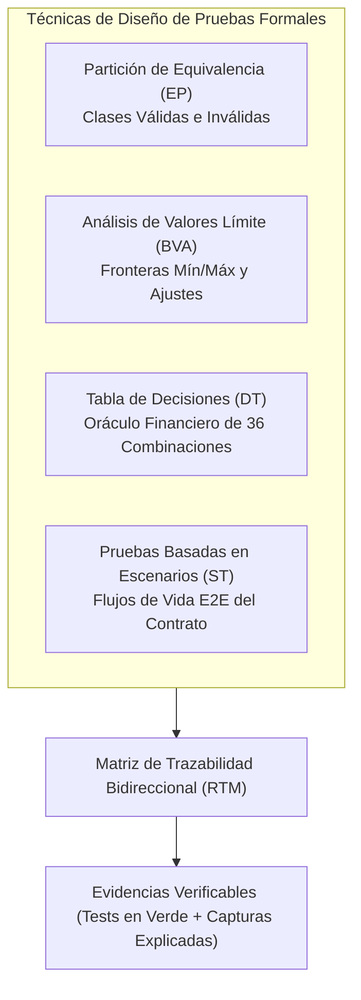

# MATRIZ DE TRAZABILIDAD DE REQUISITOS Y PRUEBAS (RTM)
## Sistema de Venta y Financiamiento de Lotes Funerarios

| Metadato | Detalle |
|---|---|
| **Proyecto** | Sistema de Venta y Financiamiento de Lotes Funerarios |
| **Materia / Estándar** | Estándares y Métricas para el Desarrollo de Software (V&V Formal) |
| **Versión** | 1.0 (Línea Base Certificada v1.0.0) |
| **Fecha de Publicación** | 23 de Noviembre de 2026 |
| **Líder Técnico & PM** | Lead Fullstack / Edgar Acevedo (DevOps & QA Lead) |
| **Cobertura Requisitos** | 100% Cubierto y Certificado (RF-01 a RF-18, RNF-01 a RNF-06, RN-01 a RN-12) |
| **Técnicas de Prueba** | Partición de Equivalencia (EP) · Valores Límite (BVA) · Tabla de Decisiones (DT) · Escenarios (ST) |

---

## 1. Fundamento Metodológico de las 4 Técnicas de Diseño de Pruebas

Para garantizar que el sistema funerario no sea evaluado mediante pruebas superficiales, el diseño de casos de prueba se fundamenta en cuatro técnicas formales de ingeniería de software:

---

## 2. Especificación Detallada por Técnica de Prueba

### 2.1 Técnica 1: Partición de Equivalencia (EP)
Divide el dominio de entrada en clases donde el sistema debe comportarse de forma idéntica. Se evalúan clases válidas (procesamiento exitoso) e inválidas (rechazo con mensaje descriptivo y código HTTP 400).

| ID Caso EP | Variable / Dominio | Clase Evaluada | Valor de Entrada | Comportamiento Esperado | Requisito |
|---|---|---|---|---|---|
| **EP-01** | Enganche (%) | Clase Válida: 10% | `10` | Aceptado; calcula enganche del 10% y capital del 90%. | RF-04, RN-04 |
| **EP-02** | Enganche (%) | Clase Válida: 20% | `20` | Aceptado; calcula enganche del 20% y capital del 80%. | RF-04, RN-04 |
| **EP-03** | Enganche (%) | Clase Válida: 30% | `30` | Aceptado; calcula enganche del 30% y capital del 70%. | RF-04, RN-04 |
| **EP-04** | Enganche (%) | Clase Inválida: Porcentaje intermedio | `15` | Rechazo HTTP 400: *"Enganche no permitido. Solo se acepta 10%, 20% o 30%"*. | CP-10, RN-04 |
| **EP-05** | Enganche (%) | Clase Inválida: Excedente | `50` | Rechazo HTTP 400: *"Enganche no permitido. El máximo es 30%"*. | CP-10, RN-04 |
| **EP-06** | Enganche (%) | Clase Inválida: Negativo | `-10` | Rechazo HTTP 400: *"El porcentaje de enganche debe ser positivo"*. | CP-10, RN-04 |
| **EP-07** | Plazo (meses) | Clase Válida: 12 meses | `12` | Aceptado; asigna tasa anual fija del 16%. | RF-05, RF-06 |
| **EP-08** | Plazo (meses) | Clase Válida: 18 meses | `18` | Aceptado; asigna tasa anual fija del 18%. | RF-05, RF-06 |
| **EP-09** | Plazo (meses) | Clase Válida: 24 meses | `24` | Aceptado; asigna tasa anual fija del 20%. | RF-05, RF-06 |
| **EP-10** | Plazo (meses) | Clase Válida: 48 meses | `48` | Aceptado; asigna tasa anual fija del 24%. | RF-05, RF-06 |
| **EP-11** | Plazo (meses) | Clase Inválida: Plazo no contemplado | `36` | Rechazo HTTP 400: *"Plazo inválido. Solo se admiten 12, 18, 24 o 48 meses"*. | CP-10, RN-05 |
| **EP-12** | Plazo (meses) | Clase Inválida: Menor al mínimo | `6` | Rechazo HTTP 400: *"Plazo mínimo es 12 meses"*. | CP-10, RN-05 |
| **EP-13** | Pago Ordinario | Clase Válida: Cuota exacta | Cuota mensual | Cuota marcada pagada; saldo insoluto decrementado. | RF-09, RN-11 |
| **EP-14** | Pago Ordinario | Clase Inválida: Importe Negativo | `-$1,000.00` | Rechazo HTTP 400: *"El monto de pago debe ser mayor a cero"*. | RN-11 |
| **EP-15** | Pago Ordinario | Clase Inválida: Cero | `$0.00` | Rechazo HTTP 400: *"El monto de pago debe ser mayor a cero"*. | RN-11 |
| **EP-16** | Abono Capital | Clase Válida: Abono parcial | `$10,000.00` | Reduce capital pendiente; genera nueva mensualidad calculada. | RF-10, RF-11 |
| **EP-17** | Abono Capital | Clase Inválida: Mayor a deuda | $\text{Saldo} + \$5,000$ | Rechazo HTTP 400: *"El abono no puede exceder el saldo insoluto"*. | RN-11 |

---

### 2.2 Técnica 2: Análisis de Valores Límite (BVA)
Se enfoca en evaluar los valores justo en las fronteras de decisión y los puntos inmediatamente adyacentes (frontera inferior, frontera superior y exactitud de cierre).

| ID Caso BVA | Parámetro Evaluado | Tipo de Límite | Valor de Prueba | Resultado Esperado | Requisito |
|---|---|---|---|---|---|
| **BVA-01** | Enganche (%) | Frontera Inferior Externa | `9.99%` | Rechazo: Por debajo del enganche accesible (10%). | RF-04, RN-04 |
| **BVA-02** | Enganche (%) | Frontera Inferior Exacta | `10.00%` | Aceptado: Enganche accesible aplicado correctamente. | RF-04, RN-04 |
| **BVA-03** | Enganche (%) | Frontera Inferior Interna | `10.01%` | Rechazo: Valor no coincide con opción exacta. | RF-04, RN-04 |
| **BVA-04** | Enganche (%) | Frontera Superior Interna | `29.99%` | Rechazo: Valor no coincide con opción exacta. | RF-04, RN-04 |
| **BVA-05** | Enganche (%) | Frontera Superior Exacta | `30.00%` | Aceptado: Enganche alto aplicado correctamente. | RF-04, RN-04 |
| **BVA-06** | Enganche (%) | Frontera Superior Externa | `30.01%` | Rechazo: Por encima del enganche máximo permitido. | RF-04, RN-04 |
| **BVA-07** | Plazo (meses) | Frontera Inferior Externa | `11 meses` | Rechazo: Plazo menor a 12 meses. | RF-05, RN-05 |
| **BVA-08** | Plazo (meses) | Frontera Inferior Exacta | `12 meses` | Aceptado: Tasa asignada 16%. | RF-05, RF-06 |
| **BVA-09** | Plazo (meses) | Frontera Superior Exacta | `48 meses` | Aceptado: Tasa asignada 24%. | RF-05, RF-06 |
| **BVA-10** | Plazo (meses) | Frontera Superior Externa | `49 meses` | Rechazo: Plazo excede el límite máximo. | RF-05, RN-05 |
| **BVA-11** | Cierre Amortización | Saldo Final Periodo $n$ | Periodo $n$ | Saldo final exactamente en `$0.00` tras absorber ajuste de centavos. | CP-06, RNF-02 |
| **BVA-12** | Abono a Capital | Límite Mínimo Válido | `$0.01` | Aceptado: Reduce capital en 1 centavo y recalcula. | RF-10, RN-08 |
| **BVA-13** | Abono a Capital | Límite Máximo Parcial | $\text{Saldo} - \$0.01$ | Aceptado: Deja $0.01 de saldo insoluto y recalcula cuota mínima. | RF-10, RN-08 |
| **BVA-14** | Abono a Capital | Límite Exacto Deuda | $\text{Saldo Insoluto}$ | Desvía a flujo de liquidación total anticipada. | RF-12, RN-09 |
| **BVA-15** | Abono a Capital | Límite Excedente Inmediato| $\text{Saldo} + \$0.01$ | Rechazo: Supera el saldo pendiente por un centavo. | RN-11 |

---

### 2.3 Técnica 3: Tabla de Decisiones (DT) · Oráculo Financiero de 36 Combinaciones
Representa la combinación cartesiana exhaustiva de las reglas de negocio del sistema:
$$\text{3 Lotes} \times \text{3 Niveles de Enganche} \times \text{4 Plazos} = \mathbf{36\text{ Combinaciones}}$$

Todos los valores son calculados mediante amortización francesa sobre saldos insolutos con tasa mensual $i = \frac{\text{Tasa Anual}}{12}$ y ajuste final en el último periodo (RNF-02, CP-05, CP-06).

| ID DT | Lote (Gavetas) | Precio Lote | Enganche (%) | Monto Enganche | Capital Financiado | Plazo | Tasa Anual | Cuota Mensual ($1 \dots n-1$) | Cuota Final Ajustada ($n$) | Total Intereses | Total Pagado |
|---|---|---|---|---|---|---|---|---|---|---|---|
| **DT-01** | Básico (2) | $120,000.00 | 10% | $12,000.00 | $108,000.00 | 12m | 16% | $9,798.93 | $9,798.94 | $9,587.17 | $129,587.17 |
| **DT-02** | Básico (2) | $120,000.00 | 10% | $12,000.00 | $108,000.00 | 18m | 18% | $6,891.02 | $6,891.10 | $16,038.44 | $136,038.44 |
| **DT-03** | Básico (2) | $120,000.00 | 10% | $12,000.00 | $108,000.00 | 24m | 20% | $5,496.75 | $5,496.66 | $23,921.91 | $143,921.91 |
| **DT-04** | Básico (2) | $120,000.00 | 10% | $12,000.00 | $108,000.00 | 48m | 24% | $3,521.00 | $3,520.90 | $61,007.90 | $181,007.90 |
| **DT-05** | Básico (2) | $120,000.00 | 20% | $24,000.00 | $96,000.00 | 12m | 16% | **$8,710.16** | $8,710.19 | **$8,521.95** | **$128,521.95** |
| **DT-06** | Básico (2) | $120,000.00 | 20% | $24,000.00 | $96,000.00 | 18m | 18% | $6,125.36 | $6,125.27 | $14,256.39 | $134,256.39 |
| **DT-07** | Básico (2) | $120,000.00 | 20% | $24,000.00 | $96,000.00 | 24m | 20% | $4,886.00 | $4,885.92 | $21,263.92 | $141,263.92 |
| **DT-08** | Básico (2) | $120,000.00 | 20% | $24,000.00 | $96,000.00 | 48m | 24% | $3,129.78 | $3,129.43 | $54,229.09 | $174,229.09 |
| **DT-09** | Básico (2) | $120,000.00 | 30% | $36,000.00 | $84,000.00 | 12m | 16% | $7,621.39 | $7,621.39 | $7,456.68 | $127,456.68 |
| **DT-10** | Básico (2) | $120,000.00 | 30% | $36,000.00 | $84,000.00 | 18m | 18% | $5,359.69 | $5,359.60 | $12,474.33 | $132,474.33 |
| **DT-11** | Básico (2) | $120,000.00 | 30% | $36,000.00 | $84,000.00 | 24m | 20% | $4,275.25 | $4,275.17 | $18,605.92 | $138,605.92 |
| **DT-12** | Básico (2) | $120,000.00 | 30% | $36,000.00 | $84,000.00 | 48m | 24% | $2,738.55 | $2,738.86 | $47,450.71 | $167,450.71 |
| **DT-13** | Familiar (3) | $150,000.00 | 10% | $15,000.00 | $135,000.00 | 12m | 16% | $12,248.67 | $12,248.61 | $11,983.98 | $161,983.98 |
| **DT-14** | Familiar (3) | $150,000.00 | 10% | $15,000.00 | $135,000.00 | 18m | 18% | $8,613.78 | $8,613.79 | $20,048.05 | $170,048.05 |
| **DT-15** | Familiar (3) | $150,000.00 | 10% | $15,000.00 | $135,000.00 | 24m | 20% | $6,870.93 | $6,871.03 | $29,902.42 | $179,902.42 |
| **DT-16** | Familiar (3) | $150,000.00 | 10% | $15,000.00 | $135,000.00 | 48m | 24% | $4,401.25 | $4,401.07 | $76,259.82 | $226,259.82 |
| **DT-17** | Familiar (3) | $150,000.00 | 20% | $30,000.00 | $120,000.00 | 12m | 16% | $10,887.70 | $10,887.74 | $10,652.44 | $160,652.44 |
| **DT-18** | Familiar (3) | $150,000.00 | 20% | $30,000.00 | $120,000.00 | 18m | 18% | $7,656.69 | $7,656.75 | $17,820.48 | $167,820.48 |
| **DT-19** | Familiar (3) | $150,000.00 | 20% | $30,000.00 | $120,000.00 | 24m | 20% | $6,107.50 | $6,107.37 | $26,579.87 | $176,579.87 |
| **DT-20** | Familiar (3) | $150,000.00 | 20% | $30,000.00 | $120,000.00 | 48m | 24% | $3,912.22 | $3,912.24 | $67,786.58 | $217,786.58 |
| **DT-21** | Familiar (3) | $150,000.00 | 30% | $45,000.00 | $105,000.00 | 12m | 16% | $9,526.74 | $9,526.74 | $9,320.88 | $159,320.88 |
| **DT-22** | Familiar (3) | $150,000.00 | 30% | $45,000.00 | $105,000.00 | 18m | 18% | $6,699.61 | $6,699.56 | $15,592.93 | $165,592.93 |
| **DT-23** | Familiar (3) | $150,000.00 | 30% | $45,000.00 | $105,000.00 | 24m | 20% | $5,344.06 | $5,344.06 | $23,257.44 | $173,257.44 |
| **DT-24** | Familiar (3) | $150,000.00 | 30% | $45,000.00 | $105,000.00 | 48m | 24% | $3,423.19 | $3,423.42 | $59,313.35 | $209,313.35 |
| **DT-25** | Ampliado (4)| $180,000.00 | 10% | $18,000.00 | $162,000.00 | 12m | 16% | $14,698.40 | $14,698.39 | $14,380.79 | $194,380.79 |
| **DT-26** | Ampliado (4)| $180,000.00 | 10% | $18,000.00 | $162,000.00 | 18m | 18% | $10,336.54 | $10,336.48 | $24,057.66 | $204,057.66 |
| **DT-27** | Ampliado (4)| $180,000.00 | 10% | $18,000.00 | $162,000.00 | 24m | 20% | $8,245.12 | $8,245.13 | $35,882.89 | $215,882.89 |
| **DT-28** | Ampliado (4)| $180,000.00 | 10% | $18,000.00 | $162,000.00 | 48m | 24% | $5,281.50 | $5,281.29 | $91,511.79 | $271,511.79 |
| **DT-29** | Ampliado (4)| $180,000.00 | 20% | $36,000.00 | $144,000.00 | 12m | 16% | $13,065.24 | $13,065.28 | $12,782.92 | $192,782.92 |
| **DT-30** | Ampliado (4)| $180,000.00 | 20% | $36,000.00 | $144,000.00 | 18m | 18% | $9,188.03 | $9,188.09 | $21,384.60 | $201,384.60 |
| **DT-31** | Ampliado (4)| $180,000.00 | 20% | $36,000.00 | $144,000.00 | 24m | 20% | $7,329.00 | $7,328.88 | $31,895.88 | $211,895.88 |
| **DT-32** | Ampliado (4)| $180,000.00 | 20% | $36,000.00 | $144,000.00 | 48m | 24% | $4,694.66 | $4,694.99 | $81,344.01 | $261,344.01 |
| **DT-33** | Ampliado (4)| $180,000.00 | 30% | $54,000.00 | $126,000.00 | 12m | 16% | $11,432.09 | $11,432.05 | $11,185.04 | $191,185.04 |
| **DT-34** | Ampliado (4)| $180,000.00 | 30% | $54,000.00 | $126,000.00 | 18m | 18% | $8,039.53 | $8,039.51 | $18,711.52 | $198,711.52 |
| **DT-35** | Ampliado (4)| $180,000.00 | 30% | $54,000.00 | $126,000.00 | 24m | 20% | $6,412.87 | $6,412.88 | $27,908.89 | $207,908.89 |
| **DT-36** | Ampliado (4)| $180,000.00 | 30% | $54,000.00 | $126,000.00 | 48m | 24% | $4,107.83 | $4,107.91 | $71,175.92 | $251,175.92 |

---

### 2.4 Técnica 4: Pruebas Basadas en Escenarios (ST - E2E)
Modela el ciclo de vida transaccional completo de las operaciones de negocio de principio a fin.

#### ST-01: Ciclo de Vida de Venta de Contado
* **Objetivo:** Comprobar la adquisición directa sin crédito de un lote familiar de 3 gavetas.
* **Precondición:** Catálogo activo; cliente *"María Gómez"* registrado sin contratos activos.
* **Secuencia de Pasos:**
  1. El vendedor selecciona el Lote Familiar de 3 gavetas (Precio: $150,000.00).
  2. Selecciona la modalidad *"Contado"*.
  3. El sistema confirma que el importe a liquidar es exactamente $150,000.00.
  4. Se confirma la venta y el cajero registra el pago por $150,000.00.
* **Resultado Esperado:** 
  * Se genera recibo oficial por $150,000.00.
  * El estado del lote cambia a `Vendido`.
  * No se genera tabla de amortización ni saldo deudor ($0.00).
* **Requisitos Trazados:** RF-01, RF-02, RF-03, RN-01, RN-02, RN-03, CP-01, CP-02.

#### ST-02: Venta Financiada con Abono Extraordinario a Capital y Recálculo (CP-07)
* **Objetivo:** Verificar la venta financiada, pago de mensualidades iniciales, abono a capital y recálculo de cuota manteniendo el plazo original de 12 meses.
* **Precondición:** Cliente *"Carlos Ruiz"* registrado; Lote Básico ($120,000.00) disponible.
* **Secuencia de Pasos:**
  1. Venta financiada: 20% enganche ($24,000.00), plazo 12 meses, tasa anual 16%.
  2. Capital financiado inicial: $96,000.00. Mensualidad calculada: $8,710.16.
  3. Cliente paga Enganche ($24,000.00). Se genera tabla de amortización de 12 meses.
  4. Cliente paga Periodo 1 ($8,710.16): Interés $1,280.00, Capital $7,430.16. Saldo Final 1: $88,569.84.
  5. Cliente paga Periodo 2 ($8,710.16): Interés $1,180.93, Capital $7,529.23. Saldo Final 2: $81,040.61.
  6. En el Periodo 3, cliente paga su mensualidad ordinaria ($8,710.16; Saldo Final 3: $73,410.99) y realiza un **Abono Extraordinario a Capital de $10,000.00**.
  7. Nuevo saldo de capital insoluto al inicio del periodo 4: $\$73,410.99 - \$10,000.00 = \mathbf{\$63,410.99}$.
  8. El sistema recalcula la cuota para los 9 periodos restantes conservando la fecha de vencimiento original (mes 12).
* **Resultado Esperado:**
  * Nueva cuota reducida para periodos 4 a 12: $\approx \mathbf{\$7,523.51}$ (ahorro de $\$1,186.65$ por mes).
  * El saldo final del periodo 12 cierra exactamente en $\$0.00$.
* **Requisitos Trazados:** RF-04, RF-07, RF-08, RF-09, RF-10, RF-11, RN-07, RN-08, CP-06, CP-07.

#### ST-03: Vencimiento sin Interés Moratorio y Liquidación Anticipada con Descuento (CP-08, CP-09)
* **Objetivo:** Comprobar la detección de mensualidades vencidas sin cargos por mora y la liquidación anticipada con 10% de descuento sobre intereses futuros.
* **Precondición:** Contrato activo Lote Básico, 20% enganche, plazo 12 meses.
* **Secuencia de Pasos:**
  1. Periodos 1 y 2 pagados en tiempo y forma.
  2. Se simula fecha de consulta posterior a la fecha de vencimiento del Periodo 3 sin registro de pago.
  3. Se consulta el Estado de Cuenta del cliente (RF-13, RF-14).
  4. Se verifica que el Periodo 3 figura en estado `Vencida`, con días de mora calculados pero **con recargo por intereses moratorios en $0.00** (RN-10).
  5. El cliente acude a regularizar y paga el Periodo 3 ($8,710.16). La cuenta queda al corriente (Saldo final 3: $73,410.99).
  6. El cliente solicita la **Liquidación Anticipada** total del contrato en ese momento.
  7. El sistema suma los intereses futuros programados de los periodos 4 a 12 ($\sum_{j=4}^{12} I_j = \$4,980.45$).
  8. Aplica el 10% de descuento comercial sobre dichos intereses ($\text{Descuento} = \$498.05$).
  9. Monto de liquidación cotizado: $\text{Capital Pendiente } (\$73,410.99) + 90\% \text{ Intereses Futuros } (\$4,482.40) = \mathbf{\$77,893.39}$.
  10. Se registra el cobro de la liquidación.
* **Resultado Esperado:**
  * El contrato pasa inmediatamente a estado `Liquidado`.
  * La deuda total queda saldada en $\$0.00$.
* **Requisitos Trazados:** RF-12, RF-13, RF-14, RN-09, RN-10, CP-08, CP-09.

#### ST-04: Concurrencia e Integridad Transaccional (RN-11, RNF-04)
* **Objetivo:** Verificar que dos transacciones simultáneas de cobro no dupliquen pagos ni generen descuadres de saldo insoluto.
* **Secuencia de Pasos:**
  1. Dos peticiones concurrentes intentan pagar la misma mensualidad (Periodo 4).
* **Resultado Esperado:**
  * La primera transacción adquiere bloqueo pesimista, procesa el pago y actualiza el saldo.
  * La segunda transacción es rechazada con HTTP 409 Conflict: *"La mensualidad ya se encuentra liquidada"*.
  * No hay duplicación de recibos ni registros huérfanos.

---

## 3. Matriz Maestra de Trazabilidad Bidireccional (RTM · Sincronizada con `SF-001` a `SF-100`)

| ID Requisito | Descripción del Requisito | Técnica de Prueba | ID Caso de Prueba | Ticket SF | Dev Responsable | Tipo / Método de Prueba | Evidencia Exigida (Archivo / Tipo) | Estado |
|---|---|---|---|---|---|---|---|---|
| **RF-01** | Catálogo de lotes (`JN-A-042`, `2, 3, 4` gavetas, precios `$120k/$150k/$180k`) y Captura 2 | DT, ST | **CP-01**, DT-01, DT-13, DT-25 | `SF-039`–`SF-047` | Gustavo L. / Juan R. / Edgar A. | Unit / HTTP / Web UI | Captura de pantalla de `/Lotes` vs Captura 2 + suite `CP-01` en verde. | 100% Cubierto y Certificado |
| **RF-02** | Directorio y registro de clientes (`CURP`, `Teléfono`, `Correo`, Capturas 3 y 4) | EP | **CP-02**, EP-Cliente | `SF-031`–`SF-038` | Gustavo L. / Guillermo S. / Juan R. | Unit / HTTP / Web UI | Formulario modal Captura 4 + validación `CURP` + pruebas HTTP. | 100% Cubierto y Certificado |
| **RF-03** | Wizard de Venta en 4 pasos (Capturas 5–8) y modalidad Contado vs Crédito | ST | **CP-02**, ST-01 | `SF-051`–`SF-065` | Reydescel / Juan R. / Edgar A. | HTTP / E2E | Captura de venta de contado (`CTR-YYYY-XXXX` Liquidado) sin amortización. | 100% Cubierto y Certificado |
| **RF-04** | Cálculo de enganche (`10%`, `20%`, `30%` / `10%`, `20%`, `30%`) | EP, BVA | **CP-03**, EP-01..06, BVA-01..06 | `SF-014`, `SF-048`, `SF-055` | Gustavo L. / Edgar A. | Unit xUnit + HTTP `Theory` | `v0.1.0` en verde + certificación HTTP en `SimuladorControllerTests`. | 100% Cubierto y Certificado |
| **RF-05** | Validación estricta de plazos (`12, 18, 24, 48` meses) | EP, BVA | **CP-04**, **CP-10**, EP-07..12 | `SF-015`, `SF-048`, `SF-055` | Gustavo L. / Guillermo S. / Edgar A. | Unit xUnit + HTTP | Test de rechazo `400 Bad Request` ante plazos inválidos (`CP-10`). | 100% Cubierto y Certificado |
| **RF-06** | Asignación de tasa anual fija indexada al plazo (`16%, 18%, 20%, 24%`) | DT | **CP-04**, DT-01..36 | `SF-015`, `SF-048`, `SF-055` | Gustavo L. / Edgar A. | Unit xUnit + HTTP | Verificación de tasas fijas por plazo en las 36 combinaciones. | 100% Cubierto y Certificado |
| **RF-07** | Cálculo de amortización francesa (cuota mensual `$4,887.54` en Cap. 7) | DT | **CP-05**, DT-01..36 | `SF-016`, `SF-048`, `SF-055` | Gustavo L. / Edgar A. | Unit xUnit (Oráculo) | 36 pruebas unitarias en verde + certificación HTTP `CP-05`/`CP-06`. | 100% Cubierto y Certificado |
| **RF-08** | Generador de tabla de amortización y ajuste al centavo en última cuota | BVA, DT | **CP-06**, BVA-11, DT-01..36 | `SF-016`, `SF-017`, `SF-066` | Gustavo L. / Reydescel | Unit / Integration | Suma de capital = `SaldoAFinanciar` y saldo final del periodo $n = \$0.00$. | 100% Cubierto y Certificado |
| **RF-09** | Registro de pago ordinario en Caja (Captura 10), recibo `PAG-` y `Corte del día` | EP, ST | **CP-07**, EP-13..15, ST-02 | `SF-075`–`SF-083` | Gustavo L. / Reydescel / Juan R. | Integración ACID | Recibo `PAG-2026-XXXXXX`, cuota `Pagada`, `xmin` y `Corte del día`. | 100% Cubierto y Certificado |
| **RF-10** | Registro de abono extraordinario a capital (100% a capital) | EP, BVA, ST | **CP-07**, EP-16..17, BVA-12..15 | `SF-084`, `SF-087`, `SF-093` | Gustavo L. / Guillermo S. / Edgar A. | Integración / Dominio | Descuento íntegro del abono sobre `SaldoInsoluto`. | 100% Cubierto y Certificado |
| **RF-11** | Recálculo de cuota periódica conservando plazo original (`$7,523.51` en `CP-07`) | ST | **CP-07**, ST-02 | `SF-084`, `SF-087`, `SF-093` | Gustavo L. / Edgar A. | Funcional / HTTP | Cuotas restantes recalculadas al centavo manteniendo fecha fin. | 100% Cubierto y Certificado |
| **RF-12** | Liquidación anticipada sin penalización (`$77,893.39` en `CP-08`) | ST | **CP-08**, ST-03 | `SF-085`, `SF-087`, `SF-093` | Gustavo L. / Guillermo S. / Edgar A. | Unit / Integration | Condonación de intereses futuros no devengados y contrato `Liquidado`. | 100% Cubierto y Certificado |
| **RF-13** | Cartera de Contratos (Captura 9) y Expediente con tabla de amortización | ST | **CP-09**, ST-03 | `SF-068`–`SF-071`, `SF-074` | Guillermo S. / Juan R. / Edgar A. | Funcional / Web UI | Vista `/Contratos` (4 KPIs, 4 tabs) y `/Contratos/Detalle`. | 100% Cubierto y Certificado |
| **RF-14** | Identificación de cuotas vencidas con `$0.00` de recargo moratorio (`TimeProvider`) | ST | **CP-09**, ST-03 | `SF-086`, `SF-094` | Gustavo L. / Edgar A. | Unit (`FakeTimeProvider`) + HTTP | Cuota marcada `Vencida` con recargo moratorio = `$0.00`. | 100% Cubierto y Certificado |
| **RF-15** | **Login, Lockout al 5.º intento (15 min) y Jitter anti-enumeración (200–600ms)** | Funcional / Seguridad | `AuthLimiter` | `SF-023`, `SF-024`, `SF-028`, `SF-030` | Gustavo L. / Guillermo S. / Juan R. | Unit / HTTP Integration | Alerta al 3.er intento, bloqueo 15m al 5.º y jitter en `/OlvideContrasena`. | 100% Cubierto y Certificado |
| **RF-16** | **CRUDs Administrativos (Lotes, Clientes, Ventas/Contratos, Usuarios y Sucursal)** | Funcional / RBAC | `ST-05` | `SF-024`, `SF-037`, `SF-045`, `SF-063`, `SF-091` | Guillermo S. / Juan R. | HTTP Integration (`403` vs `200`) | Sólo `Administrador` puede alterar catálogo, usuarios y sucursal. | 100% Cubierto y Certificado |
| **RF-17** | **Dashboard Resumen (Captura 1) y Reportes Ejecutivos (Captura 11)** | Funcional / Visual | `Indicadores` | `SF-088`–`SF-090`, `SF-094` | Guillermo S. / Juan R. / Edgar A. | HTTP / Visual Audit | Gráfica 6 meses, dona disponibilidad, indicadores y descarga CSV. | 100% Cubierto y Certificado |
| **RF-18** | **Configuración de Sucursal y Parámetros UI (Capturas 12 y 13)** | Funcional / Visual | `Config` | `SF-025`, `SF-091`, `SF-092` | Guillermo S. / Juan R. | HTTP / Visual Audit | Tokens CSS oficiales (`--forest`, `--gold`, `--rose`) y switches sucursal. | 100% Cubierto y Certificado |
| **RNF-01**| Usabilidad, diseño Figma (13 capturas) y navegación en 4 pasos | Inspección | WCAG 2.2 AA | `SF-025`–`SF-027`, `SF-051`–`SF-062`, `SF-096` | Juan R. / Edgar A. | UI / UX Review | Auditoría pixel-perfect y 0 errores críticos de accesibilidad. | 100% Cubierto y Certificado |
| **RNF-02**| Integridad de cálculos monetarios (`Dinero` + `numeric(18,2)`) | BVA, DT | BVA-11, DT-01..36 | `SF-011`, `SF-014`–`SF-017`, `SF-059` | Gustavo L. | Code Audit / Unit | Cero uso de `double`/`float`; `decimal` 128-bit en Core. | 100% Cubierto y Certificado |
| **RNF-03**| Seguridad RBAC en API (`Administrador`, `Vendedor`, `Cajero`) | Funcional | RBAC-Auth | `SF-023`, `SF-024`, `SF-030` | Guillermo S. / Edgar A. | Integration Test | `Vendedor` recibe `403` en Caja y Admin; `Cajero` recibe `403` en Lotes. | 100% Cubierto y Certificado |
| **RNF-04**| Confiabilidad ACID, `xmin` y `ClaveIdempotencia` en cobranza concurrente | ST | **ST-04** | `SF-059`, `SF-076`, `SF-077`, `SF-083` | Reydescel / Gustavo L. / Edgar A. | Testcontainers `Task.WhenAll` | 1 éxito `200 OK` y 1 rechazo `409 Conflict` sin doble cobro. | 100% Cubierto y Certificado |
| **RNF-05**| Clean Architecture de 6 proyectos (`Api` servidor + `Web` cliente puro `fetch()`) | Inspección | CleanArch Audit | `SF-001`–`SF-004`, `SF-019`–`SF-022` | Reydescel / Guillermo S. | CI / Build Audit | `Core` 0 NuGets; `Web` 0 referencias a `Infrastructure`/BD. | 100% Cubierto y Certificado |
| **RNF-06**| Rendimiento sub-200ms y cero consultas `N+1` (`AsNoTracking`) | Performance | `N+1` Audit | `SF-095` | Gustavo L. | Benchmark / Test | Consultas paginadas `< 200ms` p95 en PostgreSQL 16. | 100% Cubierto y Certificado |
