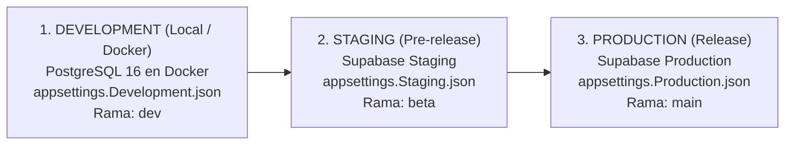
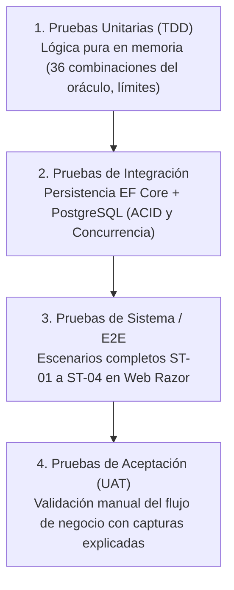

# PLAN MAESTRO DE PRUEBAS DE SOFTWARE (STP)
## Sistema de Venta y Financiamiento de Lotes Funerarios

| Metadato | Detalle |
|---|---|
| **Proyecto** | Sistema de Venta y Financiamiento de Lotes Funerarios |
| **Materia / Contexto** | Estándares y Métricas para el Desarrollo de Software (V&V) |
| **Estándar Aplicado** | IEEE 829 / ISO/IEC/IEEE 29119 adaptado a gestión ágil y TDD |
| **Versión** | 1.0 (Línea Base Congelada) |
| **Fecha de Aprobación** | 06 de Noviembre de 2026 |
| **Fecha de Certificación (Go-Live)** | 25 de Noviembre de 2026 |
| **Líder Técnico & QA Master** | Lead Fullstack |

---

## 1. Introducción y Propósito

El propósito de este Plan Maestro de Pruebas es establecer la estrategia integral, el alcance, los entornos, los recursos y los criterios de aceptación para el proceso de **Verificación y Validación (V&V)** del Sistema de Venta y Financiamiento de Lotes Funerarios.

El objetivo no es únicamente comprobar que la interfaz abra o que los botones respondan, sino demostrar con evidencia matemática, técnica y visual que:
1. Las reglas de negocio (RN-01 a RN-12) se cumplen sin excepciones.
2. Los cálculos de amortización francesa conservan precisión decimal exacta y cierran en `$0.00` en su último periodo.
3. Las operaciones de cobro y abonos a capital son consistentes, atómicas e inmunes a concurrencia.
4. El sistema rechaza rigurosamente datos no autorizados en sus fronteras de decisión.

---

## 2. Alcance de las Pruebas

```mermaid
flowchart TD
    ALCANCE["Alcance del Proceso de Pruebas (v1.0.0)"]
    ALCANCE --> IN["DENTRO DEL ALCANCE (Obligatorio)"]
    ALCANCE --> OUT["FUERA DEL ALCANCE (Exclusiones v1.0.0)"]

    IN --> IN1["Catálogo fijo de 3 lotes ($120k, $150k, $180k)"]
    IN --> IN2["Venta de Contado (pago 100% sin tabla)"]
    IN --> IN3["Financiamiento: 3 enganches (10, 20, 30%) y 4 plazos (12, 18, 24, 48m)"]
    IN --> IN4["Oráculo Financiero de 36 combinaciones en xUnit"]
    IN --> IN5["Abono extraordinario a capital con recálculo de cuota"]
    IN --> IN6["Liquidación anticipada con 10% descuento sobre intereses futuros"]
    IN --> IN7["Detección visual de cuotas vencidas sin interés moratorio"]
    IN --> IN8["Integridad transaccional ACID y no duplicidad de pagos"]

    OUT --> OUT1["Cálculo de intereses moratorios (excluido por especificación)"]
    OUT --> OUT2["CRUD o edición dinámica de precios por vendedor"]
    OUT --> OUT3["Pasarelas bancarias externas (Stripe, PayPal, SPEI)"]
    OUT --> OUT4["Timbrado de facturación fiscal (CFDI)"]
```

---

## 3. Estrategia de Ambientes y Datos (Arquitectura de 3 Entornos)

El proyecto opera bajo una segregación estricta de 3 ambientes vinculados al modelo de ramas GitFlow:

| Ambiente | Propósito | Base de Datos | Archivo de Configuración | Rama Git Asociada |
|---|---|---|---|---|
| **Development** | Desarrollo activo de los 5 programadores y pruebas unitarias/integración locales. | PostgreSQL 16 local vía `docker-compose.yml` (`localhost:5432`). | `appsettings.Development.json` | `dev` / `feature/*` |
| **CI Server** | Servidor de integración continua en la nube (GitHub Actions). | Contenedor oficial de PostgreSQL 16 efímero en Ubuntu runner. | Variables de entorno en GitHub Actions | Pull Requests a `dev`, `beta`, `main` |
| **Staging** | Entorno de certificación previa y pruebas de aceptación de usuario (UAT). | Instancia dedicada en **Supabase Staging** (Cloud). | `appsettings.Staging.json` | `beta` |
| **Production** | Entorno final congelado para la entrega y evaluación académica. | Instancia dedicada en **Supabase Production** (Cloud). | `appsettings.Production.json` | `main` (Tag `v1.0.0`) |

---

## 4. Niveles de Prueba y Pirámide de Calidad

Para asegurar calidad desde la raíz, implementamos cuatro niveles secuenciales de prueba:

### 4.1 Nivel 1: Pruebas Unitarias (Unit Testing con TDD)
* **Objetivo:** Aislar y verificar cada función matemática, regla de validación y Value Object sin dependencias de base de datos ni de red.
* **Herramienta:** xUnit + FluentAssertions en C# (.NET 8).
* **Alcance Clave:**
  * Oráculo de amortización francesa (36 combinaciones probadas con `[Theory]`).
  * Validación de enganches permitidos (10%, 20%, 30%) y rechazo de inválidos.
  * Validación de plazos (12, 18, 24, 48 meses) y asignación de tasas (16%, 18%, 20%, 24%).
  * Ajuste de centavos en la última cuota para forzar saldo final en `$0.00`.
  * Algoritmo de recálculo de cuota por abono a capital conservando plazo final.
  * Algoritmo de liquidación anticipada con 10% de descuento sobre intereses futuros.

### 4.2 Nivel 2: Pruebas de Integración (Integration Testing)
* **Objetivo:** Verificar la interacción correcta entre la capa de Aplicación y la capa de Infraestructura con la base de datos real.
* **Herramienta:** xUnit + Microsoft.AspNetCore.Mvc.Testing + PostgreSQL (Docker / Testcontainers).
* **Alcance Clave:**
  * Migraciones de EF Core y constraints de integridad referencial (Foreign Keys, Unicidad de clientes y lotes).
  * Transacciones ACID atómicas en la venta financiada (si falla la tabla, no se descuenta el lote).
  * Control de concurrencia en cobro de mensualidades (bloqueo pesimista para evitar doble pago).

### 4.3 Nivel 3: Pruebas de Sistema / Funcionales (System Testing)
* **Objetivo:** Evaluar el comportamiento del software de punta a punta a través de los casos de uso principales.
* **Herramienta:** Pruebas funcionales sobre endpoints y controladores Razor Pages.
* **Alcance Clave:**
  * Ejecución de los 4 Escenarios de Negocio (**ST-01** Venta Contado, **ST-02** Venta Financiada con Abono y Recálculo, **ST-03** Vencimiento sin mora y Liquidación, **ST-04** Rechazos por concurrencia).
  * Control de acceso basado en roles (RBAC): Vendedor vs Cajero.

### 4.4 Nivel 4: Pruebas de Aceptación (UAT / Visual Evidence)
* **Objetivo:** Demostrar el cumplimiento de los criterios de aceptación frente a la cátedra y usuarios finales.
* **Técnica:** Recorrido guiado de usuario en navegador web (Chrome / Edge).
* **Entregable:** Capturas de pantalla estructuradas con tabla explicativa (Identificador CP, entradas, resultado esperado, resultado obtenido y estado).

---

## 5. Técnicas de Prueba Aplicadas (Metodología Académica)

El diseño de casos se rige por las 4 técnicas formales detalladas en la [Matriz de Trazabilidad (RTM)](file:///Users/riguidixrodriguez/RiderProjects/SistemaFuneraria/docs/02-matriz-trazabilidad.md):

1. **Partición de Equivalencia (EP-01 a EP-17):** Clases válidas frente a inválidas para enganches, plazos, precios y pagos.
2. **Análisis de Valores Límite (BVA-01 a BVA-15):** Pruebas en las fronteras de enganche ($9.99\%, 10\%, 10.01\%$), plazos ($11, 12, 48, 49$ meses) y exactitud de saldo cero final.
3. **Tabla de Decisiones (DT-01 a DT-36):** Validación exhaustiva de las 36 combinaciones posibles del catálogo y financiamiento.
4. **Pruebas Basadas en Escenarios (ST-01 a ST-04):** Flujos E2E completos del ciclo de vida del contrato funerario.

---

## 6. Criterios de Calidad y Puertas de Enlace (Quality Gates)

### 6.1 Criterios de Entrada (Entry Criteria)
Para que un ticket inicie pruebas en su rama de feature:
* El ticket cuenta con criterios de aceptación en formato BDD (Dado / Cuando / Entonces).
* La rama `feature/FUN-XXX` nace de la versión actualizada de `dev`.

### 6.2 Criterios de Suspensión (Suspension Criteria)
El proceso de pruebas se detiene de inmediato ante cualquier incidencia crítica (**SEV1**):
* El cálculo de amortización francesa acumula error de centavos o el saldo final no termina en `$0.00`.
* Se detecta que el sistema cobra intereses moratorios (violación de RN-10).
* La migración de base de datos corrompe datos existentes o falla en `dev`.
* El pipeline de GitHub Actions CI falla en la compilación o en las pruebas unitarias.

### 6.3 Criterios de Reanudación (Resumption Criteria)
* La incidencia SEV1 ha sido corregida mediante un commit con prefijo `fix:`, validada localmente por el Tech Lead y mergeada a `dev`.

### 6.4 Criterios de Salida y Certificación (Exit Criteria para v1.0.0)
El sistema solo se certifica para producción si cumple con:
1. **100% de los Casos de Prueba (CP-01 a CP-10, EP, BVA, DT y ST) ejecutados y aprobados.**
2. **0 Incidencias críticas abiertas (0 SEV1 y 0 SEV2).**
3. **Pipeline de GitHub Actions CI 100% en verde** en las ramas `dev`, `beta` y `main`.
4. **Evidencias completas y explicadas** para cada requisito en la carpeta de documentación.
5. **Informe de Cierre de Pruebas firmado** por el Tech Lead.

---

## 7. Matriz de Responsabilidades de los 5 Desarrolladores en V&V

| Desarrollador | Rol Operativo en Pruebas | Responsabilidad Concreta de V&V |
|---|---|---|
| **Lead Fullstack (Tú)** | **Lead Architect & Gatekeeper** | Diseña los casos de prueba de concurrencia y transacciones ACID. Revisa y aprueba todos los Pull Requests antes del merge. Dictamina la certificación final v1.0.0. |
| **Gustavo Lucio** | **Especialista Core Financiero** | Diseña y ejecuta las pruebas unitarias TDD del motor de cálculo, las 36 combinaciones del oráculo (`DT-01..36`) y el recálculo por abono extraordinario. |
| **Juan Romero** | **Especialista Frontend & UI** | Ejecuta las pruebas de compatibilidad responsiva en navegadores (RNF-06), validaciones en formularios cliente (CP-10) y captura evidencias de UI. |
| **Guillermo Sandoval** | **Especialista Casos de Uso** | Implementa las pruebas de validación de entradas de clientes, venta de contado (CP-01, CP-02) y rechazo de plazos/enganches no autorizados. |
| **Edgar Acevedo** | **DevOps & QA Lead** | Mantiene el pipeline de GitHub Actions en verde, gestiona la bitácora formal de incidencias (`INC-XXX`) y coordina las corridas de regresión en staging (`beta`). |

---

## 8. Calendario Crítico de Pruebas y Certificación

| Fecha | Hito de Pruebas | Entregable de Calidad Verificable |
|---|---|---|
| **Vie 06 Nov** | Pruebas de Cimientos e Infraestructura | `v0.0.1`: CI verde con PostgreSQL y solución de 5 proyectos compilando. |
| **Mar 10 Nov** | Pruebas del Motor Financiero TDD | `v0.1.0`: 36 combinaciones del oráculo financiero aprobadas en xUnit. |
| **Mié 11 Nov** | Pruebas de Persistencia y Clientes | `v0.2.0`: Migraciones EF Core aplicadas y pruebas de clientes en verde. |
| **Jue 12 Nov** | Pruebas de Catálogo y Venta Contado | `v0.3.0`: CP-01 y CP-02 aprobados con evidencia visual. |
| **Vie 13 Nov** | Pruebas del Simulador Financiero | `v0.4.0`: CP-03 a CP-06 y CP-10 aprobados vía HTTP. |
| *Lun 16 Nov* | *Buffer de Estabilización* | *Corrección de incidencias menores y preparación de venta financiada.* |
| **Mar 17 Nov** | Pruebas de Venta Financiada Atómica | `v0.5.0`: Prueba de integración transaccional ACID aprobada. |
| **Mié 18 Nov** | Pruebas de Pagos Ordinarios y Concurrencia| `v0.6.0`: RN-11 y RNF-04 verificados; cero pagos duplicados. |
| **Jue 19 Nov** | Pruebas de Abono a Capital y Recálculo | `v0.7.0`: CP-07 aprobado con recálculo de cuota manteniendo fecha fin. |
| **Vie 20 Nov** | Pruebas de Liquidación Anticipada | `v0.8.0`: CP-08 aprobado con descuento exacto del 10% sobre intereses futuros.|
| **Lun 23 Nov (18:00)**| Pruebas de Vencidos & **CODE FREEZE** | `v0.9.0`: CP-09 aprobado (vencidas sin moratorio). **Cierre total de código.** |
| **Mar 24 - Mié 25 Nov**| **UAT Final y Certificación de Release** | `v1.0.0`: Ejecución de suite completa de regresión, cierre de incidencias, recolección de evidencias y firma del Informe de Cierre. |
