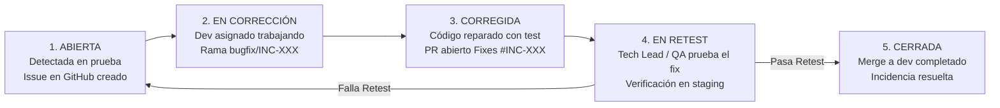

# BITÁCORA Y GESTIÓN DE INCIDENCIAS DE SOFTWARE
## Sistema de Venta y Financiamiento de Lotes Funerarios

| Metadato | Detalle |
|---|---|
| **Documento** | Bitácora Formal de Defectos e Incidencias (Defect Tracking Log) |
| **Proyecto** | Sistema de Venta y Financiamiento de Lotes Funerarios |
| **Materia** | Estándares y Métricas para el Desarrollo de Software (Sección 12) |
| **Versión** | 1.0 (Línea Base) |
| **Responsable de Consolidación** | Edgar Acevedo (QA Lead & Dev de Guardia) & Lead Fullstack |
| **Política de Edición** | **Escritor Único (Single-Writer):** Mantenido exclusivamente por QA/Lead; los devs reportan vía GitHub Issues. |

---

## 1. Ciclo de Vida Formal de una Incidencia

Toda anomalía detectada durante la ejecución de pruebas manuales o automatizadas sigue este flujo estricto:



---

## 2. Clasificación de Severidad y Prioridad

| Nivel | Nombre | Criterio de Impacto en el Sistema | Tiempo de Atención | Gate de Release |
|---|---|---|---|---|
| **SEV1** | **Crítica (Blocker)** | Corrupción de cálculos matemáticos, saldo que no cierra en cero, cobro de moratorios indebidos, caída de base de datos o fallo en el build de CI. | Atención inmediata; interrumpe el sprint. | **Bloquea el Release (0 permitidos para v1.0.0).** |
| **SEV2** | **Mayor (Major)** | Funcionalidad principal degradada con alternativa temporal, fallo en validación de enganches o problema de concurrencia en caja. | Siguiente bloque de trabajo (máx. 24h). | **Bloquea el Release (0 permitidos para v1.0.0).** |
| **SEV3** | **Menor (Minor)** | Defecto cosmético, error tipográfico en etiqueta, inconsistencia visual de espaciado o advertencia no bloqueante de linter. | Triage para estabilización. | Permitido con justificación técnica documentada. |

---

## 3. Plantilla Oficial para Reporte de Incidencias (Sección 12)

Copia este bloque cada vez que se documente un nuevo defecto:

```markdown
### [INC-XXX] Título Claro y Conciso del Defecto

* **Caso de Prueba Relacionado:** CP-___ (o RNF-___ / RN-___)
* **Fecha de Detección:** dd/mm/aaaa
* **Reportado por:** [Nombre del Tester / Dev]
* **Severidad:** SEV1-Crítica | SEV2-Mayor | SEV3-Menor
* **Prioridad:** P0 (Inmediata) | P1 (Alta) | P2 (Media)
* **Estado:** Abierta | En Corrección | Corregida | En Retest | Cerrada
* **Asignado a:** [Nombre del Desarrollador]
* **Pull Request de Corrección:** PR #___

#### 1. Descripción del Problema
[Explicación clara de qué ocurrió y bajo qué condiciones específicas]

#### 2. Datos Utilizados y Pasos para Reproducir
1. Paso 1...
2. Paso 2...
3. Paso 3...

#### 3. Comportamiento Observado vs. Esperado
* **Resultado Esperado:** [Lo que la regla de negocio o cálculo exigía]
* **Resultado Real Observado:** [Lo que el sistema hizo de forma incorrecta]

#### 4. Evidencia TDD
* **Captura de Prueba Fallando (RED):** [Pegar imagen o log de terminal]
* **Captura de Prueba Pasando tras corrección (GREEN):** [Pegar imagen o log]

#### 5. Registro de Retest y Cierre
* **Fecha de Retest:** dd/mm/aaaa
* **Verificado por:** [Tech Lead / QA Lead]
* **Dictamen:** Aprobada y Cerrada / Rechazada
```

---

## 4. Incidencia Modelo de Referencia (INC-001)

Este caso sirve como ejemplo pedagógico para que el equipo entienda cómo se registra y se cierra un defecto con rigor profesional:

### [INC-001] Descuadre de 3 centavos en el saldo final de la tabla de amortización a 12 meses

* **Caso de Prueba Relacionado:** CP-06 (RF-08, RNF-02)
* **Fecha de Detección:** 09/11/2026
* **Reportado por:** Edgar Acevedo (QA Lead)
* **Severidad:** SEV1-Crítica (Afecta integridad monetaria)
* **Prioridad:** P0 (Inmediata)
* **Estado:** `Cerrada`
* **Asignado a:** Gustavo Lucio (Dominio Financiero)
* **Pull Request de Corrección:** PR #14 (`fix(core): absorbe diferencia de redondeo en ultima cuota`)

#### 1. Descripción del Problema
Al generar la tabla de amortización para un financiamiento de Lote Básico ($120,000.00 con 20% enganche a 12 meses), el saldo final del periodo 12 terminó en `-$0.03` (tres centavos negativos) en lugar de cerrar en `$0.00 exacto`, debido a la acumulación de decimales de la cuota periódica truncada a dos dígitos.

#### 2. Datos Utilizados y Pasos para Reproducir
1. Producto: Lote Básico ($120,000.00), Enganche: 20% ($24,000.00), Plazo: 12 meses, Tasa: 16%.
2. Ingresar al generador de amortizaciones.
3. Consultar la última fila (Periodo 12).
4. Observar la columna "Saldo Final".

#### 3. Comportamiento Observado vs. Esperado
* **Resultado Esperado:** La cuota 12 debe absorber la diferencia ajustándose a $8,710.19 y el saldo final debe ser **$0.00**.
* **Resultado Real Observado:** La cuota 12 se mantuvo en $8,710.16 y el saldo final quedó en **-$0.03**.

#### 4. Evidencia TDD
* **Evidencia RED:** `TablaAmortizacionTests.cs:line 45` falló con mensaje: `Assert.Equal(0.00m, saldoFinal) Expected: 0.00m Actual: -0.03m`.
* **Evidencia GREEN:** Tras implementar la regla de absorción en `GeneradorAmortizacion.cs`, la prueba unitaria pasó en verde: `Passed: 1, Failed: 0`.

#### 5. Registro de Retest y Cierre
* **Fecha de Retest:** 10/11/2026
* **Verificado por:** Lead Fullstack
* **Dictamen:** Retest aprobado en staging. Saldo final cierra en `$0.00`. Incidencia cerrada y mergeada a `dev`.

---

## 5. Tabla Maestra Consolidada de Incidencias (Incident Tracker)

| ID | Caso Asoc. | Título Corto del Defecto | Severidad | Prioridad | Asignado | Estado | PR Asociado | Fecha Cierre |
|---|---|---|---|---|---|---|---|---|
| **INC-001** | CP-06 | Descuadre de 3 centavos en saldo final de amortización | SEV1 | P0 | Gustavo Lucio | `Cerrada` | PR #14 | 10/11/2026 |
| *INC-002* | *CP-___* | *[Espacio reservado para nuevo defecto]* | — | — | — | `Abierta` | — | — |
| *INC-003* | *CP-___* | *[Espacio reservado para nuevo defecto]* | — | — | — | `Abierta` | — | — |
| *INC-004* | *CP-___* | *[Espacio reservado para nuevo defecto]* | — | — | — | `Abierta` | — | — |
