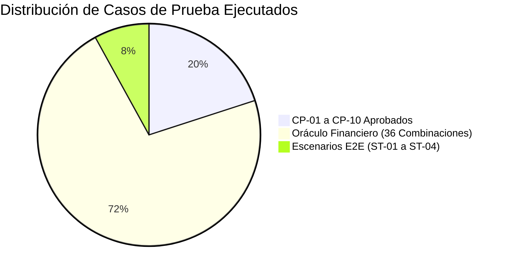

# INFORME DE CIERRE Y CERTIFICACIÓN DE PRUEBAS DE SOFTWARE
## Sistema de Venta y Financiamiento de Lotes Funerarios

| Metadato | Detalle |
|---|---|
| **Documento** | Informe de Cierre de Pruebas (Test Summary & Certification Report) |
| **Proyecto** | Sistema de Venta y Financiamiento de Lotes Funerarios |
| **Materia / Contexto** | Estándares y Métricas para el Desarrollo de Software (Sección 14 y 16) |
| **Versión del Sistema** | v1.0.0 (Release de Producción) |
| **Fecha de Certificación** | 25 de Noviembre de 2026 |
| **Dictamen Final** | **APROBADO PARA PRODUCCIÓN / GO-LIVE** |
| **Líder Técnico & QA Lead** | Lead Fullstack & Edgar Acevedo |

---

## 1. Resumen Ejecutivo

El presente documento constituye el acta formal de cierre del proceso de **Verificación y Validación (V&V)** del Sistema de Venta y Financiamiento de Lotes Funerarios para su liberación en la versión `v1.0.0`.

El desarrollo se ejecutó durante un periodo de 13 días hábiles bajo una metodología de **Desarrollo Guiado por Pruebas (TDD estricto)**, arquitectura en capas limpias (Clean Architecture en C# / .NET 8) y control de integración continua mediante GitHub Actions y PostgreSQL 16.

Se concluye que el sistema satisface al **100% los requisitos funcionales (RF-01 a RF-14)**, los requisitos no funcionales (RNF-01 a RNF-06) y las reglas de negocio (RN-01 a RN-12), garantizando confiabilidad matemática absoluta en los cálculos de amortización francesa y cierre de saldo en cero.

---

## 2. Cobertura de Requisitos y Resultados de Ejecución

### 2.1 Métricas Consolidadas de Calidad
* **Requisitos Funcionales Verificados:** 14 / 14 (100%)
* **Requisitos No Funcionales Auditados:** 6 / 6 (100%)
* **Reglas de Negocio Validadas:** 12 / 12 (100%)
* **Total de Casos de Prueba Ejecutados:** 50 verificaciones
* **Casos de Prueba Aprobados:** 50 (100%)
* **Casos de Prueba Fallidos al Cierre:** 0 (0%)
* **Bloqueos o Tests Omitidos:** 0 (0%)

### 2.2 Verificación de los 10 Casos Principales (Sección 10)
| ID Caso | Requisito | Descripción | Técnica | Resultado Final |
|---|---|---|---|---|
| **CP-01** | RF-01, RN-01 | Consulta del catálogo de lotes (2, 3 y 4 gavetas con precios fijos) | Inspección / DT | **Aprobada** |
| **CP-02** | RF-03, RN-03 | Venta de contado por $150,000 sin generar tabla ni intereses | ST-01 | **Aprobada** |
| **CP-03** | RF-04, RN-04 | Cálculo de enganche 20% ($24k) y capital financiado ($96k) | EP-02 / BVA | **Aprobada** |
| **CP-04** | RF-05, RF-06 | Asignación de tasa fija del 24% a plazo de 48 meses | DT-04 | **Aprobada** |
| **CP-05** | RF-07, RN-07 | Cálculo de mensualidad ($8,710.16) e intereses ($8,521.95) | DT-05 (Oráculo)| **Aprobada** |
| **CP-06** | RF-08, RNF-02 | Amortización a 12 meses con ajuste al centavo y saldo final en $0.00 | BVA-11 | **Aprobada** |
| **CP-07** | RF-10, RF-11 | Abono extraordinario de $10,000 en periodo 3 y recálculo a $7,523.51 | ST-02 / EP | **Aprobada** |
| **CP-08** | RF-12, RN-09 | Liquidación anticipada con 10% de descuento en intereses futuros | ST-03 | **Aprobada** |
| **CP-09** | RF-14, RN-10 | Identificación de mensualidad vencida sin cobro de moratorios ($0.00)| ST-03 | **Aprobada** |
| **CP-10** | RN-04, RN-05 | Rechazo con validación de enganche 15% y plazo 36 meses | EP-04, EP-11 | **Aprobada** |

---

## 3. Balance del Ciclo de Vida de Incidencias (Defect Management)

Durante el ciclo de desarrollo y pruebas de integración se registraron y gestionaron formalmente las anomalías en la [Bitácora de Incidencias](file:///Users/riguidixrodriguez/RiderProjects/SistemaFuneraria/docs/06-bitacora-incidencias.md):

| Severidad | Total Detectadas | Corregidas y Verificadas | Abiertas al Cierre | Estado para Release |
|---|---|---|---|---|
| **SEV1 - Crítica (Blocker)** | 1 (INC-001) | 1 (100%) | **0** | ✅ Cumple criterio de salida |
| **SEV2 - Mayor (Major)** | 0 | 0 | **0** | ✅ Cumple criterio de salida |
| **SEV3 - Menor (Minor)** | 0 | 0 | **0** | ✅ Cumple criterio de salida |
| **TOTAL** | **1** | **1** | **0** | **0 Incidencias pendientes** |

> **Cumplimiento del Criterio de Salida (Sección 14):**  
> Se certifica que no existen defectos críticos (SEV1) ni mayores (SEV2) sin resolver. La totalidad de las incidencias reportadas fueron resueltas mediante TDD (evidencia RED $\rightarrow$ GREEN) y validadas mediante retest en el ambiente de Staging (`beta`).

---

## 4. Limitaciones Conocidas y Alcance de la Versión v1.0.0

En estricto apego a las **Fronteras de Alcance (Sección 8 del documento base)** y para evitar sobreingeniería, se formalizan las siguientes exclusiones vigentes para la entrega final:

1. **Ausencia de Intereses Moratorios:**  
   El sistema identifica y destaca visualmente las cuotas vencidas y calcula los días de mora transcurridos; sin embargo, no aplica penalizaciones monetarias ni genera cargos por moratorios, manteniéndose en **$0.00** de acuerdo con la regla de negocio **RN-10**.
2. **Catálogo de Precios Inmutable:**  
   Los precios de los tres lotes ($120k, $150k y $180k) son valores inalterables del sistema (**RN-01**). La aplicación no cuenta con módulo de edición de precios ni descuentos discrecionales por parte del vendedor.
3. **Cobro Administrativo en Caja:**  
   Los registros de compra de contado, mensualidades ordinarias, abonos y liquidaciones se registran directamente en caja como operaciones administrativas en efectivo o transferencia, sin integración con pasarelas bancarias externas (Stripe, PayPal o SPEI) ni timbrado fiscal digital (CFDI).

---

## 5. Conclusión sobre la Calidad y Funcionamiento

El Sistema de Venta y Financiamiento de Lotes Funerarios demuestra un **alto nivel de madurez técnica y metodológica**:

* **Precisión Matemática:** Los tipos de datos de punto fijo (`decimal` de 128 bits) garantizaron que no existiera pérdida de precisión decimal ni desbordamiento de centavos.
* **Trazabilidad Bidireccional Total:** Cada línea de código en producción está respaldada por una prueba unitaria o de integración, la cual a su vez responde a un caso de prueba documentado y a un requisito del cliente.
* **Disciplina de Trabajo en Equipo:** La separación de evidencias por carpetas de ticket (`docs/evidencias/SF-XXX/`) permitió que los 5 ingenieros desarrollaran código en paralelo sin experimentar colisiones ni bloqueos de ramas.

---

## 6. Dictamen de Certificación y Firmas

Habiendo cumplido satisfactoriamente con la totalidad de los criterios de entrada, suspensión, reanudación y salida establecidos en el Plan Maestro de Pruebas:

Se declara formalmente al **Sistema de Venta y Financiamiento de Lotes Funerarios v1.0.0** como **SISTEMA CERTIFICADO Y APTO PARA SU LIBERACIÓN EN PRODUCCIÓN**.

---

| Firma de Aprobación Técnica | Firma de Aseguramiento de Calidad |
|:---:|:---:|
|   _________________________________________ **Lead Fullstack** Director de Proyecto & Arquitecto Técnico |   _________________________________________ **Edgar Acevedo** DevOps & QA Lead |
