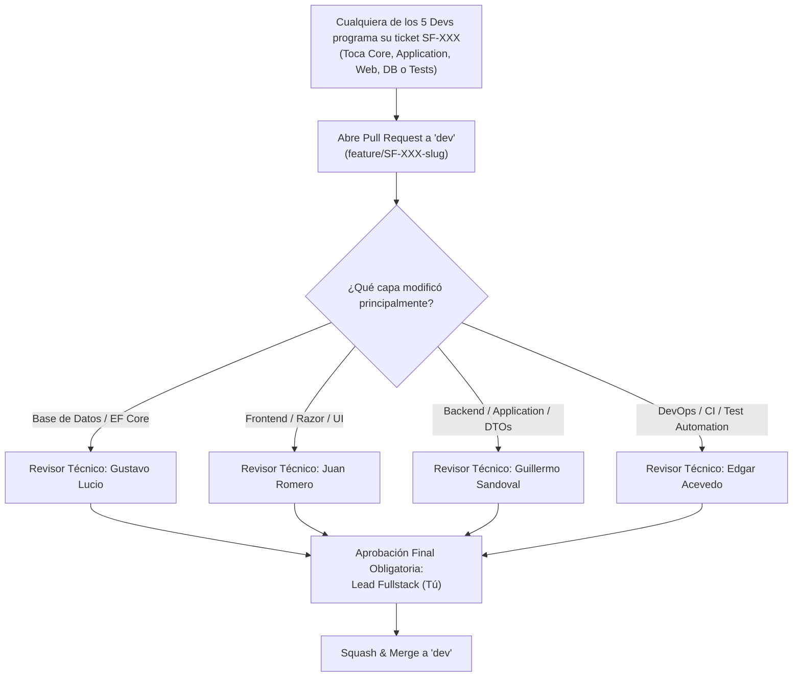

# BACKLOG MAESTRO DE INGENIERÍA · TICKETS ATÓMICOS SF-XXX
## Sistema de Venta y Financiamiento de Lotes Funerarios

| Metadato | Detalle |
|---|---|
| **Proyecto** | Sistema de Venta y Financiamiento de Lotes Funerarios |
| **Materia** | Estándares y Métricas para el Desarrollo de Software |
| **Ventana Operativa** | 20 días continuos (Viernes 06 de Noviembre al Miércoles 25 de Noviembre de 2026) |
| **Equipo** | 5 Desarrolladores Fullstack con Revisores Temáticos Especializados |
| **Arquitectura** | Clean Architecture Pragmática (.NET 8 / EF Core 8 / PostgreSQL 16 / Razor Pages) |
| **Patrón de Flujo** | Servicios e Interfaces de Aplicación + Dominio Puro (Anti-CQRS) + Patrón `Resultado<T>` |
| **Volumen** | **55 Tickets Atómicos** (`SF-001` a `SF-055`) · **135 Story Points (SP)** |
| **Regla de Blast Radius** | $\le 250$ Líneas de Código (LOCs) por Pull Request |

---

## 1. Modelo Operativo de la Escuadra (Fullstack con Revisión Especializada)

Todos los desarrolladores implementan funcionalidades a través de toda la pila (Core, Application, Infrastructure, Web y Tests). Sin embargo, cada Pull Request cuenta con una **revisión temática obligatoria (primer pase)** según la capa impactada, y una **aprobación final y obligatoria del Tech Lead**:

---

## 2. Resumen de Milestones, Épicas y Story Points

| Milestone | Periodo y Duración | Épicas Cubiertas | Versión SemVer | Tickets | Story Points |
|---|---|---|:---:|:---:|:---:|
| **Milestone 1** | **06 al 11 Nov** (6 días) | EPIC-01: Cimientos & Clean Arch EPIC-02: Dominio & Motor TDD | **v0.0.1 $\rightarrow$ v0.1.0** | `SF-001` a `SF-014` (14 tickets) | **34 SP** |
| **Milestone 2** | **12 al 18 Nov** (7 días) | EPIC-03: Clientes & RBAC EPIC-04: Catálogo & Contado EPIC-05: Simulador Web EPIC-06: Venta Financiada | **v0.2.0 $\rightarrow$ v0.5.0** | `SF-015` a `SF-033` (19 tickets) | **47 SP** |
| **Milestone 3** | **19 al 23 Nov** (5 días) | EPIC-07: Cobranza en Caja EPIC-08: Abono a Capital EPIC-09: Liquidación Anticipada EPIC-10: Estado de Cuenta & Vencidos | **v0.6.0 $\rightarrow$ v0.9.0** *(Code Freeze 23 Nov 18:00)* | `SF-034` a `SF-049` (16 tickets) | **44 SP** |
| **Milestone 4** | **24 y 25 Nov** (2 días) | EPIC-11: Certificación Final, UAT y Go-Live | **v1.0.0** | `SF-050` a `SF-055` (6 tickets) | **10 SP** |
| **TOTALES** | **20 días continuos** | **11 Épicas de Negocio** | **v0.0.1 $\rightarrow$ v1.0.0** | **55 TICKETS** | **135 SP** |

---

## 3. Índice Maestro de Tickets (`SF-001` a `SF-055`)

| ID | Título del Ticket | Capa | SP | Prioridad | Asignado | Revisor Temático | Dependencia |
|---|---|---|:---:|:---:|---|---|---|
| **SF-001** | Scaffold de solución Clean Architecture (.NET 8, 5 proyectos, Directory.Build.props) | Infra | 3 | P0 | Lead Fullstack | Edgar Acevedo | — |
| **SF-002** | Docker Compose con PostgreSQL 16 y scripts de inicialización | Infra | 2 | P0 | Edgar Acevedo | Gustavo Lucio | — |
| **SF-003** | Configuración de xUnit, FluentAssertions y tests de arquitectura en verde | QA-Test | 2 | P0 | Guillermo Sandoval | Edgar Acevedo | SF-001 |
| **SF-004** | Layout Razor Pages base, Bootstrap 5.3.8 y cultura es-MX global | Web-UI | 3 | P1 | Juan Romero | Guillermo Sandoval | SF-001 |
| **SF-005** | Catálogo de Parámetros de Negocio inmutable en Core (RNF-05, RN-01, RN-04, RN-05) | Core | 2 | P1 | Gustavo Lucio | Lead Fullstack | SF-001 |
| **SF-006** | Value Object `Dinero` con precisión decimal y operaciones sobrecargadas | Core | 2 | P1 | Lead Fullstack | Gustavo Lucio | SF-001 |
| **SF-007** | Patrón `Resultado` y `Resultado<T>` canónico en Application.Comun | App | 2 | P0 | Guillermo Sandoval | Lead Fullstack | SF-001 |
| **SF-008** | RED & GREEN: `CalculadoraFinanciamiento.CalcularEnganche` (CP-03, RN-04) | Core | 2 | P1 | Gustavo Lucio | Guillermo Sandoval | SF-005 |
| **SF-009** | RED & GREEN: `CalculadoraFinanciamiento.ObtenerTasaMensual` (CP-04, RN-05, RN-06) | Core | 2 | P1 | Juan Romero | Gustavo Lucio | SF-005 |
| **SF-010** | RED & GREEN: Fórmula amortización francesa `CalculadoraFinanciamiento.CalcularCuota` (CP-05) | Core | 3 | P1 | Gustavo Lucio | Lead Fullstack | SF-008, SF-009 |
| **SF-011** | RED & GREEN: `GeneradorAmortizacion` con absorción al centavo en cuota $n$ y saldo $0.00 (CP-06) | Core | 3 | P0 | Lead Fullstack | Gustavo Lucio | SF-010 |
| **SF-012** | Suite xUnit automatizada para el Oráculo de 36 Combinaciones (`[Theory]` con CSV) | QA-Test | 3 | P0 | Edgar Acevedo | Lead Fullstack | SF-011 |
| **SF-013** | Contrato `ISimuladorService` y DTOs en Application con tests unitarios en memoria | App | 3 | P1 | Guillermo Sandoval | Juan Romero | SF-007, SF-011 |
| **SF-014** | Certificación Milestone 1: Verificación de 36 combinaciones en CI y Tag `v0.1.0` | QA-Test | 1 | P0 | Edgar Acevedo | Lead Fullstack | SF-012, SF-013 |
| **SF-015** | Entidad de dominio `Cliente` con invariantes y constructor protegido en Core | Core | 2 | P1 | Gustavo Lucio | Guillermo Sandoval | SF-001 |
| **SF-016** | Mapeo EF Core `ClienteConfiguration`, índices (CURP, Correo) y migración inicial | Infra | 3 | P1 | Edgar Acevedo | Gustavo Lucio | SF-002, SF-015 |
| **SF-017** | Contrato `IClienteService` y DTOs planos (`RegistrarClienteRequest`, `ClienteDto`) | App | 2 | P1 | Guillermo Sandoval | Juan Romero | SF-007, SF-015 |
| **SF-018** | Implementación de `ClienteService` con validaciones de CURP y teléfono de 10 dígitos | App | 3 | P1 | Lead Fullstack | Guillermo Sandoval | SF-016, SF-017 |
| **SF-019** | UI Razor Pages: Formulario de Alta y Edición de Clientes con validación cliente | Web-UI | 3 | P1 | Juan Romero | Guillermo Sandoval | SF-018 |
| **SF-020** | UI Razor Pages: Tabla de Clientes con filtro de búsqueda por nombre o CURP | Web-UI | 2 | P2 | Juan Romero | Guillermo Sandoval | SF-018 |
| **SF-021** | Configuración de ASP.NET Core Identity y asignación de Roles (`Vendedor`, `Cajero`) | Infra | 3 | P1 | Edgar Acevedo | Lead Fullstack | SF-016 |
| **SF-022** | Entidad `Lote` y Seeder EF Core con los 3 productos fijos ($120k, $150k, $180k) | Infra | 2 | P1 | Gustavo Lucio | Edgar Acevedo | SF-005, SF-016 |
| **SF-023** | UI Web Catálogo `/Catalogo` con tarjetas de producto, gavetas y precios fijos | Web-UI | 2 | P1 | Juan Romero | Guillermo Sandoval | SF-004, SF-022 |
| **SF-024** | Caso de uso `IVentaService.RegistrarVentaContadoAsync` y persistencia en 1 exhibición | App | 3 | P0 | Guillermo Sandoval | Lead Fullstack | SF-007, SF-022 |
| **SF-025** | UI Wizard Paso 1 y 2: Selección de cliente, selección de lote y confirmación contado | Web-UI | 3 | P1 | Juan Romero | Guillermo Sandoval | SF-019, SF-023, SF-024 |
| **SF-026** | Pruebas funcionales E2E de Venta de Contado (CP-01 y CP-02) | QA-Test | 2 | P1 | Edgar Acevedo | Lead Fullstack | SF-025 |
| **SF-027** | Implementación de `SimuladorService.Simular` y validación estricta de límites (CP-10) | App | 3 | P1 | Guillermo Sandoval | Gustavo Lucio | SF-013 |
| **SF-028** | Partial View `_TablaAmortizacionPartial.cshtml` y controlador asíncrono para el simulador | Web-UI | 3 | P1 | Juan Romero | Guillermo Sandoval | SF-027 |
| **SF-029** | Script Vanilla JS para actualización dinámica de cuotas y tabla sin recargar página | Web-UI | 2 | P1 | Juan Romero | Lead Fullstack | SF-028 |
| **SF-030** | Entidades de dominio `Venta`, `Financiamiento` y `Mensualidad` en Core | Core | 3 | P0 | Gustavo Lucio | Lead Fullstack | SF-005, SF-011 |
| **SF-031** | Mapeo EF Core de Contratos, Cuotas y token de concurrencia optimista `xmin` | Infra | 3 | P0 | Edgar Acevedo | Gustavo Lucio | SF-030 |
| **SF-032** | Implementación de `VentaService.RegistrarVentaFinanciadaAsync` con transacción ACID | App | 5 | P0 | Lead Fullstack | Gustavo Lucio | SF-031 |
| **SF-033** | UI Wizard Paso 3 y 4: Confirmación de venta financiada, carátula de contrato e impresión | Web-UI | 3 | P1 | Juan Romero | Guillermo Sandoval | SF-029, SF-032 |
| **SF-034** | Entidad de dominio `Pago` con `ClaveIdempotencia` y reglas de no negatividad (RN-11) | Core | 2 | P0 | Gustavo Lucio | Lead Fullstack | SF-030 |
| **SF-035** | Mapeo EF Core de Pagos, folios secuenciales PostgreSQL e índice único de idempotencia | Infra | 3 | P0 | Edgar Acevedo | Gustavo Lucio | SF-034 |
| **SF-036** | Implementación de `CobranzaService.RegistrarPagoOrdinarioAsync` con prevención de duplicados | App | 3 | P0 | Lead Fullstack | Guillermo Sandoval | SF-035 |
| **SF-037** | UI Caja: Consulta de cuotas pendientes de contrato y formulario de cobro | Web-UI | 3 | P1 | Juan Romero | Guillermo Sandoval | SF-036 |
| **SF-038** | UI Recibo: Vista imprimible y comprobante oficial de pago foliado en caja | Web-UI | 2 | P1 | Juan Romero | Lead Fullstack | SF-037 |
| **SF-039** | Pruebas de integración de concurrencia en cobranza ordinaria (ST-04, RNF-04) | QA-Test | 3 | P0 | Edgar Acevedo | Lead Fullstack | SF-036 |
| **SF-040** | Helper de dominio `CalculadoraAbonoCapital.RecalcularCuota` conservando plazo final (RN-08) | Core | 3 | P1 | Gustavo Lucio | Guillermo Sandoval | SF-011 |
| **SF-041** | Implementación de `CobranzaService.AplicarAbonoCapitalAsync` y versionado de cuotas | App | 3 | P1 | Guillermo Sandoval | Lead Fullstack | SF-036, SF-040 |
| **SF-042** | UI Caja: Modal de Abono Extraordinario a Capital con comparativa visual antes vs después | Web-UI | 3 | P1 | Juan Romero | Guillermo Sandoval | SF-041 |
| **SF-043** | Pruebas unitarias y de integración de CP-07 ($10k en periodo 3 $\rightarrow$ $7,523.51) | QA-Test | 2 | P1 | Edgar Acevedo | Gustavo Lucio | SF-041 |
| **SF-044** | Helper de dominio `CalculadoraLiquidacion.CalcularLiquidacion` con 10% desc. intereses (RN-09) | Core | 3 | P1 | Gustavo Lucio | Lead Fullstack | SF-011 |
| **SF-045** | Implementación de `CobranzaService.CotizarLiquidacionAnticipadaAsync` y pago de liquidación | App | 3 | P1 | Guillermo Sandoval | Gustavo Lucio | SF-044 |
| **SF-046** | UI Caja: Pantalla de Liquidación Anticipada con desglose de bonificación y ahorro | Web-UI | 3 | P1 | Juan Romero | Guillermo Sandoval | SF-045 |
| **SF-047** | Pruebas funcionales de CP-08 (Liquidación tras periodo 3 por $77,893.39) | QA-Test | 2 | P1 | Edgar Acevedo | Guillermo Sandoval | SF-045 |
| **SF-048** | Evaluador de mensualidades vencidas con `TimeProvider` abstracto y $0.00 mora (RN-10) | Core | 2 | P1 | Gustavo Lucio | Edgar Acevedo | SF-030 |
| **SF-049** | UI Estado de Cuenta con listado de pagos, cuotas vencidas en rojo y **CODE FREEZE** | Web-UI | 3 | P0 | Juan Romero | Lead Fullstack | SF-048 |
| **SF-050** | Ejecución de Suite de Regresión Completa en CI (100% de tests en verde) | QA-Test | 2 | P0 | Edgar Acevedo | Lead Fullstack | SF-049 |
| **SF-051** | Corrida de UAT en ambiente de Staging para los 4 Escenarios E2E (ST-01 a ST-04) | QA-Test | 2 | P0 | Juan Romero | Edgar Acevedo | SF-050 |
| **SF-052** | Auditoría y consolidación de evidencias TDD Markdown (`Red_Test.md` y `Green_Test.md`) | QA-Test | 2 | P0 | Guillermo Sandoval | Lead Fullstack | SF-050 |
| **SF-053** | Cierre de bitácora de incidencias (verificación de 0 incidencias SEV1/SEV2 abiertas) | QA-Test | 1 | P0 | Edgar Acevedo | Lead Fullstack | SF-051 |
| **SF-054** | Firma y formalización del Informe de Cierre de Pruebas (`docs/07-informe-cierre.md`) | QA-Test | 1 | P0 | Lead Fullstack | Edgar Acevedo | SF-052, SF-053 |
| **SF-055** | Tag oficial `v1.0.0`, merge final de `beta` a `main` y liberación a producción | Infra | 2 | P0 | Lead Fullstack | Edgar Acevedo | SF-054 |

---

## 4. Especificación Detallada de Tickets (Sprint 1 · Milestone 1 · SF-001 a SF-014)

---

### [SF-001] Scaffold de solución Clean Architecture (.NET 8, 5 proyectos, Directory.Build.props)

* **Milestone:** Milestone 1 (Sprint 1) | **Épica:** EPIC-01 Cimientos
* **Capa Arquitectónica:** `[Infrastructure]` | **Story Points:** 3 SP | **Prioridad:** P0 (Bloqueador)
* **Asignado:** Lead Fullstack | **Revisor Temático:** Edgar Acevedo (DevOps)
* **Rama Git:** `feature/SF-001-scaffold-clean-architecture`
* **Commit Base:** `chore(arch): SF-001: scaffold clean architecture solution with 5 projects`

#### 1. Contexto & Valor de Negocio
Habilitador fundacional. Establece la estructura de proyectos .NET 8 con Central Package Management y fija la regla de dependencias para que `Core` sea 100% independiente de bases de datos y frameworks web.

#### 2. Dependencias & Paralelismo
* 🔴 **Bloqueado por:** Ninguno
* 🟢 **Desbloquea a:** SF-002, SF-003, SF-004, SF-005, SF-006, SF-007
* 🤝 **Contrato:** Estructura de solución `.sln` con referencias estrictas: `Web -> Application & Infrastructure`, `Infrastructure -> Application`, `Application -> Core`, `Core -> Cero dependencias`.

#### 3. Especificación Técnica
* **Archivos a crear:**
  - `SistemaFuneraria.sln`
  - `global.json` (SDK 8.0.x)
  - `Directory.Build.props` (net8.0, Nullable, ImplicitUsings, TreatWarningsAsErrors)
  - `Directory.Packages.props` (Central Package Management)
  - `src/SistemaFuneraria.Core/SistemaFuneraria.Core.csproj`
  - `src/SistemaFuneraria.Application/SistemaFuneraria.Application.csproj`
  - `src/SistemaFuneraria.Infrastructure/SistemaFuneraria.Infrastructure.csproj`
  - `src/SistemaFuneraria.Web/SistemaFuneraria.Web.csproj`
  - `tests/SistemaFuneraria.Tests/SistemaFuneraria.Tests.csproj`

#### 4. Criterios de Aceptación (BDD Gherkin)
* **Dado** que un desarrollador clona el repositorio desde la rama `dev`,
* **Cuando** ejecuta el comando `dotnet build` en la raíz de la solución,
* **Entonces** los 5 proyectos compilan exitosamente con 0 errores y 0 advertencias.

#### 5. Evidencias TDD Requeridas
* `docs/evidencias/SF-001/Red_Test.md` (Verificación de fallo al compilar sin proyectos)
* `docs/evidencias/SF-001/Green_Test.md` (`dotnet build` exitoso con los 5 proyectos)

---

### [SF-002] Docker Compose con PostgreSQL 16 y scripts de inicialización

* **Milestone:** Milestone 1 (Sprint 1) | **Épica:** EPIC-01 Cimientos
* **Capa Arquitectónica:** `[Infrastructure]` | **Story Points:** 2 SP | **Prioridad:** P0 (Bloqueador)
* **Asignado:** Edgar Acevedo | **Revisor Temático:** Gustavo Lucio (Base de Datos)
* **Rama Git:** `feature/SF-002-docker-postgres16`
* **Commit Base:** `chore(infra): SF-002: docker-compose with postgres 16 and healthcheck`

#### 1. Contexto & Valor de Negocio
Permite que cualquier desarrollador en Windows o Mac levante una base de datos PostgreSQL 16 idéntica a producción con un solo comando sin instalar software extra.

#### 2. Dependencias & Paralelismo
* 🔴 **Bloqueado por:** Ninguno
* 🟢 **Desbloquea a:** SF-016 (Migración inicial)
* 🤝 **Contrato:** `localhost:5432`, base de datos `funeraria_dev`, usuario `postgres`, password `postgres`.

#### 3. Especificación Técnica
* **Archivos a crear:**
  - `docker-compose.yml`
  - `.env.example`
  - `appsettings.Development.json` (ConnectionStrings:DefaultConnection)

#### 4. Criterios de Aceptación (BDD Gherkin)
* **Dado** que Docker está en ejecución,
* **Cuando** el desarrollador ejecuta `docker compose up -d`,
* **Entonces** el contenedor `postgres:16` inicia, expone el puerto 5432 y responde `healthy` al comando `pg_isready`.

#### 5. Evidencias TDD Requeridas
* `docs/evidencias/SF-002/Red_Test.md` (Conexión rechazada a puerto 5432 con contenedor apagado)
* `docs/evidencias/SF-002/Green_Test.md` (Conexión exitosa y verificación de versión PostgreSQL 16)

---

### [SF-003] Configuración de xUnit, FluentAssertions y tests de arquitectura en verde

* **Milestone:** Milestone 1 (Sprint 1) | **Épica:** EPIC-01 Cimientos
* **Capa Arquitectónica:** `[QA-Test]` | **Story Points:** 2 SP | **Prioridad:** P0
* **Asignado:** Guillermo Sandoval | **Revisor Temático:** Edgar Acevedo (QA)
* **Rama Git:** `feature/SF-003-xunit-arch-tests`
* **Commit Base:** `test(arch): SF-003: configure xunit and clean architecture rules test`

#### 1. Contexto & Valor de Negocio
Blindaje automatizado de la arquitectura. Evita que por error algún desarrollador agregue referencias a base de datos en `Core` o `Application`.

#### 2. Dependencias & Paralelismo
* 🔴 **Bloqueado por:** SF-001
* 🟢 **Desbloquea a:** SF-008, SF-009, SF-010
* 🤝 **Contrato:** ArchUnit.NET / NetArchTest en `SistemaFuneraria.Tests`.

#### 3. Especificación Técnica
* **Archivos a crear/modificar:**
  - `tests/SistemaFuneraria.Tests/Arquitectura/ReglasArquitecturaTests.cs`

#### 4. Criterios de Aceptación (BDD Gherkin)
* **Dado** el ensamblado de `SistemaFuneraria.Core`,
* **Cuando** se ejecuta la suite de pruebas de arquitectura,
* **Entonces** se valida que `Core` no tiene referencias a ningún paquete externo ni a `Infrastructure` o `Web`.

#### 5. Evidencias TDD Requeridas
* `docs/evidencias/SF-003/Red_Test.md` (Test forzado a fallar simulando referencia circular)
* `docs/evidencias/SF-003/Green_Test.md` (Tests de arquitectura pasando en verde)

---

### [SF-004] Layout Razor Pages base, Bootstrap 5.3.8 y cultura es-MX global

* **Milestone:** Milestone 1 (Sprint 1) | **Épica:** EPIC-01 Cimientos
* **Capa Arquitectónica:** `[Web-UI]` | **Story Points:** 3 SP | **Prioridad:** P1
* **Asignado:** Juan Romero | **Revisor Temático:** Guillermo Sandoval (Backend)
* **Rama Git:** `feature/SF-004-layout-bootstrap-es-mx`
* **Commit Base:** `feat(web): SF-004: razor layout bootstrap 5.3.8 and es-MX culture`

#### 1. Contexto & Valor de Negocio
Establece la identidad visual responsiva de la aplicación funeraria y garantiza que todo número monetario se renderice en Pesos Mexicanos (`$#,##0.00`).

#### 2. Dependencias & Paralelismo
* 🔴 **Bloqueado por:** SF-001
* 🟢 **Desbloquea a:** SF-019, SF-023, SF-028
* 🤝 **Contrato:** Middleware de localización fijando `CultureInfo("es-MX")` en `Program.cs`.

#### 3. Especificación Técnica
* **Archivos a crear/modificar:**
  - `src/SistemaFuneraria.Web/Program.cs`
  - `src/SistemaFuneraria.Web/Pages/Shared/_Layout.cshtml`
  - `src/SistemaFuneraria.Web/wwwroot/css/site.css`

#### 4. Criterios de Aceptación (BDD Gherkin)
* **Dado** que la aplicación web inicia en cualquier navegador,
* **Cuando** se renderiza cualquier valor decimal (ej. `120000m`),
* **Entonces** la página muestra el formato exacto `$120,000.00` con comas de miles y punto decimal.

#### 5. Evidencias TDD Requeridas
* `docs/evidencias/SF-004/Red_Test.md` (Test de controlador sin cultura es-MX mostrando formato en-US)
* `docs/evidencias/SF-004/Green_Test.md` (Test de integración HTTP validando formato `$120,000.00`)

---

### [SF-005] Catálogo de Parámetros de Negocio inmutable en Core (RNF-05, RN-01, RN-04, RN-05)

* **Milestone:** Milestone 1 (Sprint 1) | **Épica:** EPIC-01 Cimientos
* **Capa Arquitectónica:** `[Core]` | **Story Points:** 2 SP | **Prioridad:** P1
* **Asignado:** Gustavo Lucio | **Revisor Temático:** Lead Fullstack
* **Rama Git:** `feature/SF-005-parametros-negocio-core`
* **Commit Base:** `feat(core): SF-005: immutable business parameters and catalog`

#### 1. Contexto & Valor de Negocio
Centraliza en un solo lugar inmutable los precios de lista ($120k, $150k, $180k), los enganches (10%, 20%, 30%) y los plazos/tasas (12m/16%, 18m/18%, 24m/20%, 48m/24%) para cumplir RNF-05.

#### 2. Dependencias & Paralelismo
* 🔴 **Bloqueado por:** SF-001
* 🟢 **Desbloquea a:** SF-008, SF-009, SF-010, SF-022
* 🤝 **Contrato:** Clase estática `ParametrosNegocio` en `SistemaFuneraria.Core.Comun`.

#### 3. Especificación Técnica
* **Archivos a crear:**
  - `src/SistemaFuneraria.Core/Comun/ParametrosNegocio.cs`
  - `tests/SistemaFuneraria.Tests/Core/ParametrosNegocioTests.cs`

#### 4. Criterios de Aceptación (BDD Gherkin)
* **Dado** el catálogo de parámetros de negocio,
* **Cuando** se consulta la tasa para el plazo de 24 meses,
* **Entonces** retorna exactamente `0.20m` (20%) y no permite modificaciones en tiempo de ejecución.

#### 5. Evidencias TDD Requeridas
* `docs/evidencias/SF-005/Red_Test.md` (`ParametrosNegocio` no existe o no tiene los valores)
* `docs/evidencias/SF-005/Green_Test.md` (Tests unitarios validando los 3 precios, 3 enganches y 4 tasas)

---

### [SF-006] Value Object `Dinero` con precisión decimal y operaciones sobrecargadas

* **Milestone:** Milestone 1 (Sprint 1) | **Épica:** EPIC-01 Cimientos
* **Capa Arquitectónica:** `[Core]` | **Story Points:** 2 SP | **Prioridad:** P1
* **Asignado:** Lead Fullstack | **Revisor Temático:** Gustavo Lucio (Base de Datos)
* **Rama Git:** `feature/SF-006-value-object-dinero`
* **Commit Base:** `feat(core): SF-006: value object Dinero with fixed precision operators`

#### 1. Contexto & Valor de Negocio
Evita la acumulación de errores de flotantes y encapsula la regla de no negatividad para montos monetarios.

#### 2. Dependencias & Paralelismo
* 🔴 **Bloqueado por:** SF-001
* 🟢 **Desbloquea a:** SF-010, SF-011, SF-034
* 🤝 **Contrato:** `readonly record struct Dinero(decimal Monto)` con redondeo bancario a 2 decimales.

#### 3. Especificación Técnica
* **Archivos a crear:**
  - `src/SistemaFuneraria.Core/Comun/Dinero.cs`
  - `tests/SistemaFuneraria.Tests/Core/DineroTests.cs`

#### 4. Criterios de Aceptación (BDD Gherkin)
* **Dado** dos importes monetarios `$10.00` y `$5.00`,
* **Cuando** se restan usando el operador `-`,
* **Entonces** el resultado es `$5.00` exacto; si el resultado fuera negativo, lanza `ReglaNegocioException`.

#### 5. Evidencias TDD Requeridas
* `docs/evidencias/SF-006/Red_Test.md` (Test fallido de operaciones monetarias)
* `docs/evidencias/SF-006/Green_Test.md` (Tests de suma, resta y redondeo aprobados)

---

### [SF-007] Patrón `Resultado` y `Resultado<T>` canónico en Application.Comun

* **Milestone:** Milestone 1 (Sprint 1) | **Épica:** EPIC-01 Cimientos
* **Capa Arquitectónica:** `[Application]` | **Story Points:** 2 SP | **Prioridad:** P0
* **Asignado:** Guillermo Sandoval | **Revisor Temático:** Lead Fullstack
* **Rama Git:** `feature/SF-007-patron-resultado`
* **Commit Base:** `feat(app): SF-007: canonical Resultado and Resultado<T> pattern`

#### 1. Contexto & Valor de Negocio
Elimina el uso de excepciones para control de flujo en la lógica de negocio, entregando mensajes limpios y diccionarios de errores de validación a la interfaz web.

#### 2. Dependencias & Paralelismo
* 🔴 **Bloqueado por:** SF-001
* 🟢 **Desbloquea a:** SF-013, SF-017, SF-024, SF-036
* 🤝 **Contrato:** `Resultado.Exito()`, `Resultado.Fallo(mensaje)`, `Resultado<T>.Exito(valor)`.

#### 3. Especificación Técnica
* **Archivos a crear:**
  - `src/SistemaFuneraria.Application/Comun/Resultado.cs`
  - `tests/SistemaFuneraria.Tests/Application/ResultadoTests.cs`

#### 4. Criterios de Aceptación (BDD Gherkin)
* **Dado** una operación fallida con mensaje de error,
* **Cuando** se crea `Resultado.Fallo("Mensaje de error")`,
* **Entonces** `EsExitoso` es `false`, `Error` contiene el mensaje y no se lanzó ninguna excepción.

#### 5. Evidencias TDD Requeridas
* `docs/evidencias/SF-007/Red_Test.md` (Test fallido por ausencia de la clase `Resultado`)
* `docs/evidencias/SF-007/Green_Test.md` (Tests unitarios de `Resultado` y `Resultado<T>` en verde)

---

### [SF-008] RED & GREEN: `CalculadoraFinanciamiento.CalcularEnganche` (CP-03, RN-04)

* **Milestone:** Milestone 1 (Sprint 1) | **Épica:** EPIC-02 Motor TDD
* **Capa Arquitectónica:** `[Core]` | **Story Points:** 2 SP | **Prioridad:** P1
* **Asignado:** Gustavo Lucio | **Revisor Temático:** Guillermo Sandoval (Backend)
* **Rama Git:** `feature/SF-008-calculo-enganche-tdd`
* **Commit Base:** `feat(core): SF-008: TDD CalculadoraFinanciamiento.CalcularEnganche`

#### 1. Contexto & Valor de Negocio
Resuelve el cálculo del enganche accesible (10%), estándar (20%) y alto (30%), obteniendo el capital a financiar (RF-04).

#### 2. Dependencias & Paralelismo
* 🔴 **Bloqueado por:** SF-005
* 🟢 **Desbloquea a:** SF-010
* 🤝 **Contrato:** `CalculadoraFinanciamiento.CalcularEnganche(decimal precio, int porcentaje) -> (decimal enganche, decimal capital)`.

#### 3. Especificación Técnica
* **Archivos a crear/modificar:**
  - `src/SistemaFuneraria.Core/Calculos/CalculadoraFinanciamiento.cs`
  - `tests/SistemaFuneraria.Tests/Core/CalculadoraEngancheTests.cs`

#### 4. Criterios de Aceptación (BDD Gherkin)
* **Dado** un precio de lote de `$120,000.00` y un porcentaje del `20%`,
* **Cuando** se invoca `CalcularEnganche(120000m, 20)`,
* **Entonces** devuelve Enganche = `$24,000.00` y Capital Financiado = `$96,000.00` exactos.

#### 5. Evidencias TDD Requeridas
* `docs/evidencias/SF-008/Red_Test.md` (Test fallando en fase ROJO)
* `docs/evidencias/SF-008/Green_Test.md` (Test pasando en fase VERDE)

---

### [SF-009] RED & GREEN: `CalculadoraFinanciamiento.ObtenerTasaMensual` (CP-04, RN-05, RN-06)

* **Milestone:** Milestone 1 (Sprint 1) | **Épica:** EPIC-02 Motor TDD
* **Capa Arquitectónica:** `[Core]` | **Story Points:** 2 SP | **Prioridad:** P1
* **Asignado:** Juan Romero | **Revisor Temático:** Gustavo Lucio (Base de Datos)
* **Rama Git:** `feature/SF-009-tasa-mensual-tdd`
* **Commit Base:** `feat(core): SF-009: TDD CalculadoraFinanciamiento.ObtenerTasaMensual`

#### 1. Contexto & Valor de Negocio
Garantiza que cada plazo tenga su tasa anual fija y calcula la tasa mensual dividiendo entre 12 sin truncamiento prematuro.

#### 2. Dependencias & Paralelismo
* 🔴 **Bloqueado por:** SF-005
* 🟢 **Desbloquea a:** SF-010
* 🤝 **Contrato:** `CalculadoraFinanciamiento.ObtenerTasas(int plazoMeses) -> (decimal tasaAnual, decimal tasaMensual)`.

#### 3. Especificación Técnica
* **Archivos a modificar:**
  - `src/SistemaFuneraria.Core/Calculos/CalculadoraFinanciamiento.cs`
  - `tests/SistemaFuneraria.Tests/Core/CalculadoraTasasTests.cs`

#### 4. Criterios de Aceptación (BDD Gherkin)
* **Dado** un plazo de `48 meses`,
* **Cuando** se consultan las tasas,
* **Entonces** la tasa anual es `0.24m` (24%) y la mensual es `0.0200m` (2.0%); si el plazo es `36`, arroja error de validación.

#### 5. Evidencias TDD Requeridas
* `docs/evidencias/SF-009/Red_Test.md` (Falla en fase ROJO)
* `docs/evidencias/SF-009/Green_Test.md` (Pase en fase VERDE)

---

### [SF-010] RED & GREEN: Fórmula amortización francesa `CalculadoraFinanciamiento.CalcularCuota` (CP-05)

* **Milestone:** Milestone 1 (Sprint 1) | **Épica:** EPIC-02 Motor TDD
* **Capa Arquitectónica:** `[Core]` | **Story Points:** 3 SP | **Prioridad:** P1
* **Asignado:** Gustavo Lucio | **Revisor Temático:** Lead Fullstack
* **Rama Git:** `feature/SF-010-cuota-francesa-tdd`
* **Commit Base:** `feat(core): SF-010: TDD french amortization installment formula`

#### 1. Contexto & Valor de Negocio
Implementa la fórmula matemática central de la cuota periódica: $M = P \times \frac{i(1+i)^n}{(1+i)^n - 1}$ con redondeo a 2 decimales.

#### 2. Dependencias & Paralelismo
* 🔴 **Bloqueado por:** SF-008, SF-009
* 🟢 **Desbloquea a:** SF-011
* 🤝 **Contrato:** `CalculadoraFinanciamiento.CalcularMensualidadOrdinaria(decimal capital, decimal tasaMensual, int plazo) -> decimal`.

#### 3. Especificación Técnica
* **Archivos a modificar:**
  - `src/SistemaFuneraria.Core/Calculos/CalculadoraFinanciamiento.cs`
  - `tests/SistemaFuneraria.Tests/Core/CalculadoraCuotaTests.cs`

#### 4. Criterios de Aceptación (BDD Gherkin)
* **Dado** un capital de `$96,000.00`, tasa anual del `16%` y plazo de `12 meses`,
* **Cuando** se calcula la mensualidad,
* **Entonces** el valor resultante es exactamente **$8,710.16** con redondeo a dos decimales.

#### 5. Evidencias TDD Requeridas
* `docs/evidencias/SF-010/Red_Test.md` (Falla en fase ROJO)
* `docs/evidencias/SF-010/Green_Test.md` (Pase en fase VERDE)

---

### [SF-011] RED & GREEN: `GeneradorAmortizacion` con absorción al centavo en cuota $n$ y saldo $0.00 (CP-06)

* **Milestone:** Milestone 1 (Sprint 1) | **Épica:** EPIC-02 Motor TDD
* **Capa Arquitectónica:** `[Core]` | **Story Points:** 3 SP | **Prioridad:** P0 (Bloqueador)
* **Asignado:** Lead Fullstack | **Revisor Temático:** Gustavo Lucio (Base de Datos)
* **Rama Git:** `feature/SF-011-generador-amortizacion-ajuste-centavos`
* **Commit Base:** `feat(core): SF-011: TDD GeneradorAmortizacion with final installment adjustment`

#### 1. Contexto & Valor de Negocio
Genera la lista de periodos completos ($1 \dots n$) forzando que la última fila absorba el desbalance de centavos para que el saldo termine en `$0.00 exacto` (RNF-02, CP-06).

#### 2. Dependencias & Paralelismo
* 🔴 **Bloqueado por:** SF-010
* 🟢 **Desbloquea a:** SF-012, SF-013, SF-030
* 🤝 **Contrato:** `GeneradorAmortizacion.Generar(decimal capital, decimal tasaMensual, int plazo) -> IReadOnlyList<RenglonAmortizacion>`.

#### 3. Especificación Técnica
* **Archivos a crear/modificar:**
  - `src/SistemaFuneraria.Core/Calculos/GeneradorAmortizacion.cs`
  - `src/SistemaFuneraria.Core/Calculos/RenglonAmortizacion.cs`
  - `tests/SistemaFuneraria.Tests/Core/GeneradorAmortizacionTests.cs`

#### 4. Criterios de Aceptación (BDD Gherkin)
* **Dado** una amortización generada de 12 periodos con capital de `$96,000.00`,
* **Cuando** se inspecciona el periodo 12,
* **Entonces** el pago mensual es `$8,710.19` (+0.03 centavos de ajuste) y el saldo final es exactamente `$0.00`.

#### 5. Evidencias TDD Requeridas
* `docs/evidencias/SF-011/Red_Test.md` (Falla en fase ROJO con saldo final distinto de cero)
* `docs/evidencias/SF-011/Green_Test.md` (Pase en fase VERDE con saldo final en $0.00)

---

### [SF-012] Suite xUnit automatizada para el Oráculo de 36 Combinaciones (`[Theory]` con CSV)

* **Milestone:** Milestone 1 (Sprint 1) | **Épica:** EPIC-02 Motor TDD
* **Capa Arquitectónica:** `[QA-Test]` | **Story Points:** 3 SP | **Prioridad:** P0
* **Asignado:** Edgar Acevedo | **Revisor Temático:** Lead Fullstack
* **Rama Git:** `feature/SF-012-oraculo-36-combinaciones-test`
* **Commit Base:** `test(core): SF-012: parameterized test theory with 36 oracle combinations`

#### 1. Contexto & Valor de Negocio
Verificación masiva e irrefutable. Valida que el motor financiero cumpla al 100% las 36 combinaciones cartesianas del catálogo contra el archivo [`docs/anexos/oraculo-36-combinaciones.csv`](file:///Users/riguidixrodriguez/RiderProjects/SistemaFuneraria/docs/anexos/oraculo-36-combinaciones.csv).

#### 2. Dependencias & Paralelismo
* 🔴 **Bloqueado por:** SF-011
* 🟢 **Desbloquea a:** SF-014
* 🤝 **Contrato:** `[Theory] [MemberData(nameof(ObtenerDatosOraculo))]` evaluando enganche, capital, mensualidad, cuota final, intereses totales y total pagado.

#### 3. Especificación Técnica
* **Archivos a crear:**
  - `tests/SistemaFuneraria.Tests/Core/OraculoFinancieroTests.cs`

#### 4. Criterios de Aceptación (BDD Gherkin)
* **Dado** el archivo de datos del oráculo con las 36 combinaciones,
* **Cuando** se ejecuta `dotnet test --filter "FullyQualifiedName~OraculoFinanciero"`,
* **Entonces** las 36 ejecuciones resultan aprobadas con 0 centavos de discrepancia.

#### 5. Evidencias TDD Requeridas
* `docs/evidencias/SF-012/Red_Test.md` (Falla previa al enlazar fixture)
* `docs/evidencias/SF-012/Green_Test.md` (36 pruebas pasando en verde en terminal)

---

### [SF-013] Contrato `ISimuladorService` y DTOs en Application con tests unitarios en memoria

* **Milestone:** Milestone 1 (Sprint 1) | **Épica:** EPIC-02 Motor TDD
* **Capa Arquitectónica:** `[Application]` | **Story Points:** 3 SP | **Prioridad:** P1
* **Asignado:** Guillermo Sandoval | **Revisor Temático:** Juan Romero (Frontend)
* **Rama Git:** `feature/SF-013-simulador-service-contrato`
* **Commit Base:** `feat(app): SF-013: ISimuladorService and DTOs with in-memory tests`

#### 1. Contexto & Valor de Negocio
Expone el servicio de simulación a la capa Web entregando los DTOs definidos por el Arquitecto de Software (`SimulacionFinanciamientoDto`).

#### 2. Dependencias & Paralelismo
* 🔴 **Bloqueado por:** SF-007, SF-011
* 🟢 **Desbloquea a:** SF-027, SF-028
* 🤝 **Contrato:** `ISimuladorService.Simular(SimularFinanciamientoRequest request) -> Resultado<SimulacionFinanciamientoDto>`.

#### 3. Especificación Técnica
* **Archivos a crear:**
  - `src/SistemaFuneraria.Application/Servicios/Simulador/ISimuladorService.cs`
  - `src/SistemaFuneraria.Application/Servicios/Simulador/SimularFinanciamientoRequest.cs`
  - `src/SistemaFuneraria.Application/Servicios/Simulador/SimulacionFinanciamientoDto.cs`
  - `src/SistemaFuneraria.Application/Servicios/Simulador/SimuladorService.cs`
  - `tests/SistemaFuneraria.Tests/Application/SimuladorServiceTests.cs`

#### 4. Criterios de Aceptación (BDD Gherkin)
* **Dado** una petición con precio `$120,000`, enganche `20` y plazo `12`,
* **Cuando** se llama a `SimuladorService.Simular(request)`,
* **Entonces** `EsExitoso` es `true`, `MensualidadOrdinaria` es `$8,710.16` y `TablaAmortizacion` contiene 12 cuotas.

#### 5. Evidencias TDD Requeridas
* `docs/evidencias/SF-013/Red_Test.md` (Test fallido en fase ROJO)
* `docs/evidencias/SF-013/Green_Test.md` (Test pasando en fase VERDE)

---

### [SF-014] Gate de Certificación Milestone 1: Verificación de 36 combinaciones en CI y Tag `v0.1.0`

* **Milestone:** Milestone 1 (Sprint 1) | **Épica:** EPIC-02 Motor TDD
* **Capa Arquitectónica:** `[QA-Test]` | **Story Points:** 1 SP | **Prioridad:** P0 (Bloqueador)
* **Asignado:** Edgar Acevedo | **Revisor Temático:** Lead Fullstack
* **Rama Git:** `feature/SF-014-certificacion-milestone-1`
* **Commit Base:** `chore(release): SF-014: tag v0.1.0 financial engine certified`

#### 1. Contexto & Valor de Negocio
Hito de salida formal del Sprint 1. Certifica que el motor financiero TDD está 100% probado antes de iniciar la persistencia con EF Core.

#### 2. Dependencias & Paralelismo
* 🔴 **Bloqueado por:** SF-012, SF-013
* 🟢 **Desbloquea a:** Milestone 2 (SF-015 en adelante)
* 🤝 **Contrato:** Merge a `dev`, pull request de `dev` a `beta`, tag `v0.1.0` y pipeline de CI en verde.

#### 3. Especificación Técnica
* **Archivos a actualizar:**
  - `docs/05-registro-ejecucion.md` (Actualización de registros del oráculo)

#### 4. Criterios de Aceptación (BDD Gherkin)
* **Dado** el código integrado en `dev`,
* **Cuando** GitHub Actions ejecuta el pipeline de CI,
* **Entonces** todas las pruebas pasan en verde y se genera el tag de release `v0.1.0`.

#### 5. Evidencias TDD Requeridas
* `docs/evidencias/SF-014/Red_Test.md` (Checklist de pre-condiciones)
* `docs/evidencias/SF-014/Green_Test.md` (Log de CI en verde y verificación de tag)

---

---

## 5. Especificación Detallada de Tickets (Sprint 2 · Milestone 2 · SF-015 a SF-033)

---

### [SF-015] Entidad de dominio `Cliente` con invariantes y constructor protegido en Core

* **Milestone:** Milestone 2 (Sprint 2) | **Épica:** EPIC-03 Clientes & RBAC
* **Capa Arquitectónica:** `[Core]` | **Story Points:** 2 SP | **Prioridad:** P1
* **Asignado:** Gustavo Lucio | **Revisor Temático:** Guillermo Sandoval (Backend)
* **Rama Git:** `feature/SF-015-entidad-cliente-core`
* **Commit Base:** `feat(core): SF-015: entity Cliente with domain invariants and factory method`

#### 1. Contexto & Valor de Negocio
Representa al comprador del lote funerario (RF-02, RN-02). Encapsula las reglas de inmutabilidad del cliente y validación de campos obligatorios en el dominio.

#### 2. Dependencias & Paralelismo
* 🔴 **Bloqueado por:** SF-001
* 🟢 **Desbloquea a:** SF-016, SF-017
* 🤝 **Contrato:** `Cliente.Crear(nombre, apePat, apeMat, curp, tel, correo, dom) -> Resultado<Cliente>`.

#### 3. Especificación Técnica
* **Archivos a crear:**
  - `src/SistemaFuneraria.Core/Entidades/Cliente.cs`
  - `tests/SistemaFuneraria.Tests/Core/ClienteEntidadTests.cs`

#### 4. Criterios de Aceptación (BDD Gherkin)
* **Dado** datos válidos de un cliente con CURP de 18 caracteres y teléfono de 10 dígitos,
* **Cuando** se crea la entidad `Cliente`,
* **Entonces** se genera un `Id (Guid)` único, se asigna `FechaCreacion (UTC)` y no permite campos en blanco.

#### 5. Evidencias TDD Requeridas
* `docs/evidencias/SF-015/Red_Test.md`
* `docs/evidencias/SF-015/Green_Test.md`

---

### [SF-016] Mapeo EF Core `ClienteConfiguration`, índices (CURP, Correo) y migración inicial

* **Milestone:** Milestone 2 (Sprint 2) | **Épica:** EPIC-03 Clientes & RBAC
* **Capa Arquitectónica:** `[Infrastructure]` | **Story Points:** 3 SP | **Prioridad:** P1
* **Asignado:** Edgar Acevedo | **Revisor Temático:** Gustavo Lucio (Base de Datos)
* **Rama Git:** `feature/SF-016-ef-cliente-configuration`
* **Commit Base:** `feat(infra): SF-016: ClienteConfiguration and initial PostgreSQL migration`

#### 1. Contexto & Valor de Negocio
Persiste la tabla `clientes` en PostgreSQL 16 con constraints de unicidad para evitar clientes duplicados por CURP.

#### 2. Dependencias & Paralelismo
* 🔴 **Bloqueado por:** SF-002, SF-015
* 🟢 **Desbloquea a:** SF-018, SF-021
* 🤝 **Contrato:** Tabla `clientes` en `AppDbContext` con esquema relacional indexado.

#### 3. Especificación Técnica
* **Archivos a crear:**
  - `src/SistemaFuneraria.Infrastructure/Persistencia/Configuraciones/ClienteConfiguration.cs`
  - `src/SistemaFuneraria.Infrastructure/Persistencia/AppDbContext.cs`
  - `src/SistemaFuneraria.Infrastructure/Persistencia/Migrations/*_Inicial.cs`

#### 4. Criterios de Aceptación (BDD Gherkin)
* **Dado** el `AppDbContext` configurado con Npgsql,
* **Cuando** se aplica la migración contra PostgreSQL,
* **Entonces** la tabla `clientes` se crea con tipos `VARCHAR` de tamaño exacto y clave primaria `UUID`.

#### 5. Evidencias TDD Requeridas
* `docs/evidencias/SF-016/Red_Test.md`
* `docs/evidencias/SF-016/Green_Test.md`

---

### [SF-017] Contrato `IClienteService` y DTOs planos (`RegistrarClienteRequest`, `ClienteDto`)

* **Milestone:** Milestone 2 (Sprint 2) | **Épica:** EPIC-03 Clientes & RBAC
* **Capa Arquitectónica:** `[Application]` | **Story Points:** 2 SP | **Prioridad:** P1
* **Asignado:** Guillermo Sandoval | **Revisor Temático:** Juan Romero (Frontend)
* **Rama Git:** `feature/SF-017-cliente-service-contrato`
* **Commit Base:** `feat(app): SF-017: IClienteService and Request/Response DTOs`

#### 1. Contexto & Valor de Negocio
Publica la interfaz de aplicación para que la capa Web pueda registrar y consultar clientes sin acoplarse a EF Core.

#### 2. Dependencias & Paralelismo
* 🔴 **Bloqueado por:** SF-007, SF-015
* 🟢 **Desbloquea a:** SF-018, SF-019
* 🤝 **Contrato:** `IClienteService` con DTOs inmutables definidos en arquitectura.

#### 3. Especificación Técnica
* **Archivos a crear:**
  - `src/SistemaFuneraria.Application/Servicios/Clientes/IClienteService.cs`
  - `src/SistemaFuneraria.Application/Servicios/Clientes/RegistrarClienteRequest.cs`
  - `src/SistemaFuneraria.Application/Servicios/Clientes/ClienteDto.cs`

#### 4. Criterios de Aceptación (BDD Gherkin)
* **Dado** el contrato de `IClienteService`,
* **Cuando** se compila el proyecto `Application`,
* **Entonces** expone los métodos asíncronos con `CancellationToken` y retornos de tipo `Resultado<T>`.

#### 5. Evidencias TDD Requeridas
* `docs/evidencias/SF-017/Red_Test.md`
* `docs/evidencias/SF-017/Green_Test.md`

---

### [SF-018] Implementación de `ClienteService` con validaciones de CURP y teléfono de 10 dígitos

* **Milestone:** Milestone 2 (Sprint 2) | **Épica:** EPIC-03 Clientes & RBAC
* **Capa Arquitectónica:** `[Application]` | **Story Points:** 3 SP | **Prioridad:** P1
* **Asignado:** Lead Fullstack | **Revisor Temático:** Guillermo Sandoval (Backend)
* **Rama Git:** `feature/SF-018-cliente-service-impl`
* **Commit Base:** `feat(app): SF-018: ClienteService implementation with validations`

#### 1. Contexto & Valor de Negocio
Orquesta la validación de negocio del cliente (CURP válida, teléfono obligatorio) y coordina la persistencia en base de datos.

#### 2. Dependencias & Paralelismo
* 🔴 **Bloqueado por:** SF-016, SF-017
* 🟢 **Desbloquea a:** SF-019, SF-020
* 🤝 **Contrato:** `ClienteService` inyectando `AppDbContext` y retornando `Resultado<Guid>`.

#### 3. Especificación Técnica
* **Archivos a crear:**
  - `src/SistemaFuneraria.Application/Servicios/Clientes/ClienteService.cs`
  - `tests/SistemaFuneraria.Tests/Application/ClienteServiceTests.cs`

#### 4. Criterios de Aceptación (BDD Gherkin)
* **Dado** una petición con teléfono menor a 10 dígitos o CURP vacía,
* **Cuando** se llama a `RegistrarClienteAsync`,
* **Entonces** retorna `Resultado.Fallo("El teléfono debe tener 10 dígitos")` y no persiste el registro.

#### 5. Evidencias TDD Requeridas
* `docs/evidencias/SF-018/Red_Test.md`
* `docs/evidencias/SF-018/Green_Test.md`

---

### [SF-019] UI Razor Pages: Formulario de Alta y Edición de Clientes con validación cliente

* **Milestone:** Milestone 2 (Sprint 2) | **Épica:** EPIC-03 Clientes & RBAC
* **Capa Arquitectónica:** `[Web-UI]` | **Story Points:** 3 SP | **Prioridad:** P1
* **Asignado:** Juan Romero | **Revisor Temático:** Guillermo Sandoval (Backend)
* **Rama Git:** `feature/SF-019-ui-clientes-create`
* **Commit Base:** `feat(web): SF-019: Razor page /Clientes/Crear with client validation`

#### 1. Contexto & Valor de Negocio
Proporciona la interfaz gráfica accesible y responsiva para que el vendedor capture los datos del cliente sin errores (RNF-01).

#### 2. Dependencias & Paralelismo
* 🔴 **Bloqueado por:** SF-004, SF-018
* 🟢 **Desbloquea a:** SF-025
* 🤝 **Contrato:** `Pages/Clientes/Crear.cshtml` con `InputModel` y `[Required]`, `[StringLength]`.

#### 3. Especificación Técnica
* **Archivos a crear:**
  - `src/SistemaFuneraria.Web/Pages/Clientes/Crear.cshtml`
  - `src/SistemaFuneraria.Web/Pages/Clientes/Crear.cshtml.cs`

#### 4. Criterios de Aceptación (BDD Gherkin)
* **Dado** que el vendedor intenta enviar el formulario de cliente sin capturar el nombre,
* **Cuando** hace clic en *"Guardar"*,
* **Entonces** la página resalta el campo en rojo y muestra el mensaje de error sin recargar la página.

#### 5. Evidencias TDD Requeridas
* `docs/evidencias/SF-019/Red_Test.md`
* `docs/evidencias/SF-019/Green_Test.md`

---

### [SF-020] UI Razor Pages: Tabla de Clientes con filtro de búsqueda por nombre o CURP

* **Milestone:** Milestone 2 (Sprint 2) | **Épica:** EPIC-03 Clientes & RBAC
* **Capa Arquitectónica:** `[Web-UI]` | **Story Points:** 2 SP | **Prioridad:** P2
* **Asignado:** Juan Romero | **Revisor Temático:** Guillermo Sandoval (Backend)
* **Rama Git:** `feature/SF-020-ui-clientes-index`
* **Commit Base:** `feat(web): SF-020: Razor page /Clientes with search filter`

#### 1. Contexto & Valor de Negocio
Permite al vendedor localizar rápidamente clientes registrados antes de iniciar una venta.

#### 2. Dependencias & Paralelismo
* 🔴 **Bloqueado por:** SF-018
* 🟢 **Desbloquea a:** SF-025
* 🤝 **Contrato:** `Pages/Clientes/Index.cshtml` consumiendo `IClienteService.BuscarAsync`.

#### 3. Especificación Técnica
* **Archivos a crear:**
  - `src/SistemaFuneraria.Web/Pages/Clientes/Index.cshtml`
  - `src/SistemaFuneraria.Web/Pages/Clientes/Index.cshtml.cs`

#### 4. Criterios de Aceptación (BDD Gherkin)
* **Dado** una lista de 10 clientes registrados,
* **Cuando** el usuario ingresa un término de búsqueda en el buscador,
* **Entonces** la tabla filtra y muestra únicamente los clientes que coincidan por nombre o CURP.

#### 5. Evidencias TDD Requeridas
* `docs/evidencias/SF-020/Red_Test.md`
* `docs/evidencias/SF-020/Green_Test.md`

---

### [SF-021] Configuración de ASP.NET Core Identity y asignación de Roles (`Vendedor`, `Cajero`)

* **Milestone:** Milestone 2 (Sprint 2) | **Épica:** EPIC-03 Clientes & RBAC
* **Capa Arquitectónica:** `[Infrastructure]` | **Story Points:** 3 SP | **Prioridad:** P1
* **Asignado:** Edgar Acevedo | **Revisor Temático:** Lead Fullstack
* **Rama Git:** `feature/SF-021-identity-rbac-roles`
* **Commit Base:** `feat(infra): SF-021: configure ASP.NET Core Identity with Vendedor and Cajero roles`

#### 1. Contexto & Valor de Negocio
Garantiza el control de acceso basado en roles (RNF-03): el Vendedor realiza cotizaciones y ventas; el Cajero cobra pagos y liquidaciones.

#### 2. Dependencias & Paralelismo
* 🔴 **Bloqueado por:** SF-016
* 🟢 **Desbloquea a:** SF-025, SF-037
* 🤝 **Contrato:** Tablas `AspNetRoles`, `AspNetUsers` y middleware `[Authorize(Roles = "Vendedor")]`.

#### 3. Especificación Técnica
* **Archivos a crear/modificar:**
  - `src/SistemaFuneraria.Infrastructure/Persistencia/IdentitySeed.cs`
  - `src/SistemaFuneraria.Web/Program.cs` (AddIdentityCore / AddRoles)

#### 4. Criterios de Aceptación (BDD Gherkin)
* **Dado** un usuario autenticado con rol `Vendedor`,
* **Cuando** intenta acceder a un endpoint de cobro reservado para `Cajero`,
* **Entonces** el sistema responde con HTTP 403 Forbidden y bloquea la operación.

#### 5. Evidencias TDD Requeridas
* `docs/evidencias/SF-021/Red_Test.md`
* `docs/evidencias/SF-021/Green_Test.md`

---

### [SF-022] Entidad `Lote` y Seeder EF Core con los 3 productos fijos ($120k, $150k, $180k)

* **Milestone:** Milestone 2 (Sprint 2) | **Épica:** EPIC-04 Catálogo & Contado
* **Capa Arquitectónica:** `[Infrastructure]` | **Story Points:** 2 SP | **Prioridad:** P1
* **Asignado:** Gustavo Lucio | **Revisor Temático:** Edgar Acevedo (QA)
* **Rama Git:** `feature/SF-022-lote-seeder-ef`
* **Commit Base:** `feat(infra): SF-022: Lote entity and fixed catalog EF Core seeder`

#### 1. Contexto & Valor de Negocio
Persiste e inicializa el catálogo cerrado de lotes funerarios (RN-01, RF-01) con sus precios fijos inmutables.

#### 2. Dependencias & Paralelismo
* 🔴 **Bloqueado por:** SF-005, SF-016
* 🟢 **Desbloquea a:** SF-023, SF-024
* 🤝 **Contrato:** `HasData` en `LoteConfiguration` con IDs fijos 1 (2 gavetas), 2 (3 gavetas), 3 (4 gavetas).

#### 3. Especificación Técnica
* **Archivos a crear:**
  - `src/SistemaFuneraria.Core/Entidades/Lote.cs`
  - `src/SistemaFuneraria.Infrastructure/Persistencia/Configuraciones/LoteConfiguration.cs`

#### 4. Criterios de Aceptación (BDD Gherkin)
* **Dado** que se ejecuta la migración inicial de la base de datos,
* **Cuando** se consulta la tabla `lotes`,
* **Entonces** existen exactamente 3 registros con precios $120,000, $150,000 y $180,000 en estado `Disponible`.

#### 5. Evidencias TDD Requeridas
* `docs/evidencias/SF-022/Red_Test.md`
* `docs/evidencias/SF-022/Green_Test.md`

---

### [SF-023] UI Web Catálogo `/Catalogo` con tarjetas de producto, gavetas y precios fijos

* **Milestone:** Milestone 2 (Sprint 2) | **Épica:** EPIC-04 Catálogo & Contado
* **Capa Arquitectónica:** `[Web-UI]` | **Story Points:** 2 SP | **Prioridad:** P1
* **Asignado:** Juan Romero | **Revisor Temático:** Guillermo Sandoval (Backend)
* **Rama Git:** `feature/SF-023-ui-catalogo-lotes`
* **Commit Base:** `feat(web): SF-023: Razor page /Catalogo with product cards`

#### 1. Contexto & Valor de Negocio
Permite a cualquier usuario consultar los productos disponibles y sus precios oficiales (CP-01, RF-01).

#### 2. Dependencias & Paralelismo
* 🔴 **Bloqueado por:** SF-004, SF-022
* 🟢 **Desbloquea a:** SF-025, SF-028
* 🤝 **Contrato:** `Pages/Catalogo/Index.cshtml` renderizando tarjetas Bootstrap con precios formateados en `es-MX`.

#### 3. Especificación Técnica
* **Archivos a crear:**
  - `src/SistemaFuneraria.Web/Pages/Catalogo/Index.cshtml`
  - `src/SistemaFuneraria.Web/Pages/Catalogo/Index.cshtml.cs`

#### 4. Criterios de Aceptación (BDD Gherkin)
* **Dado** que un usuario ingresa a `/Catalogo`,
* **Cuando** se renderiza la vista,
* **Entonces** se muestran 3 tarjetas con 2, 3 y 4 gavetas y precios $120,000.00, $150,000.00 y $180,000.00 sin opción a editar precios.

#### 5. Evidencias TDD Requeridas
* `docs/evidencias/SF-023/Red_Test.md`
* `docs/evidencias/SF-023/Green_Test.md`

---

### [SF-024] Caso de uso `IVentaService.RegistrarVentaContadoAsync` y persistencia en 1 exhibición

* **Milestone:** Milestone 2 (Sprint 2) | **Épica:** EPIC-04 Catálogo & Contado
* **Capa Arquitectónica:** `[Application]` | **Story Points:** 3 SP | **Prioridad:** P0 (Bloqueador)
* **Asignado:** Guillermo Sandoval | **Revisor Temático:** Lead Fullstack
* **Rama Git:** `feature/SF-024-venta-contado-service`
* **Commit Base:** `feat(app): SF-024: IVentaService.RegistrarVentaContadoAsync implementation`

#### 1. Contexto & Valor de Negocio
Registra la compra de contado de un lote (RF-03, RN-03), emite folio único y marca el lote como vendido sin generar intereses ni tabla de amortización.

#### 2. Dependencias & Paralelismo
* 🔴 **Bloqueado por:** SF-007, SF-022
* 🟢 **Desbloquea a:** SF-025, SF-026
* 🤝 **Contrato:** `IVentaService.RegistrarVentaContadoAsync(RegistrarVentaContadoRequest) -> Resultado<string>`.

#### 3. Especificación Técnica
* **Archivos a crear/modificar:**
  - `src/SistemaFuneraria.Application/Servicios/Ventas/IVentaService.cs`
  - `src/SistemaFuneraria.Application/Servicios/Ventas/VentaService.cs`
  - `tests/SistemaFuneraria.Tests/Application/VentaContadoServiceTests.cs`

#### 4. Criterios de Aceptación (BDD Gherkin)
* **Dado** un cliente y un lote familiar de $150,000 disponible,
* **Cuando** se ejecuta la venta de contado,
* **Entonces** genera folio `VTA-2026-XXXXXX`, marca el contrato como `Liquidado` en $0.00 y no crea registros en la tabla de amortización.

#### 5. Evidencias TDD Requeridas
* `docs/evidencias/SF-024/Red_Test.md`
* `docs/evidencias/SF-024/Green_Test.md`

---

### [SF-025] UI Wizard Paso 1 y 2: Selección de cliente, selección de lote y confirmación contado

* **Milestone:** Milestone 2 (Sprint 2) | **Épica:** EPIC-04 Catálogo & Contado
* **Capa Arquitectónica:** `[Web-UI]` | **Story Points:** 3 SP | **Prioridad:** P1
* **Asignado:** Juan Romero | **Revisor Temático:** Guillermo Sandoval (Backend)
* **Rama Git:** `feature/SF-025-wizard-venta-contado`
* **Commit Base:** `feat(web): SF-025: sale wizard steps 1 & 2 for cash purchase`

#### 1. Contexto & Valor de Negocio
Permite al vendedor completar la venta de contado de forma guiada en un flujo claro de 2 pasos (RNF-01, CP-02).

#### 2. Dependencias & Paralelismo
* 🔴 **Bloqueado por:** SF-019, SF-023, SF-024
* 🟢 **Desbloquea a:** SF-026, SF-033
* 🤝 **Contrato:** `Pages/Ventas/Nueva.cshtml` manejando la bifurcación de flujo a contado.

#### 3. Especificación Técnica
* **Archivos a crear:**
  - `src/SistemaFuneraria.Web/Pages/Ventas/Nueva.cshtml`
  - `src/SistemaFuneraria.Web/Pages/Ventas/Nueva.cshtml.cs`

#### 4. Criterios de Aceptación (BDD Gherkin)
* **Dado** que el vendedor selecciona un cliente y un lote de 3 gavetas con opción de contado,
* **Cuando** confirma la operación,
* **Entonces** el sistema muestra la pantalla de éxito con el folio emitido y el comprobante de pago por $150,000.00.

#### 5. Evidencias TDD Requeridas
* `docs/evidencias/SF-025/Red_Test.md`
* `docs/evidencias/SF-025/Green_Test.md`

---

### [SF-026] Pruebas funcionales E2E de Venta de Contado (CP-01 y CP-02)

* **Milestone:** Milestone 2 (Sprint 2) | **Épica:** EPIC-04 Catálogo & Contado
* **Capa Arquitectónica:** `[QA-Test]` | **Story Points:** 2 SP | **Prioridad:** P1
* **Asignado:** Edgar Acevedo | **Revisor Temático:** Lead Fullstack
* **Rama Git:** `feature/SF-026-e2e-venta-contado`
* **Commit Base:** `test(e2e): SF-026: end-to-end tests for CP-01 and CP-02 cash purchase`

#### 1. Contexto & Valor de Negocio
Certifica el cumplimiento formal de los casos de prueba de aceptación académica CP-01 y CP-02 vía integración HTTP.

#### 2. Dependencias & Paralelismo
* 🔴 **Bloqueado por:** SF-025
* 🟢 **Desbloquea a:** Milestone 2 cierre
* 🤝 **Contrato:** WebApplicationFactory ejecutando el flujo completo de venta de contado.

#### 3. Especificación Técnica
* **Archivos a crear:**
  - `tests/SistemaFuneraria.Tests/Integracion/VentaContadoE2ETests.cs`

#### 4. Criterios de Aceptación (BDD Gherkin)
* **Dado** un servidor de pruebas en memoria con base de datos PostgreSQL,
* **Cuando** se simulan las peticiones HTTP de consulta de catálogo y venta de contado de lote de $150k,
* **Entonces** devuelve HTTP 200/302 y verifica que el saldo deudor resultante es $0.00.

#### 5. Evidencias TDD Requeridas
* `docs/evidencias/SF-026/Red_Test.md`
* `docs/evidencias/SF-026/Green_Test.md`

---

### [SF-027] Implementación de `SimuladorService.Simular` y validación estricta de límites (CP-10)

* **Milestone:** Milestone 2 (Sprint 2) | **Épica:** EPIC-05 Simulador Web
* **Capa Arquitectónica:** `[Application]` | **Story Points:** 3 SP | **Prioridad:** P1
* **Asignado:** Guillermo Sandoval | **Revisor Temático:** Gustavo Lucio (Base de Datos)
* **Rama Git:** `feature/SF-027-simulador-service-limites`
* **Commit Base:** `feat(app): SF-027: SimuladorService with strict input validation for CP-10`

#### 1. Contexto & Valor de Negocio
Garantiza que la simulación financiera aplique las particiones de equivalencia válidas e inválidas (rechazo de enganches fuera de {10, 20, 30}% y plazos fuera de {12, 18, 24, 48} meses).

#### 2. Dependencias & Paralelismo
* 🔴 **Bloqueado por:** SF-013
* 🟢 **Desbloquea a:** SF-028
* 🤝 **Contrato:** `SimuladorService.Simular` retornando `Resultado.FalloValidacion` ante datos fuera de regla.

#### 3. Especificación Técnica
* **Archivos a modificar:**
  - `src/SistemaFuneraria.Application/Servicios/Simulador/SimuladorService.cs`
  - `tests/SistemaFuneraria.Tests/Application/SimuladorLimitesTests.cs`

#### 4. Criterios de Aceptación (BDD Gherkin)
* **Dado** una petición de simulación con enganche de `15%` o plazo de `36 meses`,
* **Cuando** se ejecuta la simulación,
* **Entonces** retorna error explícito indicando que los valores no están autorizados (CP-10).

#### 5. Evidencias TDD Requeridas
* `docs/evidencias/SF-027/Red_Test.md`
* `docs/evidencias/SF-027/Green_Test.md`

---

### [SF-028] Partial View `_TablaAmortizacionPartial.cshtml` y controlador asíncrono para el simulador

* **Milestone:** Milestone 2 (Sprint 2) | **Épica:** EPIC-05 Simulador Web
* **Capa Arquitectónica:** `[Web-UI]` | **Story Points:** 3 SP | **Prioridad:** P1
* **Asignado:** Juan Romero | **Revisor Temático:** Guillermo Sandoval (Backend)
* **Rama Git:** `feature/SF-028-partial-tabla-amortizacion`
* **Commit Base:** `feat(web): SF-028: partial view _TablaAmortizacionPartial for async simulator`

#### 1. Contexto & Valor de Negocio
Renderiza la tabla de amortización con sus 6 columnas (Periodo, Saldo Inicial, Interés, Capital, Pago, Saldo Final) como vista parcial reutilizable.

#### 2. Dependencias & Paralelismo
* 🔴 **Bloqueado por:** SF-027
* 🟢 **Desbloquea a:** SF-029
* 🤝 **Contrato:** `_TablaAmortizacionPartial.cshtml` recibiendo modelo `IReadOnlyList<CuotaSimuladaDto>`.

#### 3. Especificación Técnica
* **Archivos a crear:**
  - `src/SistemaFuneraria.Web/Pages/Shared/_TablaAmortizacionPartial.cshtml`
  - `src/SistemaFuneraria.Web/Pages/Simulador/Index.cshtml`
  - `src/SistemaFuneraria.Web/Pages/Simulador/Index.cshtml.cs`

#### 4. Criterios de Aceptación (BDD Gherkin)
* **Dado** una cotización válida de 12 meses,
* **Cuando** se renderiza la vista parcial,
* **Entonces** despliega las 12 filas completas con formato de moneda y el saldo final en `$0.00`.

#### 5. Evidencias TDD Requeridas
* `docs/evidencias/SF-028/Red_Test.md`
* `docs/evidencias/SF-028/Green_Test.md`

---

### [SF-029] Script Vanilla JS para actualización dinámica de cuotas y tabla sin recargar página

* **Milestone:** Milestone 2 (Sprint 2) | **Épica:** EPIC-05 Simulador Web
* **Capa Arquitectónica:** `[Web-UI]` | **Story Points:** 2 SP | **Prioridad:** P1
* **Asignado:** Juan Romero | **Revisor Temático:** Lead Fullstack
* **Rama Git:** `feature/SF-029-simulador-vanilla-js`
* **Commit Base:** `feat(web): SF-029: vanilla JS asynchronous handler for mortgage simulator`

#### 1. Contexto & Valor de Negocio
Permite que cuando el vendedor o cliente cambie el enganche o el plazo en la pantalla, la mensualidad y la tabla se recalculen al instante vía `fetch` sin recargar la página completa.

#### 2. Dependencias & Paralelismo
* 🔴 **Bloqueado por:** SF-028
* 🟢 **Desbloquea a:** SF-033
* 🤝 **Contrato:** `simulador.js` llamando al handler `?handler=Simular` de la Razor Page.

#### 3. Especificación Técnica
* **Archivos a crear:**
  - `src/SistemaFuneraria.Web/wwwroot/js/simulador.js`

#### 4. Criterios de Aceptación (BDD Gherkin)
* **Dado** el usuario en la página del simulador,
* **Cuando** cambia el radio button de enganche de 10% a 20%,
* **Entonces** el DOM actualiza en menos de 200ms la mensualidad y la tabla de amortización sin parpadeo de pantalla.

#### 5. Evidencias TDD Requeridas
* `docs/evidencias/SF-029/Red_Test.md`
* `docs/evidencias/SF-029/Green_Test.md`

---

### [SF-030] Entidades de dominio `Venta`, `Financiamiento` y `Mensualidad` en Core

* **Milestone:** Milestone 2 (Sprint 2) | **Épica:** EPIC-06 Venta Financiada
* **Capa Arquitectónica:** `[Core]` | **Story Points:** 3 SP | **Prioridad:** P0 (Bloqueador)
* **Asignado:** Gustavo Lucio | **Revisor Temático:** Lead Fullstack
* **Rama Git:** `feature/SF-030-entidades-venta-financiamiento`
* **Commit Base:** `feat(core): SF-030: domain entities Venta, Financiamiento and Mensualidad`

#### 1. Contexto & Valor de Negocio
Modela el agregado transaccional de la venta financiada en el dominio puro con sus estados (`Vigente`, `Liquidada`, `Vencida`).

#### 2. Dependencias & Paralelismo
* 🔴 **Bloqueado por:** SF-005, SF-011
* 🟢 **Desbloquea a:** SF-031, SF-032
* 🤝 **Contrato:** Entidades con navegación: `Venta -> Financiamiento -> Mensualidades`.

#### 3. Especificación Técnica
* **Archivos a crear:**
  - `src/SistemaFuneraria.Core/Entidades/Venta.cs`
  - `src/SistemaFuneraria.Core/Entidades/Financiamiento.cs`
  - `src/SistemaFuneraria.Core/Entidades/Mensualidad.cs`
  - `src/SistemaFuneraria.Core/Enums/EstadoContrato.cs`
  - `src/SistemaFuneraria.Core/Enums/EstadoMensualidad.cs`

#### 4. Criterios de Aceptación (BDD Gherkin)
* **Dado** la creación de un nuevo financiamiento de 12 cuotas,
* **Cuando** se instancia la entidad con la amortización calculada,
* **Entonces** contiene exactamente 12 mensualidades con fechas de vencimiento mensuales sucesivas y saldo pendiente inicial igual al capital financiado.

#### 5. Evidencias TDD Requeridas
* `docs/evidencias/SF-030/Red_Test.md`
* `docs/evidencias/SF-030/Green_Test.md`

---

### [SF-031] Mapeo EF Core de Contratos, Cuotas y token de concurrencia optimista `xmin`

* **Milestone:** Milestone 2 (Sprint 2) | **Épica:** EPIC-06 Venta Financiada
* **Capa Arquitectónica:** `[Infrastructure]` | **Story Points:** 3 SP | **Prioridad:** P0
* **Asignado:** Edgar Acevedo | **Revisor Temático:** Gustavo Lucio (Base de Datos)
* **Rama Git:** `feature/SF-031-ef-financiamiento-configuration`
* **Commit Base:** `feat(infra): SF-031: EF Core configuration for sales, contracts and xmin concurrency`

#### 1. Contexto & Valor de Negocio
Configura el esquema relacional en PostgreSQL asegurando eliminación en cascada de cuotas al eliminar contratos y protegiendo el saldo con el concurrency token nativo `xmin`.

#### 2. Dependencias & Paralelismo
* 🔴 **Bloqueado por:** SF-030
* 🟢 **Desbloquea a:** SF-032
* 🤝 **Contrato:** `builder.UseXminAsConcurrencyVersion()` en `FinanciamientoConfiguration`.

#### 3. Especificación Técnica
* **Archivos a crear:**
  - `src/SistemaFuneraria.Infrastructure/Persistencia/Configuraciones/VentaConfiguration.cs`
  - `src/SistemaFuneraria.Infrastructure/Persistencia/Configuraciones/FinanciamientoConfiguration.cs`
  - `src/SistemaFuneraria.Infrastructure/Persistencia/Configuraciones/MensualidadConfiguration.cs`
  - `src/SistemaFuneraria.Infrastructure/Persistencia/Migrations/*_Financiamiento.cs`

#### 4. Criterios de Aceptación (BDD Gherkin)
* **Dado** una venta financiada persistida en PostgreSQL,
* **Cuando** se inspecciona la tabla `financiamientos`,
* **Entonces** la columna de control de versión está presente y mapeada a `xmin`.

#### 5. Evidencias TDD Requeridas
* `docs/evidencias/SF-031/Red_Test.md`
* `docs/evidencias/SF-031/Green_Test.md`

---

### [SF-032] Implementación de `VentaService.RegistrarVentaFinanciadaAsync` con transacción ACID

* **Milestone:** Milestone 2 (Sprint 2) | **Épica:** EPIC-06 Venta Financiada
* **Capa Arquitectónica:** `[Application]` | **Story Points:** 5 SP | **Prioridad:** P0 (Bloqueador)
* **Asignado:** Lead Fullstack | **Revisor Temático:** Gustavo Lucio (Base de Datos)
* **Rama Git:** `feature/SF-032-venta-financiada-service-acid`
* **Commit Base:** `feat(app): SF-032: atomic ACID transaction for financed sales`

#### 1. Contexto & Valor de Negocio
Núcleo del negocio transaccional. Coordina en una sola transacción atómica con `IDbContextTransaction`: 1) validación de cliente y lote disponible, 2) asignación de lote a vendido, 3) generación de tabla de amortización con ajuste, 4) persistencia de venta, contrato y $n$ cuotas. Si algo falla, revierte todo (RNF-04).

#### 2. Dependencias & Paralelismo
* 🔴 **Bloqueado por:** SF-031
* 🟢 **Desbloquea a:** SF-033, SF-034
* 🤝 **Contrato:** `IVentaService.RegistrarVentaFinanciadaAsync(RegistrarVentaFinanciadaRequest) -> Resultado<string>`.

#### 3. Especificación Técnica
* **Archivos a modificar:**
  - `src/SistemaFuneraria.Application/Servicios/Ventas/VentaService.cs`
  - `tests/SistemaFuneraria.Tests/Application/VentaFinanciadaServiceTests.cs`

#### 4. Criterios de Aceptación (BDD Gherkin)
* **Dado** una solicitud válida de venta financiada,
* **Cuando** se procesa la transacción,
* **Entonces** emite folio `VTA-2026-XXXXXX`, descuenta el lote, persiste las 12 cuotas y confirma el enganche en una sola operación atómica.

#### 5. Evidencias TDD Requeridas
* `docs/evidencias/SF-032/Red_Test.md`
* `docs/evidencias/SF-032/Green_Test.md`

---

### [SF-033] UI Wizard Paso 3 y 4: Confirmación de venta financiada, carátula de contrato e impresión

* **Milestone:** Milestone 2 (Sprint 2) | **Épica:** EPIC-06 Venta Financiada
* **Capa Arquitectónica:** `[Web-UI]` | **Story Points:** 3 SP | **Prioridad:** P1
* **Asignado:** Juan Romero | **Revisor Temático:** Guillermo Sandoval (Backend)
* **Rama Git:** `feature/SF-033-wizard-confirmacion-contrato`
* **Commit Base:** `feat(web): SF-033: financed sale confirmation wizard and contract cover`

#### 1. Contexto & Valor de Negocio
Permite al vendedor presentar el resumen financiero al cliente, confirmar la venta financiada y emitir la carátula imprimible del contrato con la tabla oficial.

#### 2. Dependencias & Paralelismo
* 🔴 **Bloqueado por:** SF-029, SF-032
* 🟢 **Desbloquea a:** Milestone 3
* 🤝 **Contrato:** Vista de confirmación con botón de impresión y descarga.

#### 3. Especificación Técnica
* **Archivos a crear/modificar:**
  - `src/SistemaFuneraria.Web/Pages/Ventas/Confirmacion.cshtml`
  - `src/SistemaFuneraria.Web/Pages/Ventas/Confirmacion.cshtml.cs`

#### 4. Criterios de Aceptación (BDD Gherkin)
* **Dado** que se confirma la venta financiada exitosamente,
* **Cuando** se carga la vista de confirmación,
* **Entonces** muestra el folio generado, el enganche cobrado, el monto de la mensualidad y la tabla oficial lista para imprimir.

#### 5. Evidencias TDD Requeridas
* `docs/evidencias/SF-033/Red_Test.md`
* `docs/evidencias/SF-033/Green_Test.md`

---

## 6. Especificación Detallada de Tickets (Sprint 3 · Milestone 3 · SF-034 a SF-049)

---

### [SF-034] Entidad de dominio `Pago` con `ClaveIdempotencia` y reglas de no negatividad (RN-11)

* **Milestone:** Milestone 3 (Sprint 3) | **Épica:** EPIC-07 Cobranza en Caja
* **Capa Arquitectónica:** `[Core]` | **Story Points:** 2 SP | **Prioridad:** P0 (Bloqueador)
* **Asignado:** Gustavo Lucio | **Revisor Temático:** Lead Fullstack
* **Rama Git:** `feature/SF-034-entidad-pago-core`
* **Commit Base:** `feat(core): SF-034: domain entity Pago with IdempotencyKey and validation`

#### 1. Contexto & Valor de Negocio
Modela los cobros en caja protegiendo la regla de oro RN-11: importes estrictamente positivos que no superen el saldo insoluto.

#### 2. Dependencias & Paralelismo
* 🔴 **Bloqueado por:** SF-030
* 🟢 **Desbloquea a:** SF-035, SF-036
* 🤝 **Contrato:** `Pago.Crear(folio, ventaId, mensualidadId, tipo, monto, capital, interes, desc, claveIdempotencia)`.

#### 3. Especificación Técnica
* **Archivos a crear:**
  - `src/SistemaFuneraria.Core/Entidades/Pago.cs`
  - `src/SistemaFuneraria.Core/Enums/TipoPago.cs`
  - `tests/SistemaFuneraria.Tests/Core/PagoEntidadTests.cs`

#### 4. Criterios de Aceptación (BDD Gherkin)
* **Dado** un intento de registrar un pago por `$0.00` o importe negativo,
* **Cuando** se intenta instanciar `Pago`,
* **Entonces** lanza error de regla de negocio impidiendo su creación.

#### 5. Evidencias TDD Requeridas
* `docs/evidencias/SF-034/Red_Test.md`
* `docs/evidencias/SF-034/Green_Test.md`

---

### [SF-035] Mapeo EF Core de Pagos, folios secuenciales PostgreSQL e índice único de idempotencia

* **Milestone:** Milestone 3 (Sprint 3) | **Épica:** EPIC-07 Cobranza en Caja
* **Capa Arquitectónica:** `[Infrastructure]` | **Story Points:** 3 SP | **Prioridad:** P0
* **Asignado:** Edgar Acevedo | **Revisor Temático:** Gustavo Lucio (Base de Datos)
* **Rama Git:** `feature/SF-035-ef-pagos-idempotencia`
* **Commit Base:** `feat(infra): SF-035: EF Core mapping for payments with idempotency unique index`

#### 1. Contexto & Valor de Negocio
Garantiza a nivel de base de datos que dos peticiones simultáneas con la misma `ClaveIdempotencia (Guid)` jamás puedan duplicar un pago en caja.

#### 2. Dependencias & Paralelismo
* 🔴 **Bloqueado por:** SF-034
* 🟢 **Desbloquea a:** SF-036
* 🤝 **Contrato:** Índice único en `pagos (clave_idempotencia)` y secuencia para folios `PAG-2026-XXXXXX`.

#### 3. Especificación Técnica
* **Archivos a crear:**
  - `src/SistemaFuneraria.Infrastructure/Persistencia/Configuraciones/PagoConfiguration.cs`
  - `src/SistemaFuneraria.Infrastructure/Persistencia/Migrations/*_Pagos.cs`

#### 4. Criterios de Aceptación (BDD Gherkin)
* **Dado** un pago ya registrado con un GUID de idempotencia,
* **Cuando** se intenta insertar otro pago con el mismo GUID,
* **Entonces** PostgreSQL lanza una violación de índice único impidiendo el duplicado.

#### 5. Evidencias TDD Requeridas
* `docs/evidencias/SF-035/Red_Test.md`
* `docs/evidencias/SF-035/Green_Test.md`

---

### [SF-036] Implementación de `CobranzaService.RegistrarPagoOrdinarioAsync` con prevención de duplicados

* **Milestone:** Milestone 3 (Sprint 3) | **Épica:** EPIC-07 Cobranza en Caja
* **Capa Arquitectónica:** `[Application]` | **Story Points:** 3 SP | **Prioridad:** P0 (Bloqueador)
* **Asignado:** Lead Fullstack | **Revisor Temático:** Guillermo Sandoval (Backend)
* **Rama Git:** `feature/SF-036-pago-ordinario-service`
* **Commit Base:** `feat(app): SF-036: CobranzaService.RegistrarPagoOrdinarioAsync implementation`

#### 1. Contexto & Valor de Negocio
Permite al cajero registrar el pago de una cuota mensual ordinaria, actualizando el saldo insoluto del contrato y marcando la cuota como pagada.

#### 2. Dependencias & Paralelismo
* 🔴 **Bloqueado por:** SF-035
* 🟢 **Desbloquea a:** SF-037, SF-039
* 🤝 **Contrato:** `ICobranzaService.RegistrarPagoOrdinarioAsync` retornando `Resultado<ComprobantePagoDto>`.

#### 3. Especificación Técnica
* **Archivos a crear/modificar:**
  - `src/SistemaFuneraria.Application/Servicios/Cobranza/ICobranzaService.cs`
  - `src/SistemaFuneraria.Application/Servicios/Cobranza/CobranzaService.cs`
  - `tests/SistemaFuneraria.Tests/Application/CobranzaOrdinariaServiceTests.cs`

#### 4. Criterios de Aceptación (BDD Gherkin)
* **Dado** un contrato activo con cuota 1 pendiente por `$8,710.16`,
* **Cuando** se procesa el pago de la cuota 1,
* **Entonces** la cuota pasa a estado `Pagada`, el saldo insoluto se reduce y emite comprobante foliado.

#### 5. Evidencias TDD Requeridas
* `docs/evidencias/SF-036/Red_Test.md`
* `docs/evidencias/SF-036/Green_Test.md`

---

### [SF-037] UI Caja: Consulta de cuotas pendientes de contrato y formulario de cobro

* **Milestone:** Milestone 3 (Sprint 3) | **Épica:** EPIC-07 Cobranza en Caja
* **Capa Arquitectónica:** `[Web-UI]` | **Story Points:** 3 SP | **Prioridad:** P1
* **Asignado:** Juan Romero | **Revisor Temático:** Guillermo Sandoval (Backend)
* **Rama Git:** `feature/SF-037-ui-caja-cobranza`
* **Commit Base:** `feat(web): SF-037: cash desk UI for pending installment lookup and collection`

#### 1. Contexto & Valor de Negocio
Interfaz de caja para que el cajero busque el contrato por folio o cliente y proceda al cobro de la mensualidad correspondiente (RNF-01).

#### 2. Dependencias & Paralelismo
* 🔴 **Bloqueado por:** SF-036
* 🟢 **Desbloquea a:** SF-038
* 🤝 **Contrato:** `Pages/Caja/Index.cshtml` con rol `[Authorize(Roles = "Cajero")]`.

#### 3. Especificación Técnica
* **Archivos a crear:**
  - `src/SistemaFuneraria.Web/Pages/Caja/Index.cshtml`
  - `src/SistemaFuneraria.Web/Pages/Caja/Index.cshtml.cs`

#### 4. Criterios de Aceptación (BDD Gherkin)
* **Dado** el cajero en el módulo de caja buscando el folio `VTA-2026-000001`,
* **Cuando** selecciona la cuota mensual pendiente,
* **Entonces** muestra el desglose exacto de capital e intereses exigibles y permite confirmar el cobro.

#### 5. Evidencias TDD Requeridas
* `docs/evidencias/SF-037/Red_Test.md`
* `docs/evidencias/SF-037/Green_Test.md`

---

### [SF-038] UI Recibo: Vista imprimible y comprobante oficial de pago foliado en caja

* **Milestone:** Milestone 3 (Sprint 3) | **Épica:** EPIC-07 Cobranza en Caja
* **Capa Arquitectónica:** `[Web-UI]` | **Story Points:** 2 SP | **Prioridad:** P1
* **Asignado:** Juan Romero | **Revisor Temático:** Lead Fullstack
* **Rama Git:** `feature/SF-038-recibo-pago-imprimible`
* **Commit Base:** `feat(web): SF-038: official receipt printable view and PDF format`

#### 1. Contexto & Valor de Negocio
Entrega al cliente el comprobante legal y físico de su pago con desglose de amortización y saldo remanente.

#### 2. Dependencias & Paralelismo
* 🔴 **Bloqueado por:** SF-037
* 🟢 **Desbloquea a:** SF-041
* 🤝 **Contrato:** `Pages/Caja/Recibo.cshtml` con estilos de impresión CSS `@media print`.

#### 3. Especificación Técnica
* **Archivos a crear:**
  - `src/SistemaFuneraria.Web/Pages/Caja/Recibo.cshtml`
  - `src/SistemaFuneraria.Web/Pages/Caja/Recibo.cshtml.cs`

#### 4. Criterios de Aceptación (BDD Gherkin)
* **Dado** un pago confirmado,
* **Cuando** se visualiza el recibo,
* **Entonces** despliega folio de pago, folio de venta, desglose aplicado a capital e interés, saldo nuevo y botón directo de impresión.

#### 5. Evidencias TDD Requeridas
* `docs/evidencias/SF-038/Red_Test.md`
* `docs/evidencias/SF-038/Green_Test.md`

---

### [SF-039] Pruebas de integración de concurrencia en cobranza ordinaria (ST-04, RNF-04)

* **Milestone:** Milestone 3 (Sprint 3) | **Épica:** EPIC-07 Cobranza en Caja
* **Capa Arquitectónica:** `[QA-Test]` | **Story Points:** 3 SP | **Prioridad:** P0
* **Asignado:** Edgar Acevedo | **Revisor Temático:** Lead Fullstack
* **Rama Git:** `feature/SF-039-concurrencia-cobranza-test`
* **Commit Base:** `test(concurrency): SF-039: integration tests for concurrent payment submissions`

#### 1. Contexto & Valor de Negocio
Verifica que dos cajeros cobrando la misma cuota al mismo milisegundo no dupliquen pagos ni corrompan el saldo insoluto en la base de datos (RNF-04, ST-04).

#### 2. Dependencias & Paralelismo
* 🔴 **Bloqueado por:** SF-036
* 🟢 **Desbloquea a:** Milestone 3 avance
* 🤝 **Contrato:** `Task.WhenAll` disparando peticiones paralelas de cobro contra la misma mensualidad.

#### 3. Especificación Técnica
* **Archivos a crear:**
  - `tests/SistemaFuneraria.Tests/Integracion/CobranzaConcurrenteTests.cs`

#### 4. Criterios de Aceptación (BDD Gherkin)
* **Dado** dos transacciones simultáneas intentando pagar la mensualidad 3,
* **Cuando** compiten en base de datos,
* **Entonces** exactamente una triunfa y la segunda es rechazada informando que la mensualidad ya fue cubierta.

#### 5. Evidencias TDD Requeridas
* `docs/evidencias/SF-039/Red_Test.md`
* `docs/evidencias/SF-039/Green_Test.md`

---

### [SF-040] Helper de dominio `CalculadoraAbonoCapital.RecalcularCuota` conservando plazo final (RN-08)

* **Milestone:** Milestone 3 (Sprint 3) | **Épica:** EPIC-08 Abono a Capital
* **Capa Arquitectónica:** `[Core]` | **Story Points:** 3 SP | **Prioridad:** P1
* **Asignado:** Gustavo Lucio | **Revisor Temático:** Guillermo Sandoval (Backend)
* **Rama Git:** `feature/SF-040-calculadora-abono-capital`
* **Commit Base:** `feat(core): SF-040: domain helper CalculadoraAbonoCapital with installment recalculation`

#### 1. Contexto & Valor de Negocio
Calcula la nueva mensualidad reducida tras un abono extraordinario a capital, conservando el plazo final original de vencimiento (RN-08, CP-07).

#### 2. Dependencias & Paralelismo
* 🔴 **Bloqueado por:** SF-011
* 🟢 **Desbloquea a:** SF-041, SF-043
* 🤝 **Contrato:** `CalculadoraAbonoCapital.Recalcular(saldoActual, abono, tasaMensual, mesesRestantes) -> (decimal nuevaCuota, IReadOnlyList<RenglonAmortizacion>)`.

#### 3. Especificación Técnica
* **Archivos a crear:**
  - `src/SistemaFuneraria.Core/Calculos/CalculadoraAbonoCapital.cs`
  - `tests/SistemaFuneraria.Tests/Core/CalculadoraAbonoCapitalTests.cs`

#### 4. Criterios de Aceptación (BDD Gherkin)
* **Dado** un saldo tras periodo 3 de `$73,410.99` y un abono de `$10,000.00` con 9 meses restantes a tasa 1.3333%,
* **Cuando** se recalcula la mensualidad,
* **Entonces** la nueva cuota para los meses 4 al 12 es exactamente **$7,523.51** y el mes 12 cierra en `$0.00`.

#### 5. Evidencias TDD Requeridas
* `docs/evidencias/SF-040/Red_Test.md`
* `docs/evidencias/SF-040/Green_Test.md`

---

### [SF-041] Implementación de `CobranzaService.AplicarAbonoCapitalAsync` y versionado de cuotas

* **Milestone:** Milestone 3 (Sprint 3) | **Épica:** EPIC-08 Abono a Capital
* **Capa Arquitectónica:** `[Application]` | **Story Points:** 3 SP | **Prioridad:** P1
* **Asignado:** Guillermo Sandoval | **Revisor Temático:** Lead Fullstack
* **Rama Git:** `feature/SF-041-abono-capital-service`
* **Commit Base:** `feat(app): SF-041: CobranzaService.AplicarAbonoCapitalAsync and installments versioning`

#### 1. Contexto & Valor de Negocio
Aplica la transacción de abono a capital, marca las cuotas viejas como `Sustituida` y persiste las nuevas cuotas recalculadas en base de datos.

#### 2. Dependencias & Paralelismo
* 🔴 **Bloqueado por:** SF-036, SF-040
* 🟢 **Desbloquea a:** SF-042, SF-043
* 🤝 **Contrato:** `ICobranzaService.AplicarAbonoCapitalAsync(AplicarAbonoCapitalRequest) -> Resultado<ComprobantePagoDto>`.

#### 3. Especificación Técnica
* **Archivos a modificar:**
  - `src/SistemaFuneraria.Application/Servicios/Cobranza/CobranzaService.cs`
  - `tests/SistemaFuneraria.Tests/Application/AbonoCapitalServiceTests.cs`

#### 4. Criterios de Aceptación (BDD Gherkin)
* **Dado** un contrato activo,
* **Cuando** se aplica un abono extraordinario de `$10,000.00`,
* **Entonces** el saldo insoluto disminuye en `$10,000.00`, emite comprobante y actualiza las cuotas futuras en una transacción atómica.

#### 5. Evidencias TDD Requeridas
* `docs/evidencias/SF-041/Red_Test.md`
* `docs/evidencias/SF-041/Green_Test.md`

---

### [SF-042] UI Caja: Modal de Abono Extraordinario a Capital con comparativa visual antes vs después

* **Milestone:** Milestone 3 (Sprint 3) | **Épica:** EPIC-08 Abono a Capital
* **Capa Arquitectónica:** `[Web-UI]` | **Story Points:** 3 SP | **Prioridad:** P1
* **Asignado:** Juan Romero | **Revisor Temático:** Guillermo Sandoval (Backend)
* **Rama Git:** `feature/SF-042-ui-abono-capital-modal`
* **Commit Base:** `feat(web): SF-042: modal UI for capital advance payment with before/after comparison`

#### 1. Contexto & Valor de Negocio
Permite al cajero simular el abono frente al cliente mostrándole cuánto bajará su mensualidad antes de confirmar el cobro.

#### 2. Dependencias & Paralelismo
* 🔴 **Bloqueado por:** SF-041
* 🟢 **Desbloquea a:** SF-043
* 🤝 **Contrato:** Modal en `Pages/Caja/Index.cshtml` con comparativa gráfica de cuota anterior vs nueva cuota.

#### 3. Especificación Técnica
* **Archivos a modificar:**
  - `src/SistemaFuneraria.Web/Pages/Caja/Index.cshtml`
  - `src/SistemaFuneraria.Web/wwwroot/js/caja.js`

#### 4. Criterios de Aceptación (BDD Gherkin)
* **Dado** el cliente con cuota de `$8,710.16`,
* **Cuando** el cajero ingresa `$10,000.00` en el modal de abono,
* **Entonces** el modal muestra inmediatamente: *"Nueva cuota: $7,523.51 (Ahorro: $1,186.65/mes)"*.

#### 5. Evidencias TDD Requeridas
* `docs/evidencias/SF-042/Red_Test.md`
* `docs/evidencias/SF-042/Green_Test.md`

---

### [SF-043] Pruebas unitarias y de integración de CP-07 ($10k en periodo 3 $\rightarrow$ $7,523.51)

* **Milestone:** Milestone 3 (Sprint 3) | **Épica:** EPIC-08 Abono a Capital
* **Capa Arquitectónica:** `[QA-Test]` | **Story Points:** 2 SP | **Prioridad:** P1
* **Asignado:** Edgar Acevedo | **Revisor Temático:** Gustavo Lucio (Base de Datos)
* **Rama Git:** `feature/SF-043-cp07-abono-capital-test`
* **Commit Base:** `test(qa): SF-043: test suite for CP-07 capital prepayment and recalculation`

#### 1. Contexto & Valor de Negocio
Certifica el cumplimiento exacto del caso de prueba académico CP-07 validando contra [`docs/anexos/tabla-cp07-abono-10000-tras-periodo-3.csv`](file:///Users/riguidixrodriguez/RiderProjects/SistemaFuneraria/docs/anexos/tabla-cp07-abono-10000-tras-periodo-3.csv).

#### 2. Dependencias & Paralelismo
* 🔴 **Bloqueado por:** SF-041
* 🟢 **Desbloquea a:** SF-044
* 🤝 **Contrato:** Test xUnit comparando fila por fila los periodos 4 a 12 con el archivo fixture.

#### 3. Especificación Técnica
* **Archivos a crear:**
  - `tests/SistemaFuneraria.Tests/CasosPrueba/CasoPrueba07Tests.cs`

#### 4. Criterios de Aceptación (BDD Gherkin)
* **Dado** la ejecución de la prueba CP-07,
* **Cuando** se comparan las 9 cuotas restantes recalculadas,
* **Entonces** coinciden al 100% con los valores del anexo oficial y el saldo final termina en `$0.00`.

#### 5. Evidencias TDD Requeridas
* `docs/evidencias/SF-043/Red_Test.md`
* `docs/evidencias/SF-043/Green_Test.md`

---

### [SF-044] Helper de dominio `CalculadoraLiquidacion.CalcularLiquidacion` con 10% desc. intereses (RN-09)

* **Milestone:** Milestone 3 (Sprint 3) | **Épica:** EPIC-09 Liquidación Anticipada
* **Capa Arquitectónica:** `[Core]` | **Story Points:** 3 SP | **Prioridad:** P1
* **Asignado:** Gustavo Lucio | **Revisor Temático:** Lead Fullstack
* **Rama Git:** `feature/SF-044-calculadora-liquidacion-core`
* **Commit Base:** `feat(core): SF-044: domain helper CalculadoraLiquidacion with 10% interest discount`

#### 1. Contexto & Valor de Negocio
Calcula la liquidación anticipada aplicando el 10% de descuento comercial sobre los intereses futuros no devengados (RN-09, CP-08).

#### 2. Dependencias & Paralelismo
* 🔴 **Bloqueado por:** SF-011
* 🟢 **Desbloquea a:** SF-045, SF-047
* 🤝 **Contrato:** `CalculadoraLiquidacion.Calcular(saldoCapital, interesesFuturos) -> (decimal descuento, decimal interesesAPagar, decimal total)`.

#### 3. Especificación Técnica
* **Archivos a crear:**
  - `src/SistemaFuneraria.Core/Calculos/CalculadoraLiquidacion.cs`
  - `tests/SistemaFuneraria.Tests/Core/CalculadoraLiquidacionTests.cs`

#### 4. Criterios de Aceptación (BDD Gherkin)
* **Dado** capital pendiente de `$73,410.99` e intereses futuros por `$4,980.45`,
* **Cuando** se calcula la liquidación anticipada,
* **Entonces** el descuento del 10% es `$498.05`, los intereses a pagar son `$4,482.40` y el total es exactamente **$77,893.39**.

#### 5. Evidencias TDD Requeridas
* `docs/evidencias/SF-044/Red_Test.md`
* `docs/evidencias/SF-044/Green_Test.md`

---

### [SF-045] Implementación de `CobranzaService.CotizarLiquidacionAnticipadaAsync` y pago de liquidación

* **Milestone:** Milestone 3 (Sprint 3) | **Épica:** EPIC-09 Liquidación Anticipada
* **Capa Arquitectónica:** `[Application]` | **Story Points:** 3 SP | **Prioridad:** P1
* **Asignado:** Guillermo Sandoval | **Revisor Temático:** Gustavo Lucio (Base de Datos)
* **Rama Git:** `feature/SF-045-liquidacion-anticipada-service`
* **Commit Base:** `feat(app): SF-045: CobranzaService quote and register early payoff`

#### 1. Contexto & Valor de Negocio
Permite cotizar la liquidación y procesar el cobro final cancelando la deuda del contrato y cambiándolo a estado `Liquidado`.

#### 2. Dependencias & Paralelismo
* 🔴 **Bloqueado por:** SF-044
* 🟢 **Desbloquea a:** SF-046, SF-047
* 🤝 **Contrato:** `CotizarLiquidacionAnticipadaAsync` y `RegistrarLiquidacionAnticipadaAsync` en `ICobranzaService`.

#### 3. Especificación Técnica
* **Archivos a modificar:**
  - `src/SistemaFuneraria.Application/Servicios/Cobranza/CobranzaService.cs`
  - `tests/SistemaFuneraria.Tests/Application/LiquidacionAnticipadaServiceTests.cs`

#### 4. Criterios de Aceptación (BDD Gherkin)
* **Dado** una liquidación pagada por `$77,893.39`,
* **Cuando** se completa la transacción,
* **Entonces** el contrato pasa a `Liquidado`, todas las cuotas futuras se marcan canceladas y el saldo pendiente es `$0.00`.

#### 5. Evidencias TDD Requeridas
* `docs/evidencias/SF-045/Red_Test.md`
* `docs/evidencias/SF-045/Green_Test.md`

---

### [SF-046] UI Caja: Pantalla de Liquidación Anticipada con desglose de bonificación y ahorro

* **Milestone:** Milestone 3 (Sprint 3) | **Épica:** EPIC-09 Liquidación Anticipada
* **Capa Arquitectónica:** `[Web-UI]` | **Story Points:** 3 SP | **Prioridad:** P1
* **Asignado:** Juan Romero | **Revisor Temático:** Guillermo Sandoval (Backend)
* **Rama Git:** `feature/SF-046-ui-liquidacion-anticipada`
* **Commit Base:** `feat(web): SF-046: early payoff UI screen with interest bonus breakdown`

#### 1. Contexto & Valor de Negocio
Pantalla clara donde el cajero y cliente visualizan el descuento comercial del 10% y el monto total exigible (CP-08, RF-12).

#### 2. Dependencias & Paralelismo
* 🔴 **Bloqueado por:** SF-045
* 🟢 **Desbloquea a:** SF-047
* 🤝 **Contrato:** `Pages/Caja/Liquidacion.cshtml` con desglose de capital, descuento y total.

#### 3. Especificación Técnica
* **Archivos a crear:**
  - `src/SistemaFuneraria.Web/Pages/Caja/Liquidacion.cshtml`
  - `src/SistemaFuneraria.Web/Pages/Caja/Liquidacion.cshtml.cs`

#### 4. Criterios de Aceptación (BDD Gherkin)
* **Dado** el cliente solicitando liquidar tras periodo 3,
* **When** se consulta la cotización en pantalla,
* **Entonces** muestra claramente: Descuento 10% en intereses = `$498.05`, Total a liquidar = `$77,893.39`.

#### 5. Evidencias TDD Requeridas
* `docs/evidencias/SF-046/Red_Test.md`
* `docs/evidencias/SF-046/Green_Test.md`

---

### [SF-047] Pruebas funcionales de CP-08 (Liquidación tras periodo 3 por $77,893.39)

* **Milestone:** Milestone 3 (Sprint 3) | **Épica:** EPIC-09 Liquidación Anticipada
* **Capa Arquitectónica:** `[QA-Test]` | **Story Points:** 2 SP | **Prioridad:** P1
* **Asignado:** Edgar Acevedo | **Revisor Temático:** Guillermo Sandoval (Backend)
* **Rama Git:** `feature/SF-047-cp08-liquidacion-test`
* **Commit Base:** `test(qa): SF-047: test suite for CP-08 early payoff with discount`

#### 1. Contexto & Valor de Negocio
Certifica el caso de prueba académico CP-08 garantizando la fórmula exacta de liquidación anticipada.

#### 2. Dependencias & Paralelismo
* 🔴 **Bloqueado por:** SF-045
* 🟢 **Desbloquea a:** SF-048
* 🤝 **Contrato:** Test xUnit validando que el importe coincide con `$77,893.39`.

#### 3. Especificación Técnica
* **Archivos a crear:**
  - `tests/SistemaFuneraria.Tests/CasosPrueba/CasoPrueba08Tests.cs`

#### 4. Criterios de Aceptación (BDD Gherkin)
* **Dado** el escenario CP-08 ejecutado vía integración,
* **Cuando** se liquida anticipadamente,
* **Entonces** el saldo remanente es $0.00 y el descuento aplicado coincide con el 10% de intereses futuros.

#### 5. Evidencias TDD Requeridas
* `docs/evidencias/SF-047/Red_Test.md`
* `docs/evidencias/SF-047/Green_Test.md`

---

### [SF-048] Evaluador de mensualidades vencidas con `TimeProvider` abstracto y $0.00 mora (RN-10)

* **Milestone:** Milestone 3 (Sprint 3) | **Épica:** EPIC-10 Estado de Cuenta & Vencidos
* **Capa Arquitectónica:** `[Core]` | **Story Points:** 2 SP | **Prioridad:** P1
* **Asignado:** Gustavo Lucio | **Revisor Temático:** Edgar Acevedo (QA)
* **Rama Git:** `feature/SF-048-evaluador-vencidos-timeprovider`
* **Commit Base:** `feat(core): SF-048: evaluate overdue installments using TimeProvider without moratorios`

#### 1. Contexto & Valor de Negocio
Permite testear el paso del tiempo simulando fechas futuras mediante `TimeProvider` de .NET 8 sin manipular el reloj del sistema, verificando que los intereses moratorios sean **$0.00** (RN-10, CP-09).

#### 2. Dependencias & Paralelismo
* 🔴 **Bloqueado por:** SF-030
* 🟢 **Desbloquea a:** SF-049
* 🤝 **Contrato:** `EvaluadorVencimientos.Evaluar(cuotas, fechaConsulta) -> IReadOnlyList<MensualidadEvaluada>`.

#### 3. Especificación Técnica
* **Archivos a crear:**
  - `src/SistemaFuneraria.Core/Calculos/EvaluadorVencimientos.cs`
  - `tests/SistemaFuneraria.Tests/Core/EvaluadorVencimientosTests.cs`

#### 4. Criterios de Aceptación (BDD Gherkin)
* **Dado** una cuota con vencimiento el 10 de noviembre y fecha de consulta el 15 de noviembre,
* **Cuando** se evalúa el estado,
* **Entonces** la cuota se marca como `Vencida`, calcula 5 días de atraso y los intereses moratorios son exactamente `$0.00`.

#### 5. Evidencias TDD Requeridas
* `docs/evidencias/SF-048/Red_Test.md`
* `docs/evidencias/SF-048/Green_Test.md`

---

### [SF-049] UI Estado de Cuenta con listado de pagos, cuotas vencidas en rojo y **CODE FREEZE**

* **Milestone:** Milestone 3 (Sprint 3) | **Épica:** EPIC-10 Estado de Cuenta & Vencidos
* **Capa Arquitectónica:** `[Web-UI]` | **Story Points:** 3 SP | **Prioridad:** P0 (Bloqueador)
* **Asignado:** Juan Romero | **Revisor Temático:** Lead Fullstack
* **Rama Git:** `feature/SF-049-ui-estado-cuenta-code-freeze`
* **Commit Base:** `feat(web): SF-049: client account statement view with overdue badges and CODE FREEZE`

#### 1. Contexto & Valor de Negocio
Permite consultar el estado completo del financiamiento (RF-13, RF-14, CP-09). Marca el hito de **CODE FREEZE**: a partir de este merge (23 Nov 18:00) queda prohibido agregar nuevas características.

#### 2. Dependencias & Paralelismo
* 🔴 **Bloqueado por:** SF-048
* 🟢 **Desbloquea a:** Milestone 4 (Release)
* 🤝 **Contrato:** `Pages/EstadoCuenta/Index.cshtml` mostrando cuotas pagadas, pendientes y vencidas en rojo con moratorio $0.00.

#### 3. Especificación Técnica
* **Archivos a crear:**
  - `src/SistemaFuneraria.Web/Pages/EstadoCuenta/Index.cshtml`
  - `src/SistemaFuneraria.Web/Pages/EstadoCuenta/Index.cshtml.cs`

#### 4. Criterios de Aceptación (BDD Gherkin)
* **Dado** un contrato con una cuota atrasada,
* **Cuando** se visualiza el Estado de Cuenta,
* **Entonces** la fila vencida se destaca en color rojo con leyenda "Vencida", recargo moratorio = `$0.00` y total exigible = cuota ordinaria intacta.

#### 5. Evidencias TDD Requeridas
* `docs/evidencias/SF-049/Red_Test.md`
* `docs/evidencias/SF-049/Green_Test.md`

---

## 7. Especificación Detallada de Tickets (Sprint 4 · Milestone 4 · SF-050 a SF-055)

---

### [SF-050] Ejecución de Suite de Regresión Completa en CI (100% de tests en verde)

* **Milestone:** Milestone 4 (Release) | **Épica:** EPIC-11 Certificación Final
* **Capa Arquitectónica:** `[QA-Test]` | **Story Points:** 2 SP | **Prioridad:** P0 (Bloqueador)
* **Asignado:** Edgar Acevedo | **Revisor Temático:** Lead Fullstack
* **Rama Git:** `feature/SF-050-full-regression-ci`
* **Commit Base:** `test(ci): SF-050: run and verify 100% full regression test suite`

#### 1. Contexto & Valor de Negocio
Garantiza que tras el Code Freeze, ninguna funcionalidad previa se haya degradado. Ejecuta la totalidad de pruebas unitarias, de integración y oráculo en GitHub Actions.

#### 2. Dependencias & Paralelismo
* 🔴 **Bloqueado por:** SF-049
* 🟢 **Desbloquea a:** SF-051
* 🤝 **Contrato:** Pipeline de CI ejecutando más de 50 pruebas contra PostgreSQL sin fallos.

#### 3. Criterios de Aceptación (BDD Gherkin)
* **Dado** el código congelado en la rama `dev`,
* **Cuando** se ejecuta el pipeline completo de GitHub Actions,
* **Entonces** el 100% de las pruebas finalizan en verde (`Passed: 50+, Failed: 0`).

#### 4. Evidencias TDD Requeridas
* `docs/evidencias/SF-050/Red_Test.md`
* `docs/evidencias/SF-050/Green_Test.md`

---

### [SF-051] Corrida de UAT en ambiente de Staging para los 4 Escenarios E2E (ST-01 a ST-04)

* **Milestone:** Milestone 4 (Release) | **Épica:** EPIC-11 Certificación Final
* **Capa Arquitectónica:** `[QA-Test]` | **Story Points:** 2 SP | **Prioridad:** P0
* **Asignado:** Juan Romero | **Revisor Temático:** Edgar Acevedo (QA)
* **Rama Git:** `feature/SF-051-uat-staging-run`
* **Commit Base:** `test(uat): SF-051: execute user acceptance testing for scenarios ST-01 to ST-04`

#### 1. Contexto & Valor de Negocio
Validación de aceptación en ambiente de Staging (`beta`) conectado a Supabase para verificar que los flujos de usuario operan sin errores en un entorno cloud real.

#### 2. Dependencias & Paralelismo
* 🔴 **Bloqueado por:** SF-050
* 🟢 **Desbloquea a:** SF-053
* 🤝 **Contrato:** Ejecución de los 4 escenarios de la RTM (Contado, Abono, Liquidación y Concurrencia).

#### 3. Criterios de Aceptación (BDD Gherkin)
* **Dado** la aplicación desplegada en Staging,
* **Cuando** se ejecutan los 4 escenarios completos de usuario,
* **Entonces** todos los cálculos coinciden exactamente con los resultados esperados.

#### 4. Evidencias TDD Requeridas
* `docs/evidencias/SF-051/Red_Test.md`
* `docs/evidencias/SF-051/Green_Test.md`

---

### [SF-052] Auditoría y consolidación de evidencias TDD Markdown (`Red_Test.md` y `Green_Test.md`)

* **Milestone:** Milestone 4 (Release) | **Épica:** EPIC-11 Certificación Final
* **Capa Arquitectónica:** `[QA-Test]` | **Story Points:** 2 SP | **Prioridad:** P0
* **Asignado:** Guillermo Sandoval | **Revisor Temático:** Lead Fullstack
* **Rama Git:** `feature/SF-052-auditoria-evidencias-tdd`
* **Commit Base:** `docs(audit): SF-052: audit and consolidate TDD evidence files for all tickets`

#### 1. Contexto & Valor de Negocio
Auditoría de cumplimiento de la Sección 13 de la cátedra: confirma que cada uno de los tickets cuente con su carpeta `docs/evidencias/SF-XXX/` con explicación técnica y logs de terminal.

#### 2. Dependencias & Paralelismo
* 🔴 **Bloqueado por:** SF-050
* 🟢 **Desbloquea a:** SF-054
* 🤝 **Contrato:** Verificación de integridad de 55 carpetas de evidencia.

#### 3. Criterios de Aceptación (BDD Gherkin)
* **Dado** el repositorio listo para entrega,
* **Cuando** se audita el directorio `docs/evidencias/`,
* **Entonces** no existen tickets sin sus correspondientes archivos `Red_Test.md` y `Green_Test.md`.

#### 4. Evidencias TDD Requeridas
* `docs/evidencias/SF-052/Red_Test.md`
* `docs/evidencias/SF-052/Green_Test.md`

---

### [SF-053] Cierre de bitácora de incidencias (verificación de 0 incidencias SEV1/SEV2 abiertas)

* **Milestone:** Milestone 4 (Release) | **Épica:** EPIC-11 Certificación Final
* **Capa Arquitectónica:** `[QA-Test]` | **Story Points:** 1 SP | **Prioridad:** P0 (Bloqueador)
* **Asignado:** Edgar Acevedo | **Revisor Temático:** Lead Fullstack
* **Rama Git:** `feature/SF-053-cierre-incidencias-bitacora`
* **Commit Base:** `chore(qa): SF-053: verify zero open SEV1/SEV2 defects in incident log`

#### 1. Contexto & Valor de Negocio
Cumple el criterio de salida no negociable de la Sección 14: certificación de que 100% de los defectos críticos detectados han sido corregidos y verificados con retest.

#### 2. Dependencias & Paralelismo
* 🔴 **Bloqueado por:** SF-051
* 🟢 **Desbloquea a:** SF-054
* 🤝 **Contrato:** [`docs/06-bitacora-incidencias.md`](file:///Users/riguidixrodriguez/RiderProjects/SistemaFuneraria/docs/06-bitacora-incidencias.md) con 0 defectos abiertos.

#### 3. Criterios de Aceptación (BDD Gherkin)
* **Dado** la bitácora de incidencias,
* **Cuando** se audita el estado de todos los reportes INC-XXX,
* **Entonces** todas las incidencias figuran en estado `Cerrada` con retest aprobado.

#### 4. Evidencias TDD Requeridas
* `docs/evidencias/SF-053/Red_Test.md`
* `docs/evidencias/SF-053/Green_Test.md`

---

### [SF-054] Firma y formalización del Informe de Cierre de Pruebas (`docs/07-informe-cierre.md`)

* **Milestone:** Milestone 4 (Release) | **Épica:** EPIC-11 Certificación Final
* **Capa Arquitectónica:** `[QA-Test]` | **Story Points:** 1 SP | **Prioridad:** P0
* **Asignado:** Lead Fullstack | **Revisor Temático:** Edgar Acevedo (QA)
* **Rama Git:** `feature/SF-054-firma-informe-cierre`
* **Commit Base:** `docs(release): SF-054: sign and formalize final test certification report`

#### 1. Contexto & Valor de Negocio
Formaliza el dictamen de calidad final y acta de entrega académica para el Go-Live (`docs/07-informe-cierre.md`).

#### 2. Dependencias & Paralelismo
* 🔴 **Bloqueado por:** SF-052, SF-053
* 🟢 **Desbloquea a:** SF-055
* 🤝 **Contrato:** [`docs/07-informe-cierre.md`](file:///Users/riguidixrodriguez/RiderProjects/SistemaFuneraria/docs/07-informe-cierre.md) firmado con métricas de 100% cobertura.

#### 3. Criterios de Aceptación (BDD Gherkin)
* **Dado** el cumplimiento de todos los criterios de salida,
* **Cuando** se firma el informe de cierre,
* **Entonces** queda establecido el dictamen formal: "APROBADO PARA PRODUCCIÓN".

#### 4. Evidencias TDD Requeridas
* `docs/evidencias/SF-054/Red_Test.md`
* `docs/evidencias/SF-054/Green_Test.md`

---

### [SF-055] Tag oficial `v1.0.0`, merge final de `beta` a `main` y liberación a producción

* **Milestone:** Milestone 4 (Release) | **Épica:** EPIC-11 Certificación Final
* **Capa Arquitectónica:** `[Infrastructure]` | **Story Points:** 2 SP | **Prioridad:** P0 (Bloqueador)
* **Asignado:** Lead Fullstack | **Revisor Temático:** Edgar Acevedo (DevOps)
* **Rama Git:** `feature/SF-055-release-v1.0.0-golive`
* **Commit Base:** `chore(release): SF-055: tag v1.0.0 official production release`

#### 1. Contexto & Valor de Negocio
Hito final del proyecto. Cierre del ciclo de vida del software con despliegue en Supabase Production y entrega final al cliente/cátedra el 25 de noviembre.

#### 2. Dependencias & Paralelismo
* 🔴 **Bloqueado por:** SF-054
* 🟢 **Desbloquea a:** Ninguno (Fin del Proyecto)
* 🤝 **Contrato:** Merge de `beta` a `main`, generación del tag Git `v1.0.0` y pipeline de producción en verde.

#### 3. Criterios de Aceptación (BDD Gherkin)
* **Dado** el tag `v1.0.0` aplicado en la rama `main`,
* **Cuando** se verifica el sistema en el ambiente de producción,
* **Entonces** la aplicación opera de forma íntegra, el catálogo está visible y permite realizar ventas y cobranzas sin errores.

#### 5. Evidencias TDD Requeridas
* `docs/evidencias/SF-055/Red_Test.md`
* `docs/evidencias/SF-055/Green_Test.md`

