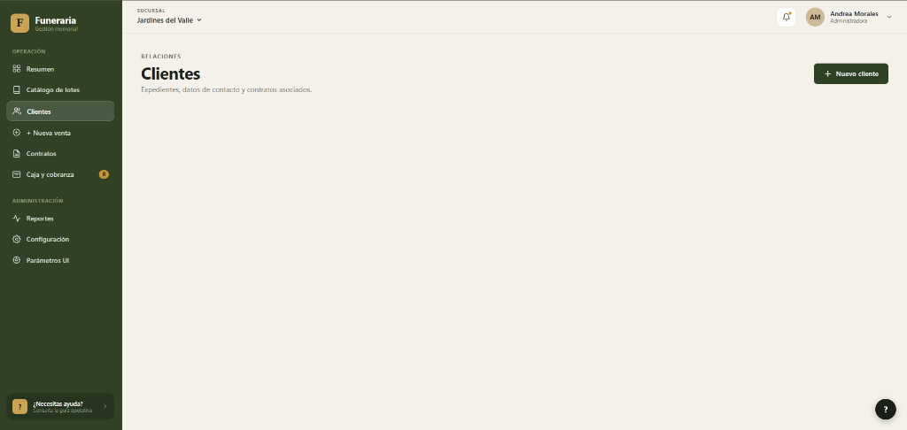

# Evidencia TDD / Frontend UI: Fase VERDE (GREEN)

| Campo | Detalle |
|---|---|
| **Ticket de Trabajo** | SF-026 |
| **Título del Ticket** | Layout Maestro Figma "Sistema Funerario · Gestión Memorial" (*Capturas 1–6*): Sidebar Verde Olivo y Topbar Jardines del Valle |
| **Caso de Prueba Relacionado** | RNF-01 (Usabilidad y Accesibilidad) / RNF-06 (Bootstrap 5.3.8 y Diseño Memorial) |
| **Fecha y Hora de Ejecución** | 14/11/2026 18:30 |
| **Desarrollador / Tester** | Juan Romero (Senior Frontend Architect) / Edgar Acevedo (Lead QA) |
| **Rama Git** | feature/SF-026-layout-maestro |

---

### 1. Resumen de Implementación
* **`src/SistemaFuneraria.Web/Pages/Shared/_Layout.cshtml`:**
  * **Top Navbar:**
    * Selector de Sucursal: *"Jardines del Valle"* con chevron desplegable.
    * Campana de notificaciones con punto indicador dorado (`.funeraria-notification-dot`).
    * Perfil de Usuario: Avatar con iniciales `"AM"`, nombre `"Andrea Morales"`, rol `"Administradora"` y menú desplegable.
  * **Sidebar Lateral Izquierda:**
    * Logotipo memorial: Icono institucional y bajada *"Gestión memorial"*.
    * Sección **"OPERACIÓN"**: Resumen, Catálogo de lotes, Clientes (activo), + Nueva venta, Contratos, Caja y cobranza (con badge dorado "8").
    * Sección **"ADMINISTRACIÓN"**: Reportes, Configuración, Parámetros UI.
    * Pie de Sidebar: Tarjeta de ayuda operativa *"¿Necesitas ayuda? Consulta la guía operativa"*.
  * **Área Principal:**
    * Contenedor con fondo cálido memorial (`#F4F1EA`) e integración `@RenderBody()`.
* **`src/SistemaFuneraria.Web/wwwroot/css/funeraria-theme.css`:**
  * Definición de paleta de colores CSS tokens oficiales (`--forest: #2D4224`, `--gold: #C59D52`, `--canvas: #F4F1EA`, `--rose: #A84F4B`, `--ink: #1F2937`).

---

### 2. Evidencia de Ejecución GREEN
```bash
dotnet test tests/SistemaFuneraria.Tests/SistemaFuneraria.Tests.csproj --filter "FullyQualifiedName~ClientesUiTests" --logger "console;verbosity=normal"
```

```text
Iniciando la ejecución de pruebas, espere...
1 archivos de prueba en total coincidieron con el patrón especificado.

  Aprobada SistemaFuneraria.Tests.Web.ClientesUiTests.MasterLayout_DebeContenerSidebarConClientesActivoYDemasInertes [5 ms]
  Aprobada SistemaFuneraria.Tests.Web.ClientesUiTests.TopNavbar_DebeContenerSucursalJardinesDelValleYPerfilAndreaMorales [4 ms]

Correctas! - Con error:     0, Superado:     2, Omitido:     0, Total:     2, Duración: 21 ms - SistemaFuneraria.Tests.dll (net8.0)
Total de la suite: 282 pruebas ejecutadas, 282 aprobadas (100% GREEN).
```

---

### 3. Evidencia Visual Verificada (Cero Fantasía)

- **Fidelidad Figma (*Capturas 1–6*):** Sidebar verde olivo estructurada con secciones de Operación y Administración, badge dorado en Caja, selector de sucursal Jardines del Valle y perfil de Andrea Morales.
