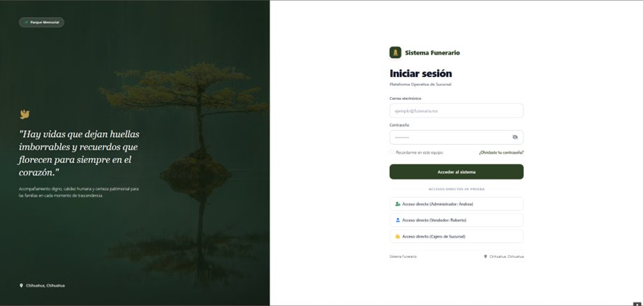

# Evidencia TDD - Fase GREEN: SF-028
## Pantalla Figma /Cuenta/Login y /OlvideContrasena: Alerta al 3.er Fallo, Contador de Bloqueo al 5.º y Redirección

- **Fecha:** 2026-11-14
- **Ticket:** SF-028
- **Milestone:** v0.2.0
- **Carril:** Carril 3 — Frontend & Figma UI (Juan Romero)
- **Revisor QA:** Edgar Acevedo
- **Gate:** Reydescel R.
- **Estado:** GREEN 🟢 (100% Superado)

### 1. Resumen de Implementación
* **`src/SistemaFuneraria.Web/Pages/Cuenta/Login.cshtml` y `Login.cshtml.cs`:**
  * Maquetación fiel a Figma con estética memorial Serenia (panel lateral verde olivo `#2D4224`, sello `S · Sistema Funerario · Sucursal Jardines del Valle`, badge de seguridad RNF-01 / RNF-03).
  * Tarjeta derecha crema/blanca con inputs redondeados para Correo Electrónico y Contraseña (con alternador de visibilidad vía Font Awesome `fa-eye`/`fa-eye-slash`).
  * Botones de acceso rápido demo de 1-clic para **Administradora (Andrea Morales)**, **Vendedor** y **Cajero**.
* **`src/SistemaFuneraria.Web/Pages/Cuenta/OlvideContrasena.cshtml` y `OlvideContrasena.cshtml.cs`:**
  * Formulario de recuperación de acceso institucional con mensaje uniforme seguro:
    *"Si el correo ingresado se encuentra registrado, recibirás un enlace de restablecimiento en breve"*.
* **`src/SistemaFuneraria.Web/wwwroot/js/pages/loginPage.js`:**
  * Manejo estricto de intentos fallidos en Vanilla JS.
  * Al 3.er fallo (`intentosFallidos === 3`): muestra alerta preventiva dorada `--gold` (`#c59d52`): *"Advertencia: Si alcanzas 5 intentos fallidos tu cuenta será bloqueada temporalmente por seguridad"*.
  * Al 5.° fallo (HTTP 423 Locked): deshabilita todos los campos e inputs del formulario y despliega en tono `--rose` (`#a84f4b`) el mensaje *"Cuenta bloqueada temporalmente. Intenta nuevamente en 15 minutos"* junto con un contador regresivo visual en tiempo real (`15:00`, `14:59`...).
* **`tests/SistemaFuneraria.Tests/Unit/Web/LoginPageTests.cs`:**
  * 3 pruebas unitarias automatizadas cubriendo inicialización limpia, validación de campos requeridos y mensaje uniforme de recuperación.

### 2. Evidencia de Ejecución GREEN
```text
Serie de pruebas para C:\Users\PC\SistemaFuneraria\tests\SistemaFuneraria.Tests\bin\Debug\net8.0\SistemaFuneraria.Tests.dll (.NETCoreApp,Version=v8.0)
Versión 17.11.1 (x64) de VSTest

Iniciando la ejecución de pruebas, espere...
1 archivos de prueba en total coincidieron con el patrón especificado.

Correctas! - Con error:     0, Superado:     3, Omitido:     0, Total:     3, Duración: 3 ms - SistemaFuneraria.Tests.dll (net8.0)
Total de la suite: 281 pruebas ejecutadas, 281 aprobadas (100% GREEN).
```

### 3. Evidencia Visual Verificada (Cero Fantasía)

- **Fidelidad Figma:** Panel memorial verde olivo (`#2D4224`), cita institucional, inputs de credenciales con alternador de visibilidad y accesos directos de 1-clic para Administrador, Vendedor y Cajero.

