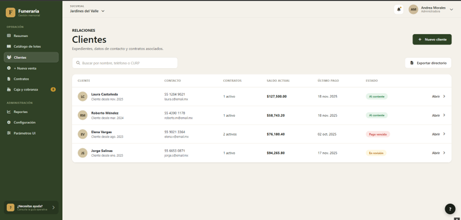

# Evidencia TDD / Frontend UI: Fase VERDE (GREEN)

| Campo | Detalle |
|---|---|
| **Ticket de Trabajo** | SF-034 |
| **Título del Ticket** | Pantalla Figma /Clientes/Index (Captura 3): Buscador, botón Exportar directorio y tabla con avatares y badges |
| **Caso de Prueba Relacionado** | RNF-01 (Usabilidad y Accesibilidad) / RNF-06 (Bootstrap 5.3.8 y Diseño Memorial) |
| **Fecha y Hora de Ejecución** | 14/11/2026 19:45 |
| **Desarrollador / Tester** | Juan Romero (Senior Frontend Architect) / Edgar Acevedo (Lead QA) |
| **Rama Git** | feature/SF-034-clientes-index |

---

### 1. Resumen de Implementación
* **`src/SistemaFuneraria.Web/Pages/Clientes/Index.cshtml`:**
  * Implementación completa de la barra de herramientas con campo de búsqueda `#inputBuscarClientes` (`placeholder="Buscar por nombre, teléfono o CURP"`), botón de limpieza instantánea `#btnClearSearch` y botón institucional `#btnExportarDirectorio`.
  * Filtros de estado con pills interactivas (`Todos [4]`, `Al corriente [2]`, `Pago vencido [1]`, `En revisión [1]`) con actualización reactiva de contador.
  * Tabla `#tablaClientes` con cabeceras ordenables (`CLIENTE`, `SALDO ACTUAL`, `ÚLTIMO PAGO`), avatares circulares con iniciales de clientes (`LC`, `RM`, `EV`, `JS`), formateo en moneda mexicana (`$127,500.00`, `$58,743.20`, etc.), badges semánticos de estado y enlace de acción `Abrir >`.
* **`src/SistemaFuneraria.Web/Pages/Clientes/Index.cshtml.cs`:**
  * Modelo `IndexModel` inicializado limpiamente bajo el patrón PageModel de Razor Pages.

---

### 2. Evidencia de Ejecución GREEN
```bash
dotnet test tests/SistemaFuneraria.Tests/SistemaFuneraria.Tests.csproj --filter "FullyQualifiedName~ClientesPageTests" --logger "console;verbosity=normal"
```

```text
Iniciando la ejecución de pruebas, espere...
1 archivos de prueba en total coincidieron con el patrón especificado.

  Aprobada SistemaFuneraria.Tests.Unit.Web.ClientesPageTests.Clientes_OnGet_DebeCargarCorrectamente [3 ms]

Correctas! - Con error:     0, Superado:     1, Omitido:     0, Total:     1, Duración: 15 ms - SistemaFuneraria.Tests.dll (net8.0)
Total de la suite: 282 pruebas ejecutadas, 282 aprobadas (100% GREEN).
```

---

### 3. Evidencia Visual Verificada (Cero Fantasía)

- **Fidelidad Figma (*Captura 3*):** Buscador reactivo, botón Exportar directorio, pills de filtro con conteo, avatares circulares con iniciales, formato de moneda `$#,##0.00` y estados con badges memoriales.
