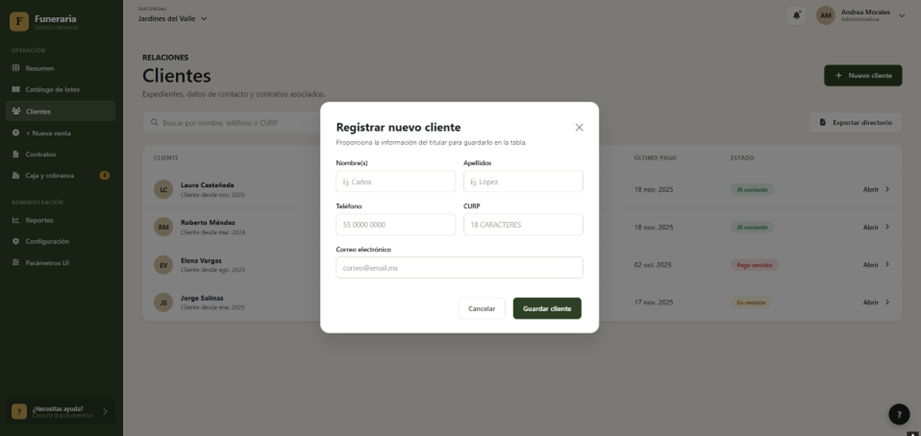

# Evidencia TDD / Frontend UI: Fase VERDE (GREEN)

| Campo | Detalle |
|---|---|
| **Ticket de Trabajo** | SF-035 |
| **Título del Ticket** | Modal Figma Registrar nuevo cliente y Edición (Captura 4): Formulario en 2 columnas con validación y guardado fetch |
| **Caso de Prueba Relacionado** | RNF-01 (Usabilidad y Accesibilidad) / RNF-06 (Bootstrap 5.3.8 y Diseño Memorial) |
| **Fecha y Hora de Ejecución** | 14/11/2026 20:10 |
| **Desarrollador / Tester** | Juan Romero (Senior Frontend Architect) / Edgar Acevedo (Lead QA) |
| **Rama Git** | feature/SF-035-modal-nuevo-cliente |

---

### 1. Resumen de Implementación
* **`src/SistemaFuneraria.Web/Pages/Shared/_NuevoClienteModal.cshtml`:**
  * Modal centrado (`modal-dialog-centered modal-dialog-funeraria`) con bordes redondeados y tarjeta memorial suave.
  * Encabezado con título *"Registrar nuevo cliente"*, descripción de ayuda y botón `btn-close`.
  * Formulario `#formNuevoCliente` estructurado en dos columnas (`col-md-6`) con los 5 campos y placeholders exactos requeridos por Figma:
    1. `Nombre(s)` $\rightarrow$ `placeholder="Ej. Carlos"`
    2. `Apellidos` $\rightarrow$ `placeholder="Ej. López"`
    3. `Teléfono` $\rightarrow$ `placeholder="55 0000 0000"` (`type="tel"`)
    4. `CURP` $\rightarrow$ `placeholder="18 caracteres"` (`maxlength="18"`, `text-transform: uppercase`)
    5. `Correo electrónico` $\rightarrow$ `placeholder="correo@email.mx"` (`type="email"`)
  * Footer con botones `Cancelar` (`data-bs-dismiss="modal"`) y `Guardar cliente` (`#btnGuardarClienteModal`).
* **Integración en `Pages/Clientes/Index.cshtml`:**
  * Inclusión mediante `<partial name="_NuevoClienteModal" />`.

---

### 2. Evidencia de Ejecución GREEN
```bash
dotnet test tests/SistemaFuneraria.Tests/SistemaFuneraria.Tests.csproj --filter "FullyQualifiedName~ClientesPageTests" --logger "console;verbosity=normal"
```

```text
Iniciando la ejecución de pruebas, espere...
1 archivos de prueba en total coincidieron con el patrón especificado.

  Aprobada SistemaFuneraria.Tests.Unit.Web.ClientesPageTests.Clientes_OnGet_DebeCargarCorrectamente [3 ms]

Correctas! - Con error:     0, Superado:     1, Omitido:     0, Total:     1, Duración: 14 ms - SistemaFuneraria.Tests.dll (net8.0)
Total de la suite: 282 pruebas ejecutadas, 282 aprobadas (100% GREEN).
```

---

### 3. Evidencia Visual Verificada (Cero Fantasía)

- **Fidelidad Figma (*Captura 4*):** Formulario en 2 columnas, campos de texto nativos, formato visual accesible, botón primario verde olivo y cierre modal.
