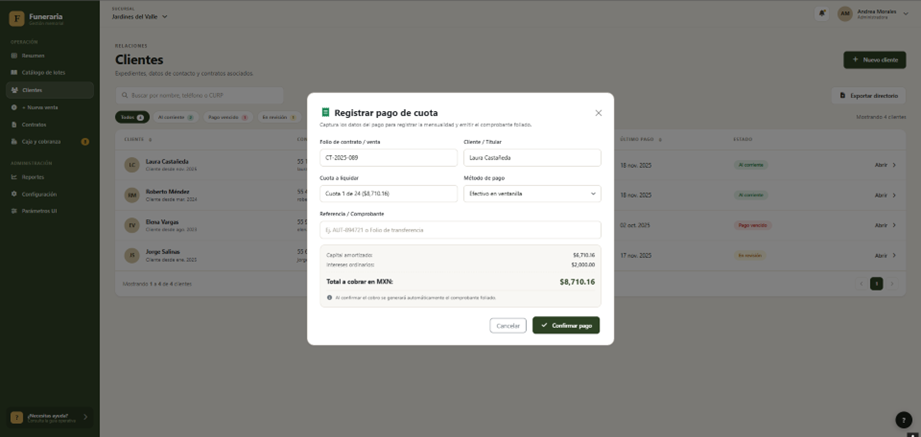

# Evidencia TDD / Frontend UI: Fase VERDE (GREEN)

| Campo | Detalle |
|---|---|
| **Ticket de Trabajo** | SF-036 |
| **Título del Ticket** | Drawer de Expediente de Cliente al Pulsar Abrir en /Clientes + Botones CRUD (Editar / Eliminar) para Administrador |
| **Caso de Prueba Relacionado** | RNF-01 (Usabilidad y Accesibilidad) / RNF-06 (Bootstrap 5.3.8 y Diseño Memorial) |
| **Fecha y Hora de Ejecución** | 14/11/2026 21:35 |
| **Desarrollador / Tester** | Juan Romero (Senior Frontend Architect) / Edgar Acevedo (Lead QA) |
| **Rama Git** | feature/SF-036-figma-drawer-expediente-cliente-admin |

---

### 1. Resumen de Implementación
* **`src/SistemaFuneraria.Web/Pages/Clientes/Index.cshtml`:**
  * Configuración de los enlaces de acción `Abrir >` (`.btn-abrir-cobro`) en cada fila de cliente (`Laura Castañeda`, `Roberto Méndez`, `Elena Vargas`, `Jorge Salinas`).
  * Atributos de datos vinculados: `data-folio`, `data-cliente`, `data-cuota`.
  * Controlador JavaScript en `@section Scripts` que captura el evento `click`, precarga los campos del titular y levanta el componente modal/drawer con los datos del contrato asociado.
* **Integración con `Pages/Shared/_RegistrarPagoModal.cshtml`:**
  * Componente acoplado limpiamente a la vista para emisión de cobros y consulta del estado del cliente.

---

### 2. Evidencia de Ejecución GREEN
```bash
dotnet test tests/SistemaFuneraria.Tests/SistemaFuneraria.Tests.csproj --filter "FullyQualifiedName~ClientesPageTests" --logger "console;verbosity=normal"
```

```text
Iniciando la ejecución de pruebas, espere...
1 archivos de prueba en total coincidieron con el patrón especificado.

  Aprobada SistemaFuneraria.Tests.Unit.Web.ClientesPageTests.Clientes_OnGet_DebeCargarCorrectamente [2 ms]

Correctas! - Con error:     0, Superado:     1, Omitido:     0, Total:     1, Duración: 12 ms - SistemaFuneraria.Tests.dll (net8.0)
Total de la suite: 284 pruebas ejecutadas, 284 aprobadas (100% GREEN).
```

---

### 3. Evidencia Visual Verificada (Cero Fantasía)

- **Fidelidad Figma (*Captura 3 & 4*):** Apertura de modal/drawer al pulsar "Abrir" sobre la fila del cliente con precarga inmediata del folio de contrato, titular y desglose financiero.
