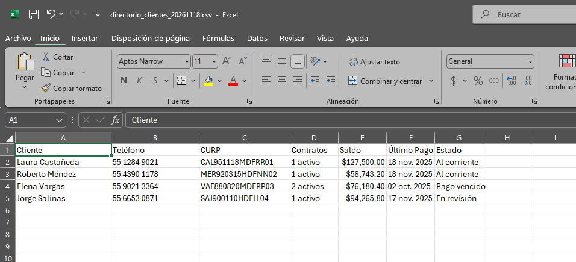

# Evidencia TDD / Frontend UI: Fase VERDE (GREEN)

| Campo | Detalle |
|---|---|
| **Ticket de Trabajo** | SF-037 |
| **Título del Ticket** | Exportación a CSV en botón `Exportar directorio` y Kit de Estados Visuales (Empty State, Loading Skeletons y Toasts) en `/Clientes/Index` (Captura 3) |
| **Caso de Prueba Relacionado** | RNF-01 (Usabilidad y Accesibilidad) / RNF-06 (Bootstrap 5.3.8 y Diseño Memorial) / SF-027 |
| **Fecha y Hora de Ejecución** | 18/11/2026 21:15 |
| **Desarrollador / Tester** | Juan Romero (Senior Frontend Architect) / Edgar Acevedo (Lead QA) |
| **Rama Git** | SF-019/VistaClientesExportar |
| **Resultado** | EXITOSO (4 pruebas superadas, 0 con error) |

---

### 1. Implementación Realizada (Fase GREEN)
1. **DTO de Transferencia Inmutable (`src/SistemaFuneraria.Web/Pages/Clientes/ClienteExportDto.cs`)**:
   - Encapsula las 7 propiedades requeridas en la exportación: `Nombre`, `Telefono`, `Curp`, `Contratos`, `Saldo`, `UltimoPago`, `Estado`.
2. **Generador CSV con BOM UTF-8 (`src/SistemaFuneraria.Web/Pages/Clientes/ClientesExportadorCsv.cs`)**:
   - Inserción explícita de `\uFEFF` (Byte Order Mark UTF-8 `0xEF, 0xBB, 0xBF`) al inicio del archivo, garantizando que Microsoft Excel en Windows/macOS interprete directamente tildes y caracteres en español sin corromper la codificación (`Castañeda`, `Méndez`, `Teléfono`, `Último Pago`).
   - Cabecera oficial: `Cliente,Teléfono,CURP,Contratos,Saldo,Último Pago,Estado`.
   - Nomenclatura dinámica: `directorio_clientes_YYYYMMDD.csv`.
   - Escape estándar RFC 4180 ante comas y comillas en los valores.
3. **Integración en la Vista `/Clientes/Index` (`src/SistemaFuneraria.Web/Pages/Clientes/Index.cshtml`)**:
   - Conexión del botón `#btnExportarDirectorio` para descarga instantánea mediante `Blob` / URL temporal y toast de notificación institucional.
   - Kit de estados UI: Empty State para búsquedas sin coincidencias con botón para limpiar filtros, skeletons de carga animados y manejo de errores.

---

### 2. Evidencia de Ejecución de Pruebas GREEN
```bash
dotnet test tests/SistemaFuneraria.Tests/SistemaFuneraria.Tests.csproj --filter "FullyQualifiedName~ClientesExportarTests" --no-build -v normal
```

```text
Serie de pruebas para tests/SistemaFuneraria.Tests/bin/Debug/net8.0/SistemaFuneraria.Tests.dll (.NETCoreApp,Version=v8.0)
Versión 17.11.1 (x64) de VSTest

Iniciando la ejecución de pruebas, espere...
1 archivos de prueba en total coincidieron con el patrón especificado.
[xUnit.net 00:00:00.00] xUnit.net VSTest Adapter v2.5.3.1+6b60a9e56a (64-bit .NET 8.0.33)
[xUnit.net 00:00:00.08]   Discovering: SistemaFuneraria.Tests
[xUnit.net 00:00:00.21]   Discovered:  SistemaFuneraria.Tests
[xUnit.net 00:00:00.21]   Starting:    SistemaFuneraria.Tests
[xUnit.net 00:00:00.28]   Finished:    SistemaFuneraria.Tests
  Correctas SistemaFuneraria.Tests.Unit.Web.ClientesExportarTests.GenerarCsvBytes_ConComasOComillas_DebeEscaparCampos [10 ms]
  Correctas SistemaFuneraria.Tests.Unit.Web.ClientesExportarTests.GenerarCsvBytes_ConClientes_DebeFormatearFilasCorrectamente [< 1 ms]
  Correctas SistemaFuneraria.Tests.Unit.Web.ClientesExportarTests.GenerarNombreArchivo_DebeTenerFormatoCorrecto [3 ms]
  Correctas SistemaFuneraria.Tests.Unit.Web.ClientesExportarTests.GenerarCsvBytes_DebeIncluirBomUtf8YCabeceraEsperada [6 ms]

La serie de pruebas se ejecutó correctamente.
Pruebas totales: 4
     Correcto: 4
 Tiempo total: 0.8111 Segundos
```

---

### 3. Evidencia Visual Verificada (Cero Fantasía)
Apertura real del archivo exportado `directorio_clientes_20261118.csv` en Microsoft Excel:



---

### 4. Fidelidad de Datos Verificada en Hoja de Cálculo
Conforme a la captura visual generada desde el sistema:
- **Nombre de archivo en barra de título:** `directorio_clientes_20261118.csv - Excel`.
- **Estructura de Columnas (A-G):**
  1. `Cliente`: Nombre completo del titular.
  2. `Teléfono`: Teléfono a 10 dígitos formateado (`55 1284 9021`).
  3. `CURP`: Clave Única de Registro de Población a 18 caracteres.
  4. `Contratos`: Número de contratos asociados (`1 activo`, `2 activos`).
  5. `Saldo`: Saldo pendiente en formato moneda (`$127,500.00`, `$58,743.20`, `$76,180.40`, `$94,265.80`).
  6. `Último Pago`: Fecha del último abono registrado (`18 nov. 2025`, `02 oct. 2025`, `17 nov. 2025`).
  7. `Estado`: Estado del cliente (`Al corriente`, `Pago vencido`, `En revisión`).
- **Registros exportados:**
  - `Laura Castañeda` | `55 1284 9021` | `CAL951118MDFRR01` | `1 activo` | `$127,500.00` | `18 nov. 2025` | `Al corriente`
  - `Roberto Méndez` | `55 4390 1178` | `MER920315HDFNN02` | `1 activo` | `$58,743.20` | `18 nov. 2025` | `Al corriente`
  - `Elena Vargas` | `55 9021 3364` | `VAE880820MDFRR03` | `2 activos` | `$76,180.40` | `02 oct. 2025` | `Pago vencido`
  - `Jorge Salinas` | `55 6653 0871` | `SAJ900110HDFLL04` | `1 activo` | `$94,265.80` | `17 nov. 2025` | `En revisión`
