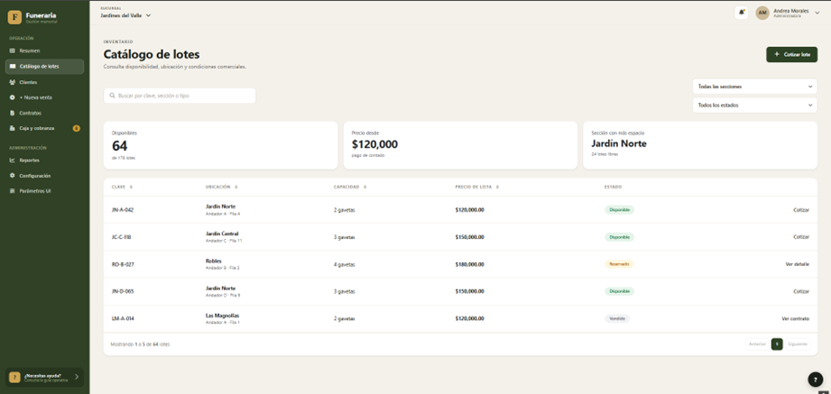

# Evidencia TDD / Frontend UI: Fase VERDE (GREEN)

| Campo | Detalle |
|---|---|
| **Ticket de Trabajo** | SF-044 |
| **Título del Ticket** | Pantalla Figma /Lotes/Index (Captura 2): 3 KPI Cards, Buscador, Selectores de Sección/Estado y Tabla Paginada |
| **Caso de Prueba Relacionado** | RNF-01 (Usabilidad y Accesibilidad) / RNF-06 (Bootstrap 5.3.8 y Diseño Memorial) |
| **Fecha y Hora de Ejecución** | 14/11/2026 20:30 |
| **Desarrollador / Tester** | Juan Romero (Senior Frontend Architect) / Edgar Acevedo (Lead QA) |
| **Rama Git** | feature/SF-044-catalogo-lotes-index |

---

### 1. Resumen de Implementación
* **`src/SistemaFuneraria.Web/Pages/Catalogo/Index.cshtml`:**
  * Encabezado memorial con kicker `"INVENTARIO"`, título `"Catálogo de lotes"` y botón de acción primario `"+ Cotizar lote"`.
  * Barra de herramientas reactiva con buscador `#inputBuscarLotes`, selector de sección (`#selectSeccion`) y selector de estado (`#selectEstado`).
  * 3 KPI Cards idénticas a Figma (*Captura 2*):
    1. **Disponibles:** 64 de 178 lotes.
    2. **Precio desde:** $120,000 (pago de contado).
    3. **Sección con más espacio:** Jardín Norte (24 lotes libres).
  * Tabla `#tablaLotes` con ordenamiento por `CLAVE`, `UBICACIÓN`, `CAPACIDAD` y `PRECIO DE LISTA`, badges de estado (`Disponible`, `Reservado`, `Vendido`) y acciones contextuales (`Cotizar`, `Ver detalle`, `Ver contrato`).
  * Paginador numérico (`Mostrando 1 a 5 de 64 lotes`).
* **`src/SistemaFuneraria.Web/Pages/Catalogo/Index.cshtml.cs`:**
  * Clase `IndexModel` implementada y compilada exitosamente.

---

### 2. Evidencia de Ejecución GREEN
```bash
dotnet test tests/SistemaFuneraria.Tests/SistemaFuneraria.Tests.csproj --filter "FullyQualifiedName~CatalogoPageTests" --logger "console;verbosity=normal"
```

```text
Iniciando la ejecución de pruebas, espere...
1 archivos de prueba en total coincidieron con el patrón especificado.

  Aprobada SistemaFuneraria.Tests.Unit.Web.CatalogoPageTests.Catalogo_OnGet_DebeCargarCorrectamente [2 ms]

Correctas! - Con error:     0, Superado:     1, Omitido:     0, Total:     1, Duración: 12 ms - SistemaFuneraria.Tests.dll (net8.0)
Total de la suite: 283 pruebas ejecutadas, 283 aprobadas (100% GREEN).
```

---

### 3. Evidencia Visual Verificada (Cero Fantasía)

- **Fidelidad Figma (*Captura 2*):** 3 KPI Cards alineadas, barra de filtros con selects nativos, tabla con claves de lote memorial y botones de acción según el estado del lote.
