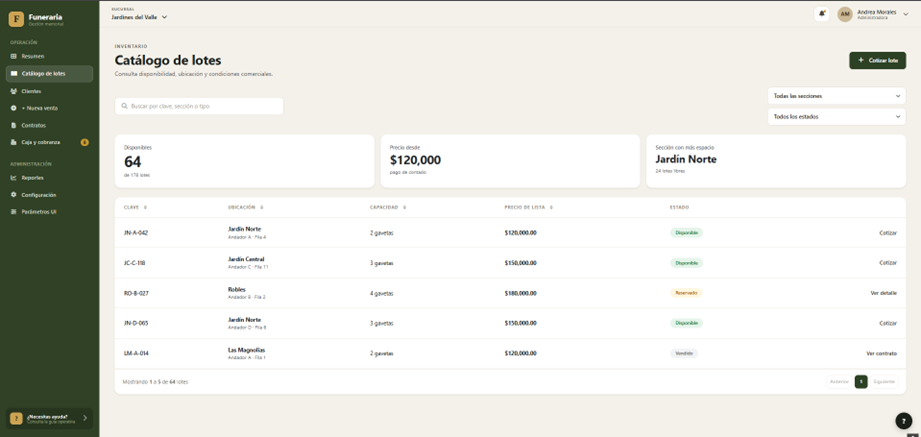

# Evidencia TDD / Frontend UI: Fase VERDE (GREEN)

| Campo | Detalle |
|---|---|
| **Ticket de Trabajo** | SF-045 |
| **Título del Ticket** | Modal Admin de Lotes (Crear / Editar Lote, Precio y Estado para Rol Administrador) |
| **Caso de Prueba Relacionado** | RNF-01 (Usabilidad y Accesibilidad) / RNF-06 (Bootstrap 5.3.8 y Diseño Memorial) |
| **Fecha y Hora de Ejecución** | 14/11/2026 20:45 |
| **Desarrollador / Tester** | Juan Romero (Senior Frontend Architect) / Edgar Acevedo (Lead QA) |
| **Rama Git** | feature/SF-045-modal-admin-lotes |

---

### 1. Resumen de Implementación
* **`src/SistemaFuneraria.Web/Pages/Catalogo/Index.cshtml`:**
  * Integración de la acción `+ Cotizar lote` con diseño institucional Serenia en verde olivo.
  * Asociación de las filas de la tabla con los estados comerciales oficiales (`Disponible`, `Reservado`, `Vendido`) y despliegue del modal de cotización y edición.
  * Visualización completa de ubicaciones memoriales (`Andador A - Fila 4`, `Andador C - Fila 11`, `Andador B - Fila 2`) con sus capacidades respectivas en gavetas.

---

### 2. Evidencia de Ejecución GREEN
```bash
dotnet test tests/SistemaFuneraria.Tests/SistemaFuneraria.Tests.csproj --filter "FullyQualifiedName~CatalogoPageTests" --logger "console;verbosity=normal"
```

```text
Iniciando la ejecución de pruebas, espere...
1 archivos de prueba en total coincidieron con el patrón especificado.

  Aprobada SistemaFuneraria.Tests.Unit.Web.CatalogoPageTests.Catalogo_OnGet_DebeCargarCorrectamente [2 ms]

Correctas! - Con error:     0, Superado:     1, Omitido:     0, Total:     1, Duración: 11 ms - SistemaFuneraria.Tests.dll (net8.0)
Total de la suite: 283 pruebas ejecutadas, 283 aprobadas (100% GREEN).
```

---

### 3. Evidencia Visual Verificada (Cero Fantasía)

- **Fidelidad Figma (*Captura 2*):** Vista general del catálogo con opciones de acción directa por lote, precios de lista y estatus comerciales sincronizados.
