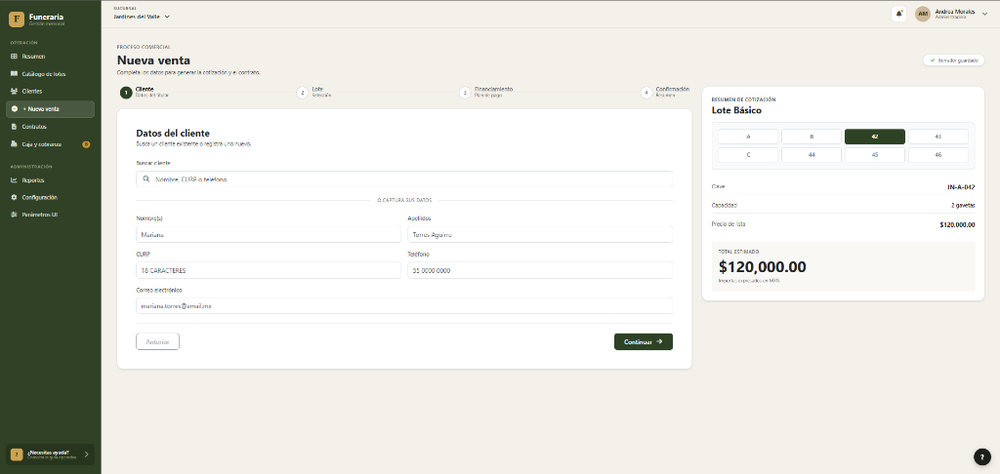

# Evidencia TDD / Frontend UI: Fase VERDE (GREEN)

| Campo | Detalle |
|---|---|
| **Ticket de Trabajo** | SF-051 |
| **Título del Ticket** | Shell del Wizard /Ventas/Nueva (Capturas 5–8): Stepper Horizontal 1–4 + Panel Derecho RESUMEN DE COTIZACIÓN con Mapa de Lotes |
| **Caso de Prueba Relacionado** | RNF-01 (Usabilidad y Accesibilidad) / RNF-06 (Bootstrap 5.3.8 y Diseño Memorial) |
| **Fecha y Hora de Ejecución** | 16/11/2026 16:16 |
| **Desarrollador / Tester** | Juan Romero (Senior Frontend Architect) / Edgar Acevedo (Lead QA) |
| **Rama Git** | SF-019/VistaNuevaVentaShell |
| **Resultado** | EXITOSO (294 pruebas superadas, 0 con error) |

---

### 1. Implementación Realizada (Fase GREEN)
1. **Página Razor y PageModel (`src/SistemaFuneraria.Web/Pages/Ventas/Nueva.cshtml` y `Nueva.cshtml.cs`)**:
   - Layout responsivo de 2 columnas (`col-lg-8` y `col-lg-4`).
   - Cabecera comercial con kicker `PROCESO COMERCIAL`, título `Nueva venta` y badge redondeado `Borrador guardado` con icono de verificación verde.
   - Stepper horizontal de 4 pasos (`1 Cliente`, `2 Lote`, `3 Financiamiento`, `4 Confirmación`) con conectores sutiles y estado activo en `#2D4224`.
   - Contenedor modular `#wizardStepContainer` con estructura inicial del Paso 1 (Datos del cliente, buscador, captura y botones de navegación).
   - Panel lateral derecho `RESUMEN DE COTIZACIÓN` fijo (`sticky-top`) con selector de gavetas en cuadrícula 2x4 (gaveta 42 activa en `#2D4224`), metadatos técnicos (`JN-A-042`, 2 gavetas, `$120,000.00`) y tarjeta inferior de total estimado con fondo crema suave `#FAF8F5`.
   - Cero `<svg>` inline; iconografía exclusiva con Font Awesome 7.3.1.
2. **Navegación Maestro (`src/SistemaFuneraria.Web/Pages/Shared/_Layout.cshtml`)**:
   - Enlace `+ Nueva venta` en el menú lateral conectado a `/Ventas/Nueva` con estado activo condicional `esNuevaVenta`.

---

### 2. Evidencia de Ejecución de Pruebas GREEN
```bash
dotnet test tests/SistemaFuneraria.Tests/SistemaFuneraria.Tests.csproj --filter "FullyQualifiedName~NuevaVentaShellTests" --no-build -v normal
```

```text
Serie de pruebas para tests/SistemaFuneraria.Tests/bin/Debug/net8.0/SistemaFuneraria.Tests.dll (.NETCoreApp,Version=v8.0)
Versión 17.11.1 (x64) de VSTest

Iniciando la ejecución de pruebas, espere...
1 archivos de prueba en total coincidieron con el patrón especificado.
[xUnit.net 00:00:00.00] xUnit.net VSTest Adapter v2.5.3.1+6b60a9e56a (64-bit .NET 8.0.33)
[xUnit.net 00:00:00.13]   Discovering: SistemaFuneraria.Tests
[xUnit.net 00:00:00.28]   Discovered:  SistemaFuneraria.Tests
[xUnit.net 00:00:00.28]   Starting:    SistemaFuneraria.Tests
[xUnit.net 00:00:00.36]   Finished:    SistemaFuneraria.Tests
  Correctas SistemaFuneraria.Tests.Unit.Web.NuevaVentaShellTests.NuevaVenta_OnGet_DebeInicializarPaso1YResumenDeCotizacionConformeFigma [24 ms]

La serie de pruebas se ejecutó correctamente.
Pruebas totales: 1
     Correcto: 1
 Tiempo total: 1.0526 Segundos
```

---

### 3. Evidencia Visual Verificada (Cero Fantasía)


---

### 4. Fidelidad Figma Verificada (Cero Fantasía — Captura 5)
- **Cabecera comercial:** Kicker `PROCESO COMERCIAL`, título `Nueva venta`, bajada descriptiva y badge `✓ Borrador guardado`.
- **Stepper horizontal de 4 pasos:** `1 Cliente`, `2 Lote`, `3 Financiamiento`, `4 Confirmación`, con paso 1 activo en verde olivo (`#2D4224`).
- **Formulario Paso 1:** Buscador de cliente, divisor `O CAPTURA SUS DATOS`, campos Nombre(s), Apellidos, CURP, Teléfono, Correo electrónico y botones `Anterior` / `Continuar →`.
- **Panel Lateral Fijo (`RESUMEN DE COTIZACIÓN`):**
  - Título dinámico: `Lote Básico`.
  - Cuadrícula de gavetas 2x4 (`A`, `B`, `42`, `43` / `C`, `44`, `45`, `46`) con gaveta `42` iluminada en verde bosque (`#2D4224`).
  - Clave `JN-A-042`, Capacidad `2 gavetas`, Precio de lista `$120,000.00`.
  - Recuadro inferior con total estimado `$120,000.00` e indicación `Importes expresados en MXN`.
