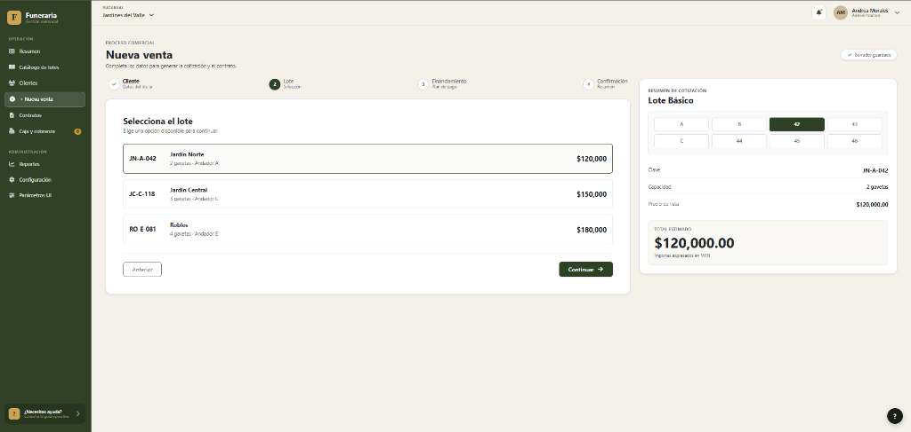

# Evidencia TDD / Frontend UI: Fase VERDE (GREEN)

| Campo | Detalle |
|---|---|
| **Ticket de Trabajo** | SF-053 |
| **Título del Ticket** | Wizard Paso 2 (Lote — Captura 6: Tarjetas de Selección de Lote y Sincronización con Panel Derecho) |
| **Caso de Prueba Relacionado** | RNF-01 (Usabilidad y Accesibilidad) / RNF-06 (Bootstrap 5.3.8 y Diseño Memorial) |
| **Fecha y Hora de Ejecución** | 16/11/2026 16:56 |
| **Desarrollador / Tester** | Juan Romero (Senior Frontend Architect) / Edgar Acevedo (Lead QA) |
| **Rama Git** | SF-019/VistaNuevaVentaPaso2 |
| **Resultado** | EXITOSO (299 pruebas superadas, 0 con error) |

---

### 1. Implementación Realizada (Fase GREEN)
1. **Vista Parcial Modular (`src/SistemaFuneraria.Web/Pages/Ventas/Partials/_Paso2Lote.cshtml`)**:
   - Tarjeta blanca con esquinas redondeadas (`bg-white rounded-4 shadow-sm border p-4 p-md-5`).
   - Título `Selecciona el lote` y subtítulo explicativo.
   - Lista interactiva de 3 tarjetas de lotes conforme a la Captura 6 de Figma:
     - `JN-A-042` | Jardín Norte (`2 gavetas · Andador A`) | `$120,000` (Seleccionada por defecto con borde institucional `#2D4224`).
     - `JC-C-118` | Jardín Central (`3 gavetas · Andador C`) | `$150,000`.
     - `RO-E-081` | Robles (`4 gavetas · Andador E`) | `$180,000`.
   - Botón `Anterior` (`#btnAnteriorPaso2`) para regresar al Paso 1 conservando los datos capturados.
   - Botón `Continuar →` (`#btnContinuarPaso2`) para avanzar al Paso 3 en el Stepper horizontal.
2. **Lógica de Selección y Sincronización Frontend (`src/SistemaFuneraria.Web/wwwroot/js/ventas/paso2Lote.js`)**:
   - Resaltado reactivo de tarjeta activa en verde bosque `#2D4224` y fondo `#FAFBF9`.
   - Sincronización en tiempo real del panel derecho `RESUMEN DE COTIZACIÓN`: título de lote, clave, capacidad, precio de lista, total estimado e iluminación de la gaveta en la cuadrícula 2x4.
   - Persistencia automática de selección en `sessionStorage` (`sf_nueva_venta_draft`) y emisión del evento `sf:draft-updated`.
3. **Catálogo y Modelo DTO (`src/SistemaFuneraria.Web/Pages/Ventas/LoteOpcionesCatalogo.cs`)**:
   - Clases `LoteOpcionDto` y `LoteOpcionesCatalogo` con los 3 lotes de la Captura 6 de Figma.
4. **Integración en Vista Maestro (`src/SistemaFuneraria.Web/Pages/Ventas/Nueva.cshtml`)**:
   - Inyección modular de `_Paso2Lote.cshtml` y script `paso2Lote.js`.

---

### 2. Evidencia de Ejecución de Pruebas GREEN
```bash
dotnet test tests/SistemaFuneraria.Tests/SistemaFuneraria.Tests.csproj --filter "FullyQualifiedName~Paso2LoteTests" --no-build -v normal
```

```text
Serie de pruebas para C:\Users\PC\SistemaFuneraria\tests\SistemaFuneraria.Tests\bin\Debug\net8.0\SistemaFuneraria.Tests.dll (.NETCoreApp,Version=v8.0)
Versión 17.11.1 (x64) de VSTest

Iniciando la ejecución de pruebas, espere...
1 archivos de prueba en total coincidieron con el patrón especificado.
[xUnit.net 00:00:00.00] xUnit.net VSTest Adapter v2.5.3.1+6b60a9e56a (64-bit .NET 8.0.33)
[xUnit.net 00:00:00.08]   Discovering: SistemaFuneraria.Tests
[xUnit.net 00:00:00.20]   Discovered:  SistemaFuneraria.Tests
[xUnit.net 00:00:00.20]   Starting:    SistemaFuneraria.Tests
[xUnit.net 00:00:00.27]   Finished:    SistemaFuneraria.Tests
  Correctas SistemaFuneraria.Tests.Unit.Web.Paso2LoteTests.ObtenerOpcionesLotes_DebeRetornarTresOpcionesFigmaCaptura6 [14 ms]
  Correctas SistemaFuneraria.Tests.Unit.Web.Paso2LoteTests.BuscarPorClave_ConClaveExistente_DebeRetornarLoteCorrecto [2 ms]

La serie de pruebas se ejecutó correctamente.
Pruebas totales: 2
     Correcto: 2
 Tiempo total: 0.8098 Segundos
```

---

### 3. Evidencia Visual Verificada (Cero Fantasía)


---

### 4. Fidelidad Figma Verificada (Cero Fantasía — Captura 6)
- **Cabecera comercial:** Kicker `PROCESO COMERCIAL`, título `Nueva venta` y pill `✓ Borrador guardado`.
- **Stepper horizontal de 4 pasos:**
  - Paso 1 `Cliente` marcado como completado con checkmark `✓`.
  - Paso 2 `Lote · Selección` activo en círculo verde bosque institucional (`#2D4224`).
  - Pasos 3 `Financiamiento` y 4 `Confirmación` pendientes.
- **Tarjeta Central de Selección:**
  - Título `Selecciona el lote` / Subtítulo `Elige una opción disponible para continuar.`
  - 3 tarjetas horizontales interactivas:
    1. `JN-A-042` | Jardín Norte (`2 gavetas · Andador A`) | `$120,000` (Activa por defecto con borde `#2D4224` y fondo sutil `#FAFBF9`).
    2. `JC-C-118` | Jardín Central (`3 gavetas · Andador C`) | `$150,000`.
    3. `RO-E-081` | Robles (`4 gavetas · Andador E`) | `$180,000`.
  - Botones inferiores `Anterior` (regresa al Paso 1 conservando titular) y `Continuar →` (avanza al Paso 3).
- **Panel Lateral Fijo (`RESUMEN DE COTIZACIÓN`):**
  - Sincronización en tiempo real: al seleccionar un lote, se actualiza el tipo (`Lote Básico`), la cuadrícula 2x4 con la celda correspondiente iluminada (`42`), la clave (`JN-A-042`), capacidad (`2 gavetas`), precio de lista y el `TOTAL ESTIMADO` (`$120,000.00`).
