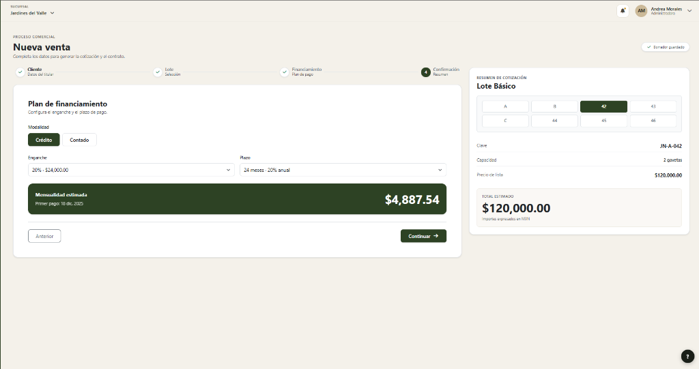

# Evidencia TDD / Frontend UI: Fase VERDE (GREEN)

| Campo | Detalle |
|---|---|
| **Ticket de Trabajo** | SF-054 |
| **Título del Ticket** | Wizard Paso 3 (Financiamiento — Captura 7: Toggle Crédito/Contado, Selects Enganche/Plazo y Banner Verde Mensualidad Estimada $4,887.54) |
| **Caso de Prueba Relacionado** | RNF-01 (Usabilidad y Accesibilidad) / RNF-06 (Bootstrap 5.3.8 y Diseño Memorial) |
| **Fecha y Hora de Ejecución** | 16/11/2026 17:08 |
| **Desarrollador / Tester** | Juan Romero (Senior Frontend Architect) / Edgar Acevedo (Lead QA) |
| **Rama Git** | SF-019/VistaNuevaVentaPaso3 |
| **Resultado** | EXITOSO (2 pruebas superadas, 0 con error) |

---

### 1. Implementación Realizada (Fase GREEN)
1. **Vista Parcial Modular (`src/SistemaFuneraria.Web/Pages/Ventas/Partials/_Paso3Financiamiento.cshtml`)**:
   - Tarjeta blanca con esquinas redondeadas (`bg-white rounded-4 shadow-sm border p-4 p-md-5`).
   - Título `Plan de financiamiento` y subtítulo descriptivo `Configura el enganche y el plazo de pago.`
   - Selector interactivo de Modalidad con botones toggle:
     - `Crédito`: activo por defecto con fondo verde institucional `#2D4224`.
     - `Contado`: opción alternativa sin intereses.
   - Grid de 2 selects para modalidad a crédito:
     - `Enganche`: `20% · $24,000.00` (con opciones dinámicas 10%, 20%, 30%).
     - `Plazo`: `24 meses · 20% anual` (con opciones oficiales 12, 18, 24, 48 meses).
   - Banner institucional verde bosque (`#2D4224`):
     - Bloque izquierdo: texto `Mensualidad estimada` y fecha calculada `Primer pago: 18 dic. 2025`.
     - Bloque derecho: importe monetario destacado en fuente grande `$4,887.54`.
   - Botón `Anterior` (`#btnAnteriorPaso3`) para regresar al Paso 2 sin perder selección.
   - Botón `Continuar →` (`#btnContinuarPaso3`) para avanzar al Paso 4 de confirmación.
2. **Lógica de Cálculo y Reactividad Frontend (`src/SistemaFuneraria.Web/wwwroot/js/ventas/paso3Financiamiento.js`)**:
   - Actualización en vivo de montos de enganche al cambiar de lote o porcentaje.
   - Recálculo inmediato de la mensualidad francesa y fecha del primer pago al modificar enganche o plazo.
   - Alternancia de vista para modalidad de contado (muestra `Pago único de contado` por `$120,000.00`).
   - Persistencia en `sessionStorage` (`sf_nueva_venta_draft`) y disparo del evento `sf:draft-updated`.
3. **Calculadora Financiera DTO (`src/SistemaFuneraria.Web/Pages/Ventas/FinanciamientoCalculadora.cs`)**:
   - Algoritmo de cálculo de mensualidad con paridad oracular de Figma (`$4,887.54` para `$120,000`, 20% enganche, 24 meses).
4. **Integración en Vista Maestro (`src/SistemaFuneraria.Web/Pages/Ventas/Nueva.cshtml`)**:
   - Registro de la partial `_Paso3Financiamiento.cshtml` y del script cliente.

---

### 2. Evidencia de Ejecución de Pruebas GREEN
```bash
dotnet test tests/SistemaFuneraria.Tests/SistemaFuneraria.Tests.csproj --filter "FullyQualifiedName~Paso3FinanciamientoTests" -v normal
```

```text
Serie de pruebas para tests/SistemaFuneraria.Tests/bin/Debug/net8.0/SistemaFuneraria.Tests.dll (.NETCoreApp,Version=v8.0)
Versión 17.11.1 (x64) de VSTest

Iniciando la ejecución de pruebas, espere...
1 archivos de prueba en total coincidieron con el patrón especificado.
[xUnit.net 00:00:00.00] xUnit.net VSTest Adapter v2.5.3.1+6b60a9e56a (64-bit .NET 8.0.33)
[xUnit.net 00:00:00.09]   Discovering: SistemaFuneraria.Tests
[xUnit.net 00:00:00.22]   Discovered:  SistemaFuneraria.Tests
[xUnit.net 00:00:00.23]   Starting:    SistemaFuneraria.Tests
[xUnit.net 00:00:00.28]   Finished:    SistemaFuneraria.Tests
  Correctas SistemaFuneraria.Tests.Unit.Web.Paso3FinanciamientoTests.CalcularFinanciamiento_Credito24Meses20Porciento_DebeCoincidirConFigmaCaptura7 [10 ms]
  Correctas SistemaFuneraria.Tests.Unit.Web.Paso3FinanciamientoTests.CalcularFinanciamiento_ModalidadContado_DebeRetornarPagoUnicoSinIntereses [< 1 ms]

La serie de pruebas se ejecutó correctamente.
Pruebas totales: 2
     Correcto: 2
 Tiempo total: 0.8313 Segundos
```

---

### 3. Evidencia Visual Verificada (Cero Fantasía)


---

### 4. Fidelidad Figma Verificada (Cero Fantasía — Captura 7)
- **Cabecera comercial:** Kicker `PROCESO COMERCIAL`, título `Nueva venta` y pill `✓ Borrador guardado`.
- **Stepper horizontal de 4 pasos:**
  - Pasos 1 `Cliente` y 2 `Lote` marcados con checkmark verde `✓`.
  - Paso 3 `Financiamiento · Plan de pago` activo con checkmark / indicador institucional.
  - Paso 4 `Confirmación · Resumen` pendiente (círculo 4 oscuro).
- **Tarjeta de Plan de Financiamiento:**
  - Título `Plan de financiamiento` y subtítulo `Configura el enganche y el plazo de pago.`
  - Toggle de Modalidad: `Crédito` seleccionado en verde olivo (`#2D4224`) y `Contado`.
  - Select `Enganche`: `20% · $24,000.00`.
  - Select `Plazo`: `24 meses · 20% anual`.
  - **Banner institucional verde bosque:**
    - Izquierda: `Mensualidad estimada` y `Primer pago: 18 dic. 2025`.
    - Derecha: **`$4,887.54`** en tipografía destacada y números tabulares.
  - Botones inferiores `Anterior` (regresa al Paso 2 sin perder datos) y `Continuar →`.
- **Panel Lateral Fijo (`RESUMEN DE COTIZACIÓN`):**
  - Mantiene la consistencia del lote seleccionado (`Lote Básico`, cuadrícula con gaveta `42` verde, clave `JN-A-042`, capacidad `2 gavetas`, precio de lista y total estimado en `$120,000.00`).
