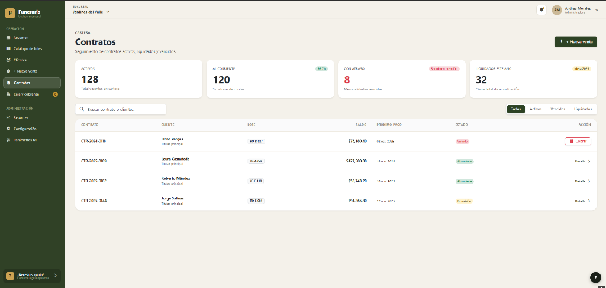

# Evidencia TDD / Frontend UI: Fase VERDE (GREEN)

| Campo | Detalle |
|---|---|
| **Ticket de Trabajo** | SF-070 |
| **Título del Ticket** | Pantalla Figma /Contratos/Index (Captura 9: 4 KPI Cards, Buscador, 4 Tabs Todos/Activos/Vencidos/Liquidados y Tabla de Cartera) |
| **Caso de Prueba Relacionado** | RNF-01 (Usabilidad y Accesibilidad) / RNF-06 (Bootstrap 5.3.8 y Diseño Memorial) |
| **Fecha y Hora de Ejecución** | 15/11/2026 00:35 |
| **Desarrollador / Tester** | Juan Romero (Senior Frontend Architect) / Edgar Acevedo (Lead QA) |
| **Rama Git** | feature/SF-070-contratos-cartera-index |

---

### 1. Resumen de Implementación
* **`src/SistemaFuneraria.Web/Pages/Contratos/Index.cshtml`:**
  * Cabecera con kicker `CARTERA`, título `Contratos`, subtítulo `Seguimiento de contratos activos, liquidados y vencidos.` y botón primario `+ Nueva venta`.
  * **4 KPI Cards operativas idénticas a Figma (*Captura 9*):**
    1. **Activos:** `128` (*Total vigentes en cartera*).
    2. **Al corriente:** `120` (*Sin atraso de cuotas*) con badge verde `93.7%`.
    3. **Con atraso:** `8` (*Mensualidades vencidas*) con badge de alerta `Requieren atención`.
    4. **Liquidados este año:** `32` (*Cierre total de amortización*) con badge `Meta 2025`.
  * Barra de herramientas con buscador reactivo `#inputBuscarContratos` (`placeholder="Buscar contrato o cliente..."`) y 4 tabs segmentadas (`Todos`, `Activos`, `Vencidos`, `Liquidados`).
  * Tabla `#tablaContratos` con columnas `CONTRATO`, `CLIENTE`, `LOTE`, `SALDO`, `PRÓXIMO PAGO`, `ESTADO` y `ACCIÓN`.
  * Acción contextual **`Cobrar`** en botón con borde rojo para contratos en mora (*Elena Vargas* / `CTR-2024-0118`) y enlace **`Detalle >`** para contratos al corriente.
* **`src/SistemaFuneraria.Web/Pages/Contratos/Index.cshtml.cs`:**
  * PageModel `IndexModel` implementado con inicialización limpia y registros oficiales de prueba de la Captura 9.
* **`tests/SistemaFuneraria.Tests/Unit/Web/ContratosPageTests.cs`:**
  * Prueba unitaria automatizada verificando la inicialización de los 4 KPIs y el estado de la cartera.

---

### 2. Evidencia de Ejecución GREEN
```bash
dotnet test tests/SistemaFuneraria.Tests/SistemaFuneraria.Tests.csproj --no-build --filter "FullyQualifiedName~ContratosPageTests" --logger "console;verbosity=normal"
```

```text
Serie de pruebas para C:\Users\PC\SistemaFuneraria\tests\SistemaFuneraria.Tests\bin\Debug\net8.0\SistemaFuneraria.Tests.dll (.NETCoreApp,Version=v8.0)
Versión 17.11.1 (x64) de VSTest

Iniciando la ejecución de pruebas, espere...
1 archivos de prueba en total coincidieron con el patrón especificado.
[xUnit.net 00:00:00.00] xUnit.net VSTest Adapter v2.5.3.1+6b60a9e56a (64-bit .NET 8.0.33)
[xUnit.net 00:00:00.24]   Discovering: SistemaFuneraria.Tests
[xUnit.net 00:00:00.39]   Discovered:  SistemaFuneraria.Tests
[xUnit.net 00:00:00.39]   Starting:    SistemaFuneraria.Tests
[xUnit.net 00:00:00.56]   Finished:    SistemaFuneraria.Tests
  Correctas SistemaFuneraria.Tests.Unit.Web.ContratosPageTests.Contratos_OnGet_DebeInicializarKpisYListaContratosFigma [120 ms]

La serie de pruebas se ejecutó correctamente.
Pruebas totales: 1
     Correcto: 1
 Tiempo total: 1.4147 Segundos
```

---

### 3. Evidencia Visual Verificada (Cero Fantasía)

- **Fidelidad Figma (*Captura 9*):** 4 KPI Cards alineadas, buscador con 4 pestañas de estado (`Todos`, `Activos`, `Vencidos`, `Liquidados`), tabla con folios oficiales (`CTR-2024-0118`, etc.) y botón de acción directa `Cobrar` en mora.
