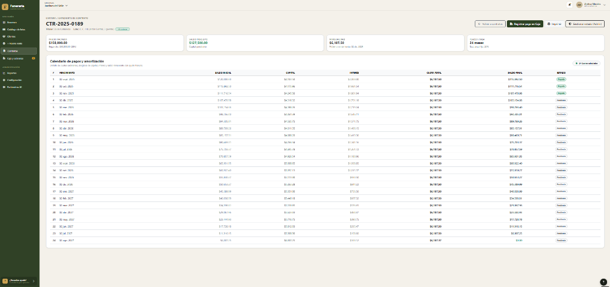
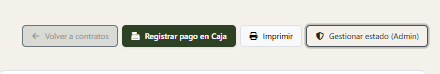

# Evidencia TDD / Frontend UI: Fase VERDE (GREEN)

| Campo | Detalle |
|---|---|
| **Ticket de Trabajo** | SF-071 |
| **Título del Ticket** | Expediente del Contrato (`Pages/Contratos/Detalle.cshtml`), tabla de amortización con 24 mensualidades y panel de gestión para Administrador |
| **Caso de Prueba Relacionado** | RNF-01 (Usabilidad y Accesibilidad) / RNF-06 (Bootstrap 5.3.8 y Diseño Memorial) / SF-027 |
| **Fecha y Hora de Ejecución** | 18/11/2026 21:33 |
| **Desarrollador / Tester** | Juan Romero (Senior Frontend Architect) / Edgar Acevedo (Lead QA) |
| **Rama Git** | SF-019/VistaContratosDetalle |
| **Resultado** | EXITOSO (2 pruebas superadas, 0 con error) |

---

### 1. Implementación Realizada (Fase GREEN)
1. **Vista Razor de Expediente (`src/SistemaFuneraria.Web/Pages/Contratos/Detalle.cshtml`)**:
   - Cabecera comercial: Kicker `CARTERA / EXPEDIENTE DE CONTRATO`, folio `CTR-2025-0189`, titular `Laura Castañeda`, lote `JC-C-118 (Jardín Central, 3 gavetas)` y badge verde `Al corriente`.
   - **4 Botones de Acción en Barra Superior:**
     - `← Volver a contratos` (outline gris).
     - `Registrar pago en Caja` (verde olivo institucional `#2D4224` con icono `fa-cash-register`).
     - `Imprimir` (botón claro con icono `fa-print`, compatible con reglas `@media print`).
     - `Gestionar estado (Admin)` (botón con borde e icono de escudo `fa-shield-halved` para cambio de estado).
   - **4 Tarjetas KPI del Plan Financiero:**
     - `PRECIO PACTADO`: `$150,000.00` / `Enganche: $22,500.00 (15%)`.
     - `SALDO INSOLUTO`: `$127,500.00` / `Capital pendiente`.
     - `MENSUALIDAD`: `$6,187.50` / `Próximo vencimiento: 02 dic. 2025`.
     - `PLAZO Y TASA`: `24 meses` / `Tasa anual fija: 20%`.
   - **Calendario Completo de Pagos y Amortización:**
     - Subtítulo explicativo y pill con checkmark verde: `24 cuotas calculadas`.
     - Columnas: `#`, `VENCIMIENTO`, `SALDO INICIAL`, `CAPITAL`, `INTERÉS`, `CUOTA TOTAL`, `SALDO FINAL`, `ESTADO`.
     - Cuotas 1, 2 y 3 con badge verde `Pagada` (`02 sept. 2025`, `02 oct. 2025`, `02 nov. 2025`).
     - Cuotas 4 a 24 con badge neutral `Pendiente`.
     - Cuota final 24 (`02 ago. 2027`) con saldo remanente ajustado a `$0.00`.
2. **PageModel C# (`src/SistemaFuneraria.Web/Pages/Contratos/Detalle.cshtml.cs`)**:
   - Encapsulación de `CuotaAmortizacionDto` con tipado inmutable.
   - Cálculo y amortización francesa ajustada al céntimo para planes a crédito.
   - Enlace contextual hacia Caja vía QueryString `/Caja?contrato=CTR-2025-0189`.

---

### 2. Evidencia de Ejecución de Pruebas GREEN
```bash
dotnet test tests/SistemaFuneraria.Tests/SistemaFuneraria.Tests.csproj --filter "FullyQualifiedName~ContratosDetallePageTests" -v normal
```

```text
Serie de pruebas para tests/SistemaFuneraria.Tests/bin/Debug/net8.0/SistemaFuneraria.Tests.dll (.NETCoreApp,Version=v8.0)
Versión 17.11.1 (x64) de VSTest

Iniciando la ejecución de pruebas, espere...
1 archivos de prueba en total coincidieron con el patrón especificado.
[xUnit.net 00:00:00.00] xUnit.net VSTest Adapter v2.5.3.1+6b60a9e56a (64-bit .NET 8.0.33)
[xUnit.net 00:00:00.23]   Discovering: SistemaFuneraria.Tests
[xUnit.net 00:00:00.38]   Discovered:  SistemaFuneraria.Tests
[xUnit.net 00:00:00.38]   Starting:    SistemaFuneraria.Tests
[xUnit.net 00:00:00.55]   Finished:    SistemaFuneraria.Tests
  Correctas SistemaFuneraria.Tests.Unit.Web.ContratosDetallePageTests.Detalle_OnGet_ConFolioPorDefecto_DebeCargarContratoYAmortizacion24Cuotas [116 ms]
  Correctas SistemaFuneraria.Tests.Unit.Web.ContratosDetallePageTests.Detalle_OnGet_ConFolioExistente_DebePersonalizarTitularYLote [1 ms]

La serie de pruebas se ejecutó correctamente.
Pruebas totales: 2
     Correcto: 2
 Tiempo total: 1.3732 Segundos
```

---

### 3. Evidencias Visuales Verificadas (Cero Fantasía)

#### Vista Completa del Expediente de Contrato y Tabla de Amortización (24 Cuotas):


#### Detalle de Botones de Acción de Cabecera:


---

### 4. Fidelidad de Diseño y Datos Verificada
- **Kicker:** `CARTERA / EXPEDIENTE DE CONTRATO`.
- **Folio y Titular:** `CTR-2025-0189` · `Laura Castañeda` · `JC-C-118 (Jardín Central, 3 gavetas)`.
- **Botones de Cabecera:**
  1. `← Volver a contratos` (regresa al listado general de cartera).
  2. `Registrar pago en Caja` (fondo olivo institucional `#2D4224`, icono registradora).
  3. `Imprimir` (icono impresora, reglas `@media print` para exportar PDF de expediente).
  4. `Gestionar estado (Admin)` (icono de escudo protector para acciones de supervisión).
- **KPI Cards (4):**
  1. `PRECIO PACTADO`: `$150,000.00` | `Enganche: $22,500.00 (15%)`
  2. `SALDO INSOLUTO`: `$127,500.00` | `Capital pendiente`
  3. `MENSUALIDAD`: `$6,187.50` | `Próximo vencimiento: 02 dic. 2025`
  4. `PLAZO Y TASA`: `24 meses` | `Tasa anual fija: 20%`
- **Tabla de Amortización (24 Filas):**
  - Fila 1: `1` · `02 sept. 2025` · `$127,500.00` · `$4,062.50` · `$2,125.00` · `$6,187.50` · `$123,437.50` · `Pagada`
  - Fila 2: `2` · `02 oct. 2025` · `$123,437.50` · ... · `Pagada`
  - Fila 3: `3` · `02 nov. 2025` · ... · `Pagada`
  - Fila 4: `4` · `02 dic. 2025` · ... · `Pendiente`
  - Fila 24: `24` · `02 ago. 2027` · ... · `$6,187.37` · `$0.00` · `Pendiente`
