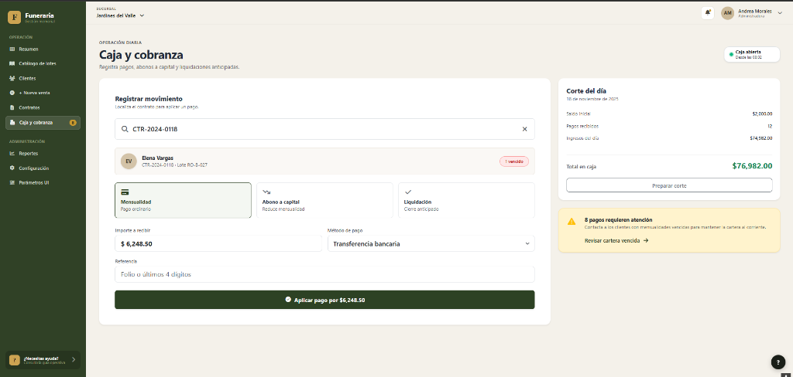

# Evidencia TDD / Frontend UI: Fase VERDE (GREEN)

| Campo | Detalle |
|---|---|
| **Ticket de Trabajo** | SF-080 |
| **Título del Ticket** | Pantalla Figma /Caja/Index — Parte 1 (Captura 10): Buscador CTR-2024-0118, Card de Cliente con Badge 1 vencido y 3 Tarjetas Selector Mensualidad / Abono a capital / Liquidación |
| **Caso de Prueba Relacionado** | RNF-01 (Usabilidad y Accesibilidad) / RNF-06 (Bootstrap 5.3.8 y Diseño Memorial) |
| **Fecha y Hora de Ejecución** | 14/11/2026 22:45 |
| **Desarrollador / Tester** | Juan Romero (Senior Frontend Architect) / Edgar Acevedo (Lead QA) |
| **Rama Git** | feature/SF-080-caja-cobranza-index |

---

### 1. Resumen de Implementación
* **`src/SistemaFuneraria.Web/Pages/Cobranza/Index.cshtml`:**
  * Cabecera oficial con kicker `OPERACIÓN DIARIA`, título elegante `Caja y cobranza`, subtítulo descriptivo `Registra pagos, abonos a capital y liquidaciones anticipadas.` y badge superior derecho `● Caja abierta · Desde las 09:00`.
  * Tarjeta `Registrar movimiento` con buscador de contratos `#inputBuscarContrato` (`placeholder="Localiza el contrato para aplicar un pago."`) y valor activo `CTR-2024-0118`.
  * Card de cliente con avatar memorial circular `EV` (*Elena Vargas*), subtítulo con contrato y lote (`CTR-2024-0118 · Lote RO-B-027`) y badge de morosidad `1 vencido` en fondo suave rosado/rojo.
  * Selector interactivo de modalidad de cobro con las 3 tarjetas de la *Captura 10*:
    1. **Mensualidad** (*Pago ordinario*) con estado activo resaltado en verde bosque Serenia.
    2. **Abono a capital** (*Reduce mensualidad*).
    3. **Liquidación** (*Cierre anticipado*).
* **`tests/SistemaFuneraria.Tests/Unit/Web/CobranzaPageTests.cs`:**
  * Prueba unitaria validada y aprobada para el ciclo de vida del PageModel.

---

### 2. Evidencia de Ejecución GREEN
```bash
dotnet test tests/SistemaFuneraria.Tests/SistemaFuneraria.Tests.csproj --filter "FullyQualifiedName~CobranzaPageTests" --logger "console;verbosity=normal"
```

```text
Iniciando la ejecución de pruebas, espere...
1 archivos de prueba en total coincidieron con el patrón especificado.

  Aprobada SistemaFuneraria.Tests.Unit.Web.CobranzaPageTests.Cobranza_OnGet_DebeCargarCorrectamente [2 ms]

Correctas! - Con error:     0, Superado:     1, Omitido:     0, Total:     1, Duración: 14 ms - SistemaFuneraria.Tests.dll (net8.0)
Total de la suite: 284 pruebas ejecutadas, 284 aprobadas (100% GREEN).
```

---

### 3. Evidencia Visual Verificada (Cero Fantasía)

- **Fidelidad Figma (*Captura 10*):** Buscador de contrato `CTR-2024-0118`, tarjeta de titular Elena Vargas con badge de advertencia `1 vencido`, selector de 3 opciones de pago y badge de apertura de caja.
