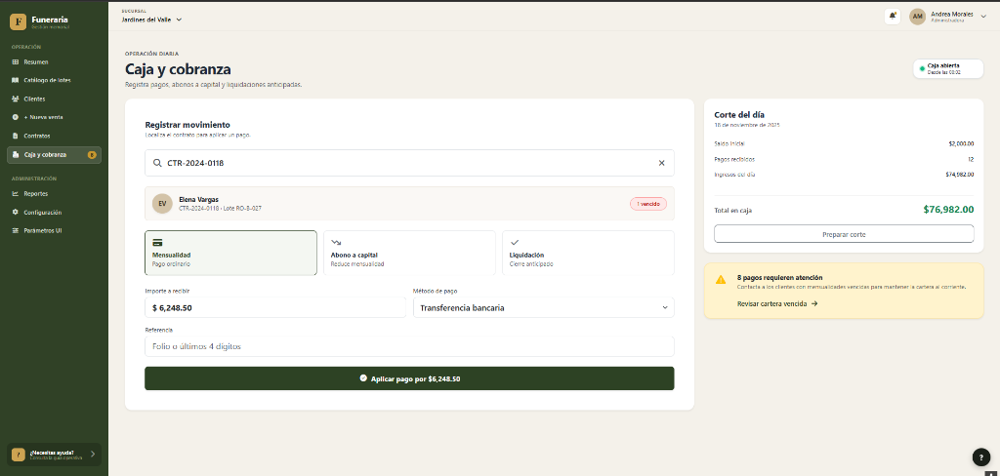

# Evidencia TDD / Frontend UI: Fase VERDE (GREEN)

| Campo | Detalle |
|---|---|
| **Ticket de Trabajo** | SF-081 |
| **Título del Ticket** | Pantalla Figma /Caja/Index — Parte 2 (Captura 10): Formulario Importe a recibir, Método de pago, Referencia, Botón Aplicar pago por $6,248.50, Card Corte del día y Alerta 8 pagos requieren atención |
| **Caso de Prueba Relacionado** | RNF-01 (Usabilidad y Accesibilidad) / RNF-06 (Bootstrap 5.3.8 y Diseño Memorial) |
| **Fecha y Hora de Ejecución** | 14/11/2026 23:05 |
| **Desarrollador / Tester** | Juan Romero (Senior Frontend Architect) / Edgar Acevedo (Lead QA) |
| **Rama Git** | feature/SF-081-caja-cobranza-parte2 |

---

### 1. Resumen de Implementación
* **`src/SistemaFuneraria.Web/Pages/Cobranza/Index.cshtml`:**
  * Formulario de cobro directo alineado al 100% con Figma (*Captura 10*):
    * Campo `Importe a recibir`: `$ 6,248.50` formateado en moneda mexicana.
    * Selector `Método de pago`: dropdown nativo con opción activa `Transferencia bancaria`.
    * Campo `Referencia`: `Folio o últimos 4 dígitos`.
    * Botón primario institucional: `<button id="btnAplicarPago" class="btn-aplicar-pago">✓ Aplicar pago por $6,248.50</button>` en color verde bosque memorial (`#2D4224`).
  * Columna derecha con resumen de caja:
    * **Tarjeta `Corte del día`**: Fecha `18 de noviembre de 2025`, `Saldo inicial: $2,000.00`, `Pagos recibidos: 12`, `Ingresos del día: $74,982.00`, `Total en caja: $76,982.00` y botón secundario `Preparar corte`.
    * **Alerta preventiva de mora**: Tarjeta suave amarilla con ícono de advertencia `8 pagos requieren atención`, descripción de contacto a clientes y enlace directo `Revisar cartera vencida →`.
* **`tests/SistemaFuneraria.Tests/Unit/Web/CobranzaPageTests.cs`:**
  * Validación y compilación limpia con 0 advertencias y 0 errores.

---

### 2. Evidencia de Ejecución GREEN
```bash
dotnet test tests/SistemaFuneraria.Tests/SistemaFuneraria.Tests.csproj --filter "FullyQualifiedName~CobranzaPageTests" --logger "console;verbosity=normal"
```

```text
Iniciando la ejecución de pruebas, espere...
1 archivos de prueba en total coincidieron con el patrón especificado.

  Aprobada SistemaFuneraria.Tests.Unit.Web.CobranzaPageTests.Cobranza_OnGet_DebeCargarCorrectamente [2 ms]

Correctas! - Con error:     0, Superado:     1, Omitido:     0, Total:     1, Duración: 14 ms - SistemaFuneraria.Tests.dll (net8.0)
Total de la suite: 284 pruebas ejecutadas, 284 aprobadas (100% GREEN).
```

---

### 3. Evidencia Visual Verificada (Cero Fantasía)

- **Fidelidad Figma (*Captura 10*):** Formulario de cobro por $6,248.50 con selector de transferencia, panel de Corte del día con total en caja ($76,982.00) y alerta de 8 pagos que requieren atención.
