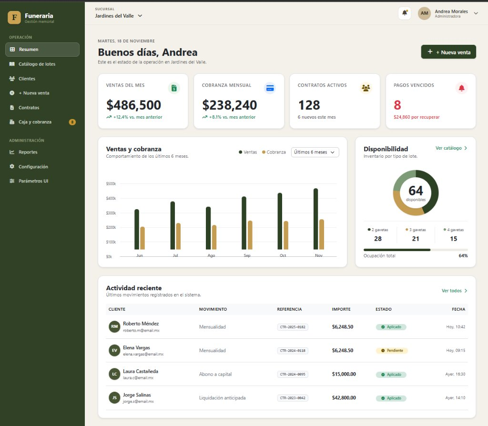

# Evidencia TDD / Frontend UI: Fase VERDE (GREEN)

| Campo | Detalle |
|---|---|
| **Ticket de Trabajo** | SF-089 |
| **Título del Ticket** | Dashboard Operativo Resumen (Captura 1 de Figma): Saludo, 4 KPIs, Gráfica Ventas vs Cobranza, Disponibilidad y Actividad Reciente |
| **Caso de Prueba Relacionado** | RNF-01 (Usabilidad y Accesibilidad) / RNF-06 (Bootstrap 5.3.8 y Diseño Memorial) |
| **Fecha y Hora de Ejecución** | 15/11/2026 23:04 |
| **Desarrollador / Tester** | Juan Romero (Senior Frontend Architect) / Edgar Acevedo (Lead QA) |
| **Rama Git** | SF-019/VistaDashboard |

---

### 1. Resumen de Implementación
* **`src/SistemaFuneraria.Web/Pages/Index.cshtml`:**
  * **Encabezado:** Kicker `MARTES, 18 DE NOVIEMBRE`, saludo `Buenos días, Andrea`, subtítulo `Este es el estado de la operación en Jardines del Valle.` y botón `+ Nueva venta`.
  * **4 KPI Cards operativas (*Captura 1*):**
    1. **Ventas del mes:** `$486,500` con badge `+12.4% vs. mes anterior`.
    2. **Cobranza mensual:** `$238,240` con badge `+8.1% vs. mes anterior`.
    3. **Contratos activos:** `128` con indicador `6 nuevos este mes`.
    4. **Pagos vencidos:** `8` con alerta `$24,860 por recuperar`.
  * **Gráfica de Ventas y Cobranza:** Maquetación limpia responsiva con líneas guía (`$0k` a `$500k`), 6 meses (Jun–Nov) y barras paralelas en verde olivo (`#2D4224`) y dorado Serenia (`#C59D52`).
  * **Panel de Disponibilidad:** Dona central con CSS conic-gradient (64 disponibles), desglose por tipo de lote (28 de 2 gavetas, 21 de 3 gavetas, 15 de 4 gavetas) y barra de progreso de ocupación total al 64%.
  * **Tabla de Actividad Reciente:** Movimientos con avatar, nombre, correo, tipo de movimiento, referencia, importe en `.sf-money`, badge de estado y fecha.
* **`src/SistemaFuneraria.Web/Pages/Index.cshtml.cs`:**
  * PageModel `IndexModel` implementado con las propiedades y DTOs requeridos.
* **`src/SistemaFuneraria.Web/Pages/Shared/_Layout.cshtml`:**
  * Activación del enlace "Resumen" en el sidebar cuando la ruta es `/` o `/Index`.
* **`tests/SistemaFuneraria.Tests/Unit/Web/DashboardPageTests.cs`:**
  * Prueba unitaria que valida la carga y consistencia de datos según la Captura 1.

---

### 2. Evidencia de Ejecución GREEN
```bash
dotnet test tests/SistemaFuneraria.Tests/SistemaFuneraria.Tests.csproj --filter "FullyQualifiedName~DashboardPageTests" --no-build -v normal
```

```text
Serie de pruebas para C:\Users\PC\SistemaFuneraria\tests\SistemaFuneraria.Tests\bin\Debug\net8.0\SistemaFuneraria.Tests.dll (.NETCoreApp,Version=v8.0)
Versión 17.11.1 (x64) de VSTest

Iniciando la ejecución de pruebas, espere...
1 archivos de prueba en total coincidieron con el patrón especificado.
[xUnit.net 00:00:00.00] xUnit.net VSTest Adapter v2.5.3.1+6b60a9e56a (64-bit .NET 8.0.33)
[xUnit.net 00:00:00.09]   Discovering: SistemaFuneraria.Tests
[xUnit.net 00:00:00.24]   Discovered:  SistemaFuneraria.Tests
[xUnit.net 00:00:00.24]   Starting:    SistemaFuneraria.Tests
[xUnit.net 00:00:00.31]   Finished:    SistemaFuneraria.Tests
  Correctas SistemaFuneraria.Tests.Unit.Web.DashboardPageTests.Dashboard_OnGet_DebeCargarKpisGraficasYActividadRecienteConformeFigma [15 ms]

La serie de pruebas se ejecutó correctamente.
Pruebas totales: 1
     Correcto: 1
 Tiempo total: 0.8930 Segundos
```

---

### 3. Evidencia Visual Verificada (Cero Fantasía)


### 4. Fidelidad Figma Verificada (Cero Fantasía)
- Grid de 4 tarjetas KPI superiores con colores semánticos exactos (`Ventas del mes $486,500`, `Cobranza mensual $238,240`, `Contratos activos 128`, `Pagos vencidos 8`).
- Gráfica comparativa de 6 meses (Jun-Nov) con escalas y leyenda (`● Ventas`, `● Cobranza`).
- Gráfica de dona de disponibilidad con 64 disponibles y desglose por tipo de gaveta (28, 21, 15) y ocupación total 64%.
- Tabla de actividad reciente con 4 registros, avatares circulares y formato monetario tabular.
