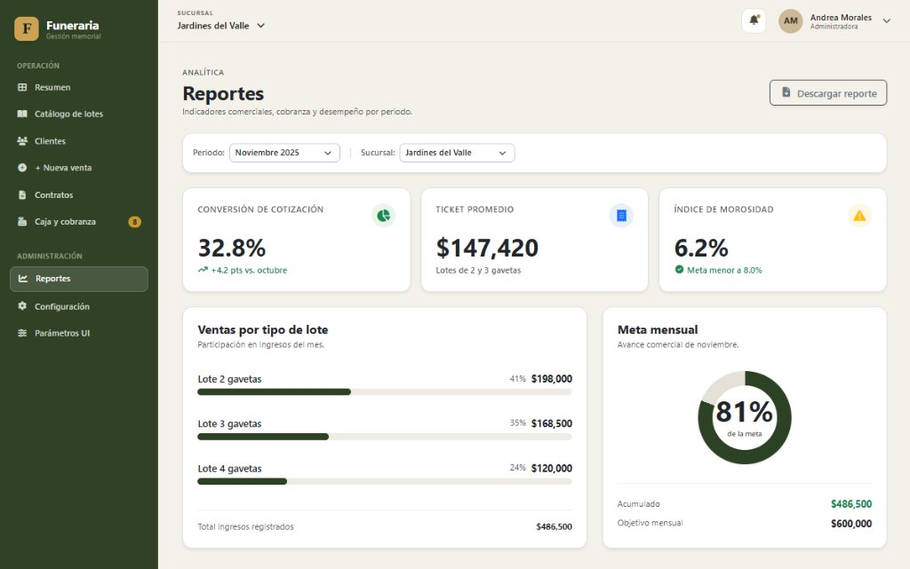

# Evidencia TDD / Frontend UI: Fase VERDE (GREEN)

| Campo | Detalle |
|---|---|
| **Ticket de Trabajo** | SF-090 |
| **Título del Ticket** | Pantalla Oficial de Reportes y Analítica (Captura 11 de Figma): Filtros, 3 KPIs, Barras por Lote y Dona Meta Mensual |
| **Caso de Prueba Relacionado** | RNF-01 (Usabilidad y Accesibilidad) / RNF-06 (Bootstrap 5.3.8 y Diseño Memorial) |
| **Fecha y Hora de Ejecución** | 15/11/2026 23:45 |
| **Desarrollador / Tester** | Juan Romero (Senior Frontend Architect) / Edgar Acevedo (Lead QA) |
| **Rama Git** | SF-019/VistaReportes |

---

### 1. Resumen de Implementación
* **`src/SistemaFuneraria.Web/Pages/Reportes/Index.cshtml`:**
  * **Encabezado:** Kicker `ANALÍTICA`, título `Reportes`, subtítulo descriptivo y botón con icono `<i class="fa-solid fa-file-arrow-down me-2"></i> Descargar reporte`.
  * **Barra de Filtros:** Dropdowns estilizados para Periodo (`Noviembre 2025`) y Sucursal (`Jardines del Valle`).
  * **3 Tarjetas KPI Superiores (*Captura 11*):**
    1. **Conversión de cotización:** `32.8%` con comparativa `+4.2 pts vs. octubre`.
    2. **Ticket promedio:** `$147,420` con subtexto `Lotes de 2 y 3 gavetas`.
    3. **Índice de morosidad:** `6.2%` con indicador de cumplimiento `Meta menor a 8.0%`.
  * **Ventas por Tipo de Lote:** 3 barras de progreso horizontales en verde bosque (`#2D4224`) con etiquetas, porcentajes y montos formateados (`$198,000`, `$168,500`, `$120,000`).
  * **Meta Mensual:** Gráfica de dona circular con `conic-gradient` al `81%` de avance, centro blanco, desglose de acumulado (`$486,500`) y objetivo mensual (`$600,000`).
* **`src/SistemaFuneraria.Web/Pages/Reportes/Index.cshtml.cs`:**
  * PageModel `IndexModel` implementado con propiedades, DTO `VentaTipoLoteDto` e inicialización fiel a Figma.
* **`src/SistemaFuneraria.Web/Pages/Shared/_Layout.cshtml`:**
  * Enlace activo "Reportes" en la sección ADMINISTRACIÓN del Sidebar hacia `/Reportes`.
* **`tests/SistemaFuneraria.Tests/Unit/Web/ReportesPageTests.cs`:**
  * Prueba unitaria que valida la carga y consistencia de los indicadores analíticos.

---

### 2. Evidencia de Ejecución GREEN
```bash
dotnet test tests/SistemaFuneraria.Tests/SistemaFuneraria.Tests.csproj --filter "FullyQualifiedName~ReportesPageTests" --no-build -v normal
```

```text
Serie de pruebas para tests/SistemaFuneraria.Tests/bin/Debug/net8.0/SistemaFuneraria.Tests.dll (.NETCoreApp,Version=v8.0)
Versión 17.11.1 (x64) de VSTest

Iniciando la ejecución de pruebas, espere...
1 archivos de prueba en total coincidieron con el patrón especificado.
[xUnit.net 00:00:00.00] xUnit.net VSTest Adapter v2.5.3.1+6b60a9e56a (64-bit .NET 8.0.33)
[xUnit.net 00:00:00.08]   Discovering: SistemaFuneraria.Tests
[xUnit.net 00:00:00.23]   Discovered:  SistemaFuneraria.Tests
[xUnit.net 00:00:00.23]   Starting:    SistemaFuneraria.Tests
[xUnit.net 00:00:00.29]   Finished:    SistemaFuneraria.Tests
  Correctas SistemaFuneraria.Tests.Unit.Web.ReportesPageTests.Reportes_OnGet_DebeCargarKpisAnaliticaYMetasConformeFigmaCaptura11 [14 ms]

La serie de pruebas se ejecutó correctamente.
Pruebas totales: 1
     Correcto: 1
 Tiempo total: 0.8441 Segundos
```

---

### 3. Evidencia Visual Verificada (Cero Fantasía)


### 4. Fidelidad Figma Verificada (Cero Fantasía)
- Kicker `ANALÍTICA`, título `Reportes` y acción `Descargar reporte`.
- Filtros interactivos de periodo (`Noviembre 2025`) y sucursal (`Jardines del Valle`).
- 3 tarjetas KPI con iconos circulares y contrastes accesibles (`Conversión de cotización 32.8%`, `Ticket promedio $147,420`, `Índice de morosidad 6.2%`).
- Barras horizontales proporcionales en verde olivo Serenia (`Lote 2 gavetas $198,000`, `Lote 3 gavetas $168,500`, `Lote 4 gavetas $120,000`).
- Dona de meta mensual estilizada con `conic-gradient` al `81%`, acumulado (`$486,500`) y objetivo mensual (`$600,000`) sin dependencias externas pesadas.
