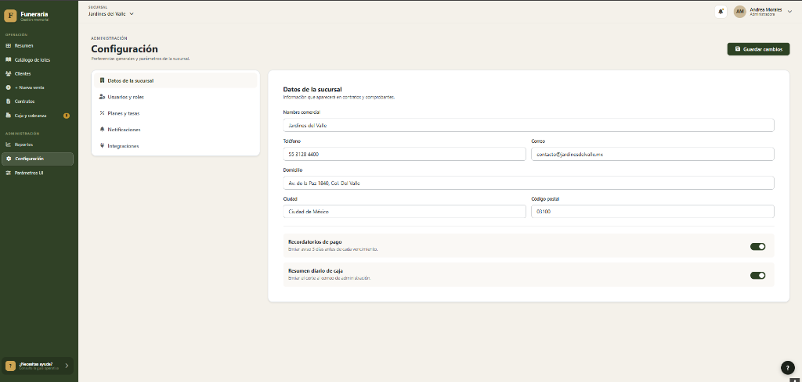
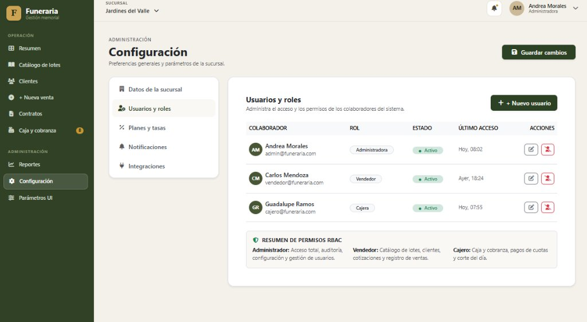
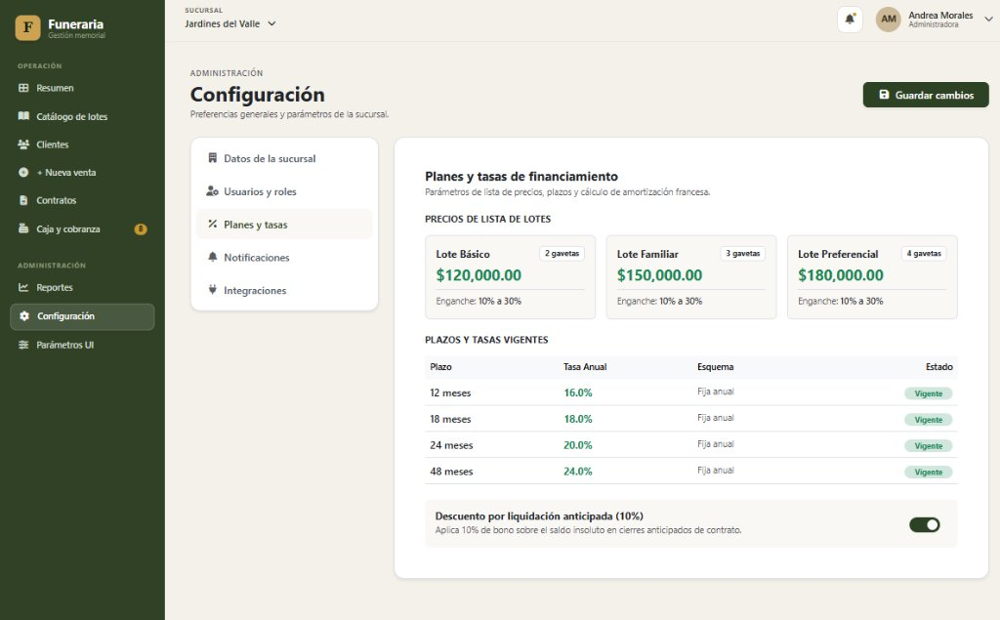
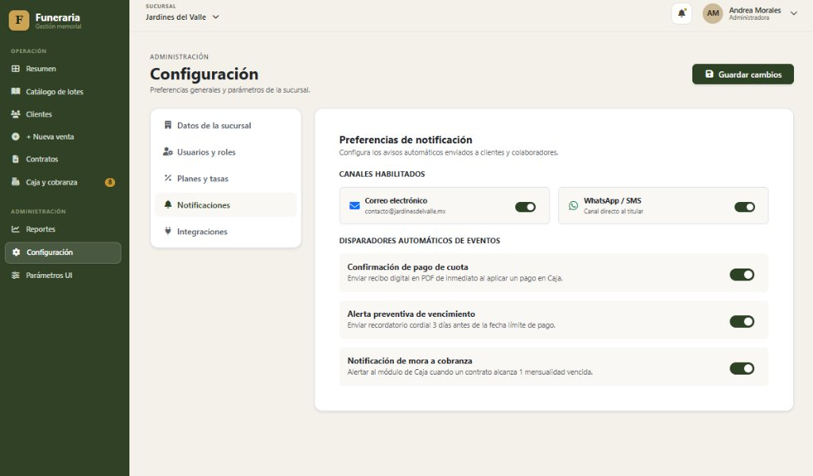
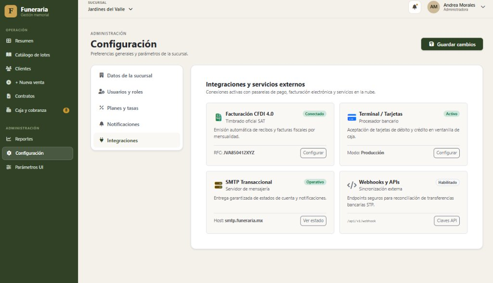

# Evidencia TDD / Frontend UI: Fase VERDE (GREEN)

| Campo | Detalle |
|---|---|
| **Ticket de Trabajo** | SF-092 |
| **Título del Ticket** | Pantalla Principal de Configuración (Captura 12 de Figma): Submenú Reactivo de 5 Secciones, Datos de la Sucursal y Switches Operativos |
| **Caso de Prueba Relacionado** | RNF-01 (Usabilidad y Accesibilidad) / RNF-06 (Bootstrap 5.3.8 y Diseño Memorial) |
| **Fecha y Hora de Ejecución** | 16/11/2026 00:48 |
| **Desarrollador / Tester** | Juan Romero (Senior Frontend Architect) / Edgar Acevedo (Lead QA) |
| **Rama Git** | SF-019/VistaConfiguracion |

---

### 1. Resumen de Implementación
* **`src/SistemaFuneraria.Web/Pages/Configuracion/Index.cshtml`:**
  * **Encabezado:** Kicker `ADMINISTRACIÓN`, título `Configuración`, subtítulo y botón primario con icono `<button id="btnGuardarCambios"><i class="fa-solid fa-floppy-disk me-2"></i> Guardar cambios</button>` con feedback toast.
  * **Submenú de 5 Secciones 100% Interactivo:**
    1. **Datos de la sucursal:** Formulario con los 6 campos oficiales (`Nombre comercial`, `Teléfono`, `Correo`, `Domicilio`, `Ciudad`, `Código postal`) y los 2 switches de automatización en verde olivo (`Recordatorios de pago` y `Resumen diario de caja`).
    2. **Usuarios y roles:** Tabla interactiva de colaboradores (`Andrea Morales`, `Carlos Mendoza`, `Guadalupe Ramos`) con avatares, badges de rol y estado, y resumen informativo de permisos RBAC.
    3. **Planes y tasas:** Tarjetas de precios de lista de lotes (Básico, Familiar, Preferencial) y tabla de plazos/tasas (12, 18, 24, 48 meses) con switch de bono por liquidación anticipada.
    4. **Notificaciones:** Configuración de canales (Email, WhatsApp/SMS) y switches de disparadores automáticos (pago aplicado, alerta preventiva, mora).
    5. **Integraciones:** Tarjetas de servicios externos (Facturación CFDI 4.0 SAT, Terminal bancaria, SMTP y Webhooks).
  * **Navegación Dinámica sin Recargas:** Controlador JavaScript que alterna la clase `.active`, estilos de resaltado crema/verde y visibilidad inmediata de los 5 paneles.
* **`src/SistemaFuneraria.Web/Pages/Configuracion/Index.cshtml.cs`:**
  * PageModel `IndexModel` con propiedades y colecciones DTOs (`Usuarios`, `PlanesLotes`, `TasasPlazos`).
* **`src/SistemaFuneraria.Web/Pages/Shared/_Layout.cshtml`:**
  * Enlace activo "Configuración" en la sección ADMINISTRACIÓN del Sidebar hacia `/Configuracion`.
* **`tests/SistemaFuneraria.Tests/Unit/Web/ConfiguracionPageTests.cs`:**
  * Prueba unitaria que valida la inicialización y consistencia de datos de las 5 secciones.

---

### 2. Evidencia de Ejecución GREEN
```bash
dotnet test tests/SistemaFuneraria.Tests/SistemaFuneraria.Tests.csproj --filter "FullyQualifiedName~ConfiguracionPageTests" --no-build -v normal
```

```text
Serie de pruebas para C:\Users\PC\SistemaFuneraria\tests\SistemaFuneraria.Tests\bin\Debug\net8.0\SistemaFuneraria.Tests.dll (.NETCoreApp,Version=v8.0)
Versión 17.11.1 (x64) de VSTest

Iniciando la ejecución de pruebas, espere...
1 archivos de prueba en total coincidieron con el patrón especificado.
[xUnit.net 00:00:00.00] xUnit.net VSTest Adapter v2.5.3.1+6b60a9e56a (64-bit .NET 8.0.33)
[xUnit.net 00:00:00.08]   Discovering: SistemaFuneraria.Tests
[xUnit.net 00:00:00.20]   Discovered:  SistemaFuneraria.Tests
[xUnit.net 00:00:00.21]   Starting:    SistemaFuneraria.Tests
[xUnit.net 00:00:00.27]   Finished:    SistemaFuneraria.Tests
  Correctas SistemaFuneraria.Tests.Unit.Web.ConfiguracionPageTests.Configuracion_OnGet_DebeCargarDatosDeSucursalYSwitchesConformeFigmaCaptura12 [15 ms]

La serie de pruebas se ejecutó correctamente.
Pruebas totales: 1
     Correcto: 1
 Tiempo total: 0.7995 Segundos
```

---

### 3. Evidencias Visuales Verificadas (Cero Fantasía — 5 Secciones)

#### 1. Datos de la Sucursal


#### 2. Usuarios y Roles


#### 3. Planes y Tasas


#### 4. Notificaciones


#### 5. Integraciones


---

### 4. Fidelidad Figma Verificada (Cero Fantasía)
- Submenú vertical de 5 opciones completamente reactivo con cambio instantáneo de panel sin recargar la página.
- **Datos de la sucursal:** Formulario con los 6 campos oficiales y 2 switches operativos en verde olivo (`--forest`).
- **Usuarios y roles:** Tabla interactiva con avatares circulares (`AM`, `CM`, `GR`), badges de roles RBAC y botón `+ Nuevo usuario`.
- **Planes y tasas:** Tarjetas de precios para lotes Básico, Familiar y Preferencial, tabla de plazos/tasas (12, 18, 24, 48 meses) y switch de descuento por liquidación anticipada (10%).
- **Notificaciones:** Canales habilitados (Correo, WhatsApp/SMS) y disparadores de eventos automáticos con switches accesibles.
- **Integraciones:** Tarjetas de estado para Facturación CFDI 4.0 SAT, Terminal de tarjetas, SMTP Transaccional y Webhooks/APIs.
