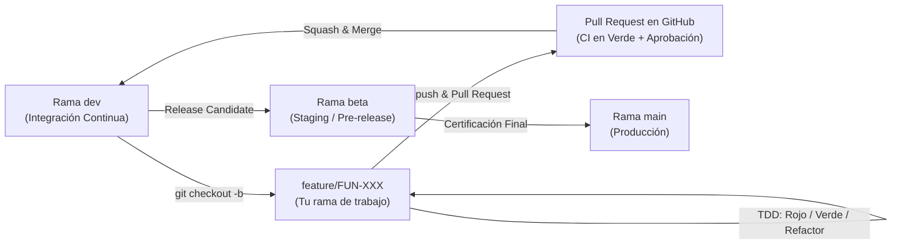
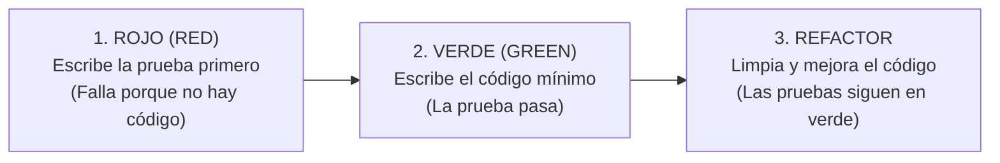

# GUÍA DE FLUJO DE TRABAJO, GIT Y TDD PARA DESARROLLADORES
## Sistema de Venta y Financiamiento de Lotes Funerarios

> **Para el equipo de desarrollo:**  
> Esta guía está diseñada para que trabajemos de forma ordenada, con la misma disciplina de una empresa de tecnología profesional, pero con pasos claros, sencillos y directos al grano. Si nunca has usado Git, GitHub o TDD profesionalmente, **sigue esta receta paso a paso y nada se romperá**.

---

## 1. El Mapa de Ramas (Estrategia GitFlow Adaptada)

En nuestro repositorio existen tres ramas principales protegidas y ramas temporales para cada tarea:



| Rama | Propósito | ¿Quién la toca? |
|---|---|---|
| **`main`** | **Producción.** Código 100% estable, certificado y listo para entrega final. | **Solo el Tech Lead** (Mediante PR desde `beta`). |
| **`beta`** | **Staging / Pre-release.** Entorno donde ejecutamos las pruebas de certificación UAT. | **Solo el Tech Lead** (Mediante PR desde `dev`). |
| **`dev`** | **Integración Continua.** Aquí se integran todas las funcionalidades terminadas del sprint. | **Mediante Pull Requests aprobados.** |
| **`feature/FUN-XXX-...`** | **Tu rama de trabajo.** Aquí programas tu tarea asignada. Nace de `dev` y muere al unirse a `dev`. | **Tú (Desarrollador asignado).** |

> [!CAUTION]
> **REGLA DE ORO #1:** Nunca hagas `git commit` ni `git push` directamente sobre `main`, `beta` ni `dev`. Siempre debes crear tu propia rama de feature.

---

## 2. El Ciclo Diario del Desarrollador (Paso a Paso)

Cada vez que vayas a trabajar en una tarea, sigue estrictamente estos **8 pasos**:

### Paso 1: Toma tu tarea en GitHub Projects
1. Entra al repositorio en GitHub $\rightarrow$ pestaña **Projects**.
2. Ubica la tarjeta asignada a ti (ejemplo: `[FUN-010] CalculadoraFinanciamiento`).
3. Arrastra la tarjeta de la columna **To Do (Por Hacer)** a **In Progress (En Curso)**.
4. *Límite WIP (Work In Progress):* **Solo puedes tener 1 tarea activa a la vez.**

---

### Paso 2: Actualiza tu repositorio local
Antes de empezar a programar, asegúrate de tener la última versión del código de integración:
```bash
# 1. Cambia a la rama dev
git checkout dev

# 2. Descarga los últimos cambios del equipo
git pull origin dev
```

---

### Paso 3: Crea tu rama de trabajo
El nombre de tu rama **debe** incluir el identificador del ticket y una descripción corta en minúsculas separada por guiones (`kebab-case`):
```bash
# Formato: git checkout -b feature/FUN-XXX-nombre-corto dev
git checkout -b feature/FUN-010-calculadora-financiamiento dev
```

---

### Paso 4: Programa usando TDD (Rojo $\rightarrow$ Verde $\rightarrow$ Refactor)
En este proyecto no programamos a ciegas; usamos **Desarrollo Guiado por Pruebas (TDD)**:



#### Ejemplo práctico en C#:

**1. Fase ROJO (Escribe el test primero en `SistemaFuneraria.Tests`):**
```csharp
[Fact]
public void CalcularEnganche_ConLoteDe120MilYPorcentaje20_DebeRetornar24Mil()
{
    // Arrange (Preparación)
    decimal precioLote = 120000.00m;
    decimal porcentajeEnganche = 0.20m;

    // Act (Acción) - La clase CalculadoraFinanciamiento aún no existe o no tiene el método
    decimal resultado = CalculadoraFinanciamiento.CalcularEnganche(precioLote, porcentajeEnganche);

    // Assert (Verificación)
    Assert.Equal(24000.00m, resultado);
}
```
Ejecuta las pruebas en tu terminal:
```bash
dotnet test
```
*(El resultado debe ser **ROJO / FAILED** porque el método aún no está implementado).*

**2. Fase VERDE (Escribe el código mínimo en `SistemaFuneraria.Core`):**
```csharp
public static class CalculadoraFinanciamiento
{
    public static decimal CalcularEnganche(decimal precioLote, decimal porcentajeEnganche)
    {
        return precioLote * porcentajeEnganche;
    }
}
```
Vuelve a ejecutar las pruebas:
```bash
dotnet test
```
*(El resultado debe ser **VERDE / PASSED**).*

**3. Fase REFACTOR:**  
Revisa si puedes mejorar nombres de variables o extraer constantes. Vuelve a correr `dotnet test` para confirmar que nada se rompió.

---

### Paso 5: Guarda tus cambios con Commits Convencionales
Usamos el estándar internacional **Conventional Commits 1.0.0**.  
Tus mensajes de commit deben indicar claramente qué hiciste:

#### Estructura del mensaje:
```text
<tipo>(<ámbito opcional>): <descripción corta en imperativo>

[cuerpo explicativo opcional]

[referencia al ticket obligatoria]
```

#### Tipos autorizados:
* `feat`: Introduce una nueva funcionalidad de negocio (ej. `feat(cotizador): agrega calculo de mensualidad`).
* `fix`: Corrige un error o bug (ej. `fix(amortizacion): corrige ajuste de centavos en ultima cuota`).
* `test`: Agrega o modifica pruebas unitarias o de integración (ej. `test(oraculo): agrega pruebas de 36 combinaciones`).
* `refactor`: Cambio de código que no arregla un bug ni añade una función (ej. `refactor(core): extrae constantes de tasas`).
* `docs`: Cambios en la documentación o comentarios (ej. `docs(rtm): actualiza matriz de trazabilidad`).
* `chore`: Tareas de mantenimiento o configuración (ej. `chore(deps): actualiza paquetes nuget`).

#### Comandos exactos:
```bash
# 1. Revisa qué archivos modificaste
git status

# 2. Agrega los archivos modificados
git add .

# 3. Haz el commit con el formato correcto
git commit -m "feat(financiamiento): implementa calculo de enganche accesible, estandar y alto" -m "Closes #FUN-010"
```

---

### Paso 6: Sube tu rama a GitHub
```bash
git push origin feature/FUN-010-calculadora-financiamiento
```

---

### Paso 7: Abre tu Pull Request (PR) en GitHub
1. Ve al repositorio en GitHub. Verás un botón amarillo que dice **"Compare & pull request"**. Haz clic en él.
2. **Base:** `dev` $\leftarrow$ **Compare:** `feature/FUN-010-calculadora-financiamiento`.
3. Llena la plantilla de Pull Request que aparecerá automáticamente en pantalla:
   * Describe qué problema resolviste y cómo lo implementaste.
   * **Crea y sube tus evidencias TDD en Markdown:** Crea la carpeta `docs/evidencias/FUN-XXX/` y adentro genera `Red_Test.md` (falla previa) y `Green_Test.md` (pase exitoso) usando las plantillas de `docs/evidencias/README.md`.
   * Confirma que tu PR no excede las 300 líneas de código (Blast Radius $\le 300$ LOCs).
4. Asigna como revisores a un compañero de equipo (Revisión Par) y al **Tech Lead**.
5. Haz clic en **Create Pull Request**.

---

### Paso 8: Revisión y Aprobación (Doble Filtro de Calidad)
* Tu compañero de equipo revisará tu código y dejará comentarios o su aprobación.
* El **Tech Lead** hará la revisión técnica final.
* **GitHub Actions CI** compilará y ejecutará las pruebas automáticamente en el servidor. Si el CI se pone en rojo ❌, revisa el log, corrige el error en tu computadora, haz commit y vuelve a subir (`git push`).
* Una vez aprobado con doble check verde ✅, el Tech Lead hará **Squash and Merge** a `dev`.
* En ese momento, GitHub moverá automáticamente tu tarjeta a **Done (Completado)**.

---

## 3. Las Reglas de Oro Inquebrantables

1. **Límite de Blast Radius ($\le 300$ Líneas):**  
   Ningún Pull Request debe superar las 300 líneas de código modificadas. Si tu tarea es muy grande, divídela con la ayuda del Tech Lead. PRs grandes provocan fatiga, se revisan mal y esconden errores.
2. **Cero Fantasía (Evidencia TDD Obligatoria):**  
   No se acepta "ya casi queda" ni "funciona en mi máquina". Cada Pull Request debe incluir obligatoriamente su captura de la fase **ROJO** (test que fallaba) y su fase **VERDE** (suite completa pasando).
3. **Aislamiento de Evidencias (Cero Merge Conflicts):**  
   Los desarrolladores **NUNCA modifican los documentos maestros compartidos** (`01-PRD`, `02-matriz`, `03-plan`, `04-diseno`, etc.). Cada desarrollador únicamente crea sus archivos de evidencia dentro de su propia subcarpeta aislada: `docs/evidencias/FUN-XXX/` (`Red_Test.md` y `Green_Test.md`). Al ser rutas exclusivas por ticket, Git jamás genera conflictos de merge.
4. **No romper `dev`:**  
   Antes de abrir un PR, corre **siempre** `dotnet test` en tu computadora. Si algo falla localmente, jamás lo subas a GitHub.
5. **Prohibido `git push --force`:**  
   Nunca uses la opción `--force` para subir cambios. Si te equivocas, pide apoyo.

---

## 4. Protocolo de Emergencia ("¿Qué hago si me equivoco en Git?")

Todos cometemos errores en Git. Mantén la calma y sigue estas soluciones probadas:

### Caso A: Hice cambios en mis archivos y quiero descartarlos todos para volver a empezar
```bash
# Descarta todos los cambios locales no guardados en commit
git restore .
```

### Caso B: Hice un commit pero me equivoqué en el mensaje o faltó un archivo
```bash
# Deshace el último commit pero conserva tus archivos intactos
git reset --soft HEAD~1
```

### Caso C: Me equivoqué de rama y empecé a programar en `dev` sin querer
*(No entres en pánico, no hagas commit)*
```bash
# 1. Guarda tus cambios en un casillero temporal
git stash

# 2. Crea tu rama correcta desde dev
git checkout -b feature/FUN-XXX-mi-tarea dev

# 3. Recupera tus cambios en la rama correcta
git stash pop
```

### Caso D: Apareció un "Merge Conflict" (Conflicto al hacer pull)
1. **No borres la carpeta.**
2. Abre tu editor (VS Code o Rider). Verás los archivos marcados en rojo con las secciones `<<<<<<< HEAD` y `>>>>>>>`.
3. El editor te mostrará botones para elegir: *"Accept Current Change"* (tus cambios) o *"Accept Incoming Change"* (los cambios del servidor).
4. Si tienes la más mínima duda de qué código conservar: **detente y llama al Tech Lead por chat**. Resolverlo juntos toma 2 minutos; adivinar puede borrar el trabajo de otro compañero.

---

## 5. Resumen Rápido de Comandos Frecuentes

| Quiero hacer esto... | Comando de Terminal |
|---|---|
| Saber en qué rama estoy y qué archivos cambié | `git status` |
| Ver el historial de commits limpio | `git log --oneline -n 5` |
| Cambiarme a la rama `dev` | `git checkout dev` |
| Bajar los últimos cambios de GitHub | `git pull origin dev` |
| Crear una nueva rama de trabajo | `git checkout -b feature/FUN-XXX-slug dev` |
| Guardar cambios en commit | `git add .` <br> `git commit -m "feat(modulo): descripcion" -m "Closes #FUN-XXX"` |
| Subir mi rama a GitHub | `git push origin feature/FUN-XXX-slug` |
| Ejecutar todas las pruebas del proyecto | `dotnet test` |
